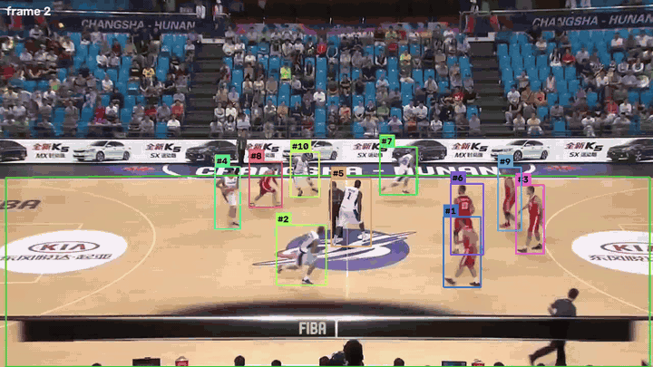
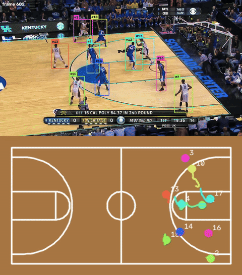
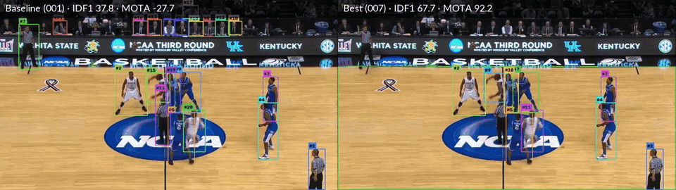
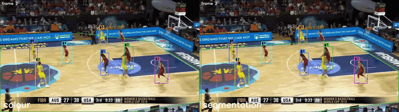
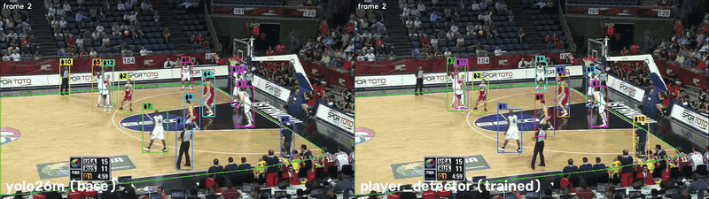
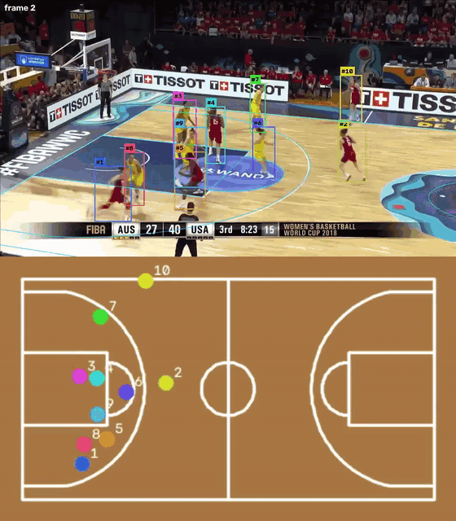
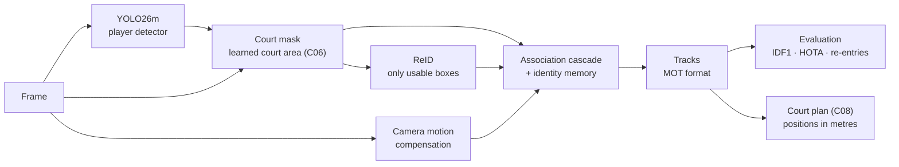

<div align="center">

# 🏀 hoop-reid-tracker

**Identity-preserving multi-player tracking for broadcast basketball**

YOLO26 detection · a tracker written from scratch · appearance re-identification · long-term identity memory · court geometry<br>
developed **experiment by experiment**, every change measured on [SportsMOT](https://github.com/MCG-NJU/SportsMOT) (ICCV 2023)

[](https://github.com/VaroLG/hoop-reid-tracker/actions)




<sub><b>Best configuration so far</b> (experiment 011b): YOLO26m fine-tuned to detect <i>players</i> + learned court mask (C06) +
the tracker with ResNet ReID and identity memory. FIBA Asia 2015, Changsha (<code>v_4r8QL_wglzQ_c001</code>, an arena never seen in
training): <b>IDF1 85.6 · MOTA 97.3</b>. Over 4 validation arenas: <b>IDF1 74.6 · MOTA 96.0</b>, and <b>IDF1 81.3</b> with offline tracklet stitching (013). On all 15 validation clips: <b>IDF1 72.7</b> online, <b>79.9</b> with stitching, <b>81.8</b> when tracklets are first cut where their team changes (020), <b>83.9</b> (HOTA <b>76.9</b>) when the stitching compares pieces with a SigLIP fine-tuned for player re-identification (029), and <b>89.6</b> (HOTA <b>79.7</b>) when the pieces are given out to exactly 10 players, keeping the online tracker's continuity (038). Each colour/<code>#id</code> is one identity;
the green polygon is the court area predicted on every frame. ▶ <a href="assets/011/demo_player_c06.mp4">20-second clip in full quality</a></sub>

<br>



<sub><b>The same tracks on the court plan, in metres</b> (chapter 2, C08): NCAA clip <code>v_00HRwkvvjtQ_c001</code>. Every player's feet are
projected with the court homography of the frame (5.7 cm from a hand-made reference); distances and speeds per identity come out of
<code>hooptrack map</code>. Made with an earlier tracker configuration (COCO detector). ▶ <a href="experiments/court/C08_topdown_map/">C08</a></sub>

</div>

---

## What this project is

Keeping track of **who is who** in a basketball broadcast is harder than street
pedestrian tracking: team-mates wear identical jerseys, players occlude each
other constantly, the camera pans with the ball and players leave the frame
and come back. On top of that, a generic person detector also sees the crowd,
the bench and the referees.

This repository is an end-to-end pipeline — detection → filtering →
re-identification → tracking → evaluation — whose goal is **never to give a
player someone else's identity, and to give it back when he returns.**

It is also a record of *how* it was built: each improvement starts from a
measured weakness of the previous run, is added behind a config switch, and is
kept only if the numbers say so. Nothing is deleted. Every result can be
reproduced, including the ideas that failed.

## Results, step by step

All numbers on SportsMOT **validation** clips (never used for training or tuning), laptop CPU.
IDF1 measures how well identities are kept, MOTA how many errors there are (false positives, misses,
ID switches). "OVERALL" means the metrics recomputed over all clips together, not an average.

### 1 · One clip: the tracker built from scratch (001–007)

NCAA clip `v_00HRwkvvjtQ_c001` (1162 frames, **10 players**), YOLO26m with COCO weights (no training).

| # | Change | IDF1 ↑ | MOTA ↑ | ID switches ↓ | Identities | False positives ↓ | FPS ↑ |
|---|---|---|---|---|---|---|---|
| [001](experiments/001_baseline_yolo26m_coco/) | Baseline: YOLO26m (COCO) + tracker, no tuning | 37.8 | −27.7 | 49 | 123 | 13,725 | 0.49 |
| [002](experiments/002_reid_only_usable_boxes/) | Run ReID only on boxes the tracker can use | 37.8 | −27.7 | 49 | 123 | 13,725 | 1.75 |
| [003](experiments/003_court_mask_filter/) | **Court mask** (floor colour): drop people whose feet are off the court | 56.6 | 68.0 | 48 | 58 | 2,941 | 2.38 |
| [004a](experiments/004a_component_ablation/) | Ablation: court mask + motion + camera compensation, no ReID | 58.2 | 69.1 | 36 | 50 | 2,909 | **52** ¹ |
| [005](experiments/005_make_reid_earn_its_place/) | **ReID as a soft cost, not a veto** (+ identity memory) | 60.5 | 68.0 | 34 | 42 | 2,941 | 2.9 |
| [006](experiments/006_team_classifier/) | **Team / referee colour classifier**: hide referees | 66.9 | 90.1 | 34 | 42 | 390 | 2.5 |
| [007](experiments/007_referee_leftovers/) | Offline mode: remove referee tracks after the whole video ² | **67.7** | **92.2** | **33** | **42** | **142** | 2.4 |

<sub>¹ detection cached; without ReID the tracker itself runs at 52 FPS on CPU. ² analytics mode (`--set teams.offline_suppress_other=true`).</sub>

- **+29.9 IDF1 and +119.9 MOTA without training anything.** The baseline's problem was *who* was detected:
  half of the confident boxes were spectators, bench and photographers (court mask), most of the rest referees
  (colour classifier).
- **ReID had to earn its place**: as a hard veto it made things worse (004a); as a soft cost, calibrated on
  the train split, it beat the motion-only tracker (005).
- **A good idea that failed**: forbidding matches between the two teams fixed none of the cross-team swaps — they
  all happen inside occlusions, where the hidden jersey cannot be seen (006).

<div align="center">

<br><sub>Left: baseline (001). Right: 007 — court mask, soft ReID with memory, referee filter. False positives 13,725 → 142.
▶ <a href="assets/compare_baseline_best.mp4">side-by-side clip</a> · step by step: <a href="experiments/003_court_mask_filter/">003</a> · <a href="experiments/006_team_classifier/">006</a> · <a href="experiments/007_referee_leftovers/">007</a></sub>
</div>

### 2 · The honest test: other arenas

Everything above was tuned on **one** clip. Measured on clips from the other validation arenas
(three FIBA games: Tenerife 2018, Istanbul 2010, Changsha 2015), the same configuration falls apart. The
floor-colour mask lets the bench and crowd through in some arenas and cuts real players in others; the
referee classifier switches itself off when it cannot find three clear colour groups.

| 4 clips, one per validation arena | IDF1 | MOTA | ID switches | False positives | Missed players |
|---|---|---|---|---|---|
| Configuration of section 1 (006, live) | 45.0 | 55.6 | 107 | 6,897 | 4,169 |

One clip per arena from here on: NCAA `c005`, Tenerife `c002`, Istanbul `c012`, Changsha `c001`,
with `scripts/run_court_source_eval.py` (detections cached once, one folder per run, per-arena tables).

### 3 · A court mask that works in any arena (C06 → 010)

Rules about the floor colour cannot cover every arena, so the court area is **learned**: YOLO26n-seg trained
on 15 French arenas (DeepSportRadar), NBA broadcasts, SportsMOT train clips and synthetic courts with random
floors, paint and cameras (domain randomisation). On the validation arenas it overlaps the true court by
IoU 0.82–0.94 and, unlike the court homography (C05), it is never catastrophically wrong.
▶ [C06](experiments/court/C06_court_segmentation/)

| 4 arenas | IDF1 | MOTA | ID switches | False positives | Missed players |
|---|---|---|---|---|---|
| Floor-colour mask (003) | 45.0 | 55.6 | 107 | 6,897 | 4,169 |
| **Learned court mask (C06)** | **53.1** | **76.8** | 107 | **3,989** | **1,732** |

<sub>Tenerife: MOTA 54.8 → 90.3 · Istanbul: 5.2 → 48.9. ID switches do not change: the mask decides <i>who</i> enters the tracker, not how identities are assigned.</sub>

<div align="center">

<br><sub>FIBA Tenerife, same detector and tracker. Left: floor-colour mask. Right: learned court mask (green polygon).
▶ <a href="assets/010/compare_colour_vs_c06_tenerife.mp4">20-second clip</a></sub>
</div>

### 4 · A detector that sees players, not people (011)

The COCO detector's class is *person*: everyone is detected, and sections 1–3 remove the non-players with
rules. The strong trackers on SportsMOT do the opposite: they fine-tune the detector. SportsMOT labels only
the ten players, so referees, bench and crowd are background during training, and the detector learns the
difference from the whole image. YOLO26m, 40 epochs on a Colab T4, trained on 3 games
([notebook](notebooks/colab_train_player_detector.ipynb)). On the 4 unseen games: false positives per frame
**8.4 → 0.17**, missed players per frame 0.81 → 0.19. ▶ [011](experiments/011_player_detector/)

| 4 arenas | IDF1 | MOTA | ID switches | False positives | Missed players |
|---|---|---|---|---|---|
| COCO detector + C06 mask (section 3) | 53.1 | 76.8 | 107 | 3,989 | 1,732 |
| Players-only detector + C06 mask | 73.7 | 93.6 | 50 | 324 | 1,226 |
| **… without the referee classifier (011b)** | **74.6** | **96.0** | **49** | 397 | **551** |

- **False positives ÷10, ID switches halved** without touching the tracker: with fewer people in the image,
  each track has fewer wrong candidates.
- **The referee classifier became harmful.** It hides the smallest of three colour groups; with no referees
  left in the detections, it was hiding real players (NCAA: 787 → 139 missed players without it). It stays
  behind its switch, off in the best configuration ([`configs/player.yaml`](configs/player.yaml)).
- The C06 mask still helps on top of the new detector (+1.9 IDF1): the colour mask now mostly cuts real players.

<div align="center">

<br><sub>FIBA Istanbul, same court mask and tracker. Left: COCO detector (referees and staff get identities). Right: players-only detector.
▶ <a href="assets/011/compare_coco_vs_player_istanbul.mp4">20-second clip</a></sub>
</div>

### 5 · A ReID model trained on players (012) — better model, same tracking

The appearance model was a ResNet-50 trained on ImageNet; for it, two team-mates are "a person in a white
shirt". An **OSNet ReID model fine-tuned on SportsMOT player crops** (the main ingredient of Deep-EIoU, the
reference tracker on SportsMOT; [notebook](notebooks/colab_train_reid_osnet.ipynb)) finds the same player
among his team-mates twice as well on the unseen games: rank-1 **0.42 → 0.71**, mAP 0.19 → 0.41.
Its distances live on another scale, so the tracker's thresholds were recalibrated on the train split.

| 4 arenas | IDF1 | MOTA | ID switches | Identities per clip |
|---|---|---|---|---|
| ResNet-50 ImageNet (011b) | 74.6 | 96.0 | 49 | 17–21 |
| OSNet fine-tuned, calibrated | 72.9 | 96.1 | 47 | 18–22 |

**Neutral, and the diagnosis says why.** Classifying every identity break: two thirds happen inside
crossings, where by design the tracker uses motion only (the crop mixes two players), and the memory that
should bring lost players back never fires. The bottleneck is how the tracker uses appearance, not the
model. ▶ [012](experiments/012_reid_osnet/)

### 6 · Joining each player's fragments after the video (013)

Seeing the whole video at once, every id is a *tracklet*. Two tracklets that are never on screen together
and look alike (OSNet, median over many clean crops) are the same player and get one id; if a team-mate on
screen at the same time looks almost as alike, nothing is merged. This is the *connector* of GTA (Global
Tracklet Association), the step that lifts Deep-EIoU from 77 to 81 HOTA on SportsMOT. Thresholds come
from the train-split calibration. It post-processes a finished run in minutes, without re-tracking.
▶ [013](experiments/013_tracklet_stitching/)

| 4 arenas | IDF1 | MOTA | ID switches | Identities per clip |
|---|---|---|---|---|
| Online tracker (011b) | 74.6 | 96.0 | 49 | 17–21 |
| + our first, conservative stitching rules | 77.2 | 96.1 | 43 | 16–19 |
| + original GTA code (connector, published settings) | 80.5 | 96.1 | 36 | 11–12 |
| **+ GTA's connector rebuilt here, 12 clean crops per tracklet (013b)** | **81.3** | **96.1** | **34** | **11–12** |

<sub>Per clip IDF1: NCAA 68.9 → 77.2 · Tenerife 69.1 → 73.9 · Istanbul 69.5 → 72.9 · Changsha 85.6 → 95.1.
The rebuilt connector gives exactly the original code's numbers when fed the same embeddings. Describing each
tracklet by clean crops (no other player covering them) instead of every box is better and 10× cheaper.
GTA's splitter added nothing on these clips.</sub>

Our first version refused every doubtful merge, and that was too cautious. The rule that matters is
simpler: two tracklets on screen at the same time are two people. Merging the most similar remaining pair
first, again and again, brings the identities close to one per player.

### 7 · A looser motion match: Expansion IoU (014) — negative

Deep-EIoU, the reference tracker on SportsMOT, matches tracks and detections with boxes grown by 0.7× their
size on each side, so a player who changes direction is not lost. Added to our Kalman tracker with Deep-EIoU's
own settings, it fixes nothing (short losses 18 → 20) and almost doubles the swaps in crossings: grown boxes of
players standing side by side overlap, so neighbours become candidates. It stays in the code, off.
▶ [014](experiments/014_expansion_iou/)

| 4 arenas | IDF1 | MOTA | ID switches |
|---|---|---|---|
| Online tracker (011b) | **74.6** | **96.0** | **49** |
| + Expansion IoU (014) | 68.6 | 95.8 | 81 |
| 011b + stitching (013b) | **81.3** | **96.1** | **34** |
| 014 + stitching | 72.5 | 95.8 | 76 |

### 8 · Swaps in crossings: where the limit is (015–017)

Every identity change that happens while a player stays visible happens in a crossing (015). Cutting the
tracklets at every crossing and re-joining them makes things worse (IDF1 64.3). A local keep-or-swap check
is right only 1 time in 8. A **team-mate benchmark** (016) explains why. With clean ground-truth crops, OSNet
takes the right decision at 97 % of team-mate crossings, but real swaps are only ~4 % of crossings. A 3 % error
rate then creates about as many false swaps as it fixes. Training OSNet on 4× more people, with football and
volleyball added (017), improves retrieval (rank-1 0.71 → 0.75) but not the team-mate separation (AUC 0.71).
The stitching stays at ~81. ▶ [015](experiments/015_crossings/) · [016](experiments/016_teammate_reid_benchmark/) · [017](experiments/017_reid_multisport/)

| team-mate benchmark, 15 val clips | AUC same player vs team-mate | right decision at team-mate crossings |
|---|---|---|
| ResNet-50 ImageNet (online tracker) | 0.558 | 77 % |
| OSNet fine-tuned on basketball (012) | 0.713 | 97 % |
| OSNet fine-tuned on 3 sports (017) | 0.715 | 97 % |

### 9 · Giving stolen ids back (018–019)

A part-based ReID model (one vector per body stripe, 018) is worse than plain OSNet: team-mate AUC 0.713 → 0.668,
and its stripes do not specialise. The real problem turned out to be elsewhere. After stitching, **46 identity
changes are ids stolen in a crossing**: player A's track goes on with player B, and A's id cannot come back while
it is on screen, on B. **36 of the 46 thieves play for the other team**, the case OSNet separates at 100 %. 019 cuts a
tracklet where its team changes for at least 1 s on both sides (team from OSNet, tracklets clustered), then stitches
as before. ▶ [018](experiments/018_reid_parts/) · [019](experiments/019_team_split/)

| 4 arenas | IDF1 | MOTA | ID switches | IDF1 NCAA / Tenerife / Istanbul / Changsha |
|---|---|---|---|---|
| 013b: stitching | 81.3 | 96.1 | **34** | 77.2 / 73.9 / 72.9 / 95.1 |
| **019: team cut + stitching** | **83.5** | 96.0 | 52 | **83.8 / 75.4 / 74.8** / 95.0 |
| ceiling of 019 (ground-truth teams) | 89.1 | 96.4 | 22 | 81.5 / 90.7 / 81.0 / 98.7 |

**On all 15 validation clips the gain disappears** (IDF1 013b 79.9, 019 79.7; 11 clips never used before: 4 better,
5 worse). The unsupervised team labels are not reliable enough everywhere, so 019 stays off and 013b remains the offline
mode. With ground-truth teams the cut would be worth +7.8 on the 4 clips: the idea is right, the labels are the limit.

### 10 · Team labels chosen on train, checked on val (020)

The labeller is now chosen on the **train** clips and checked once on val. A benchmark on ground-truth tracks measures
accuracy, false cuts (a ground-truth track is one player) and how many simulated stolen ids each labeller finds. Two
findings. With the players-only detector there are no referees left, so 019's **third cluster ("other") eats 16–22 % of real
players**: k = 2 is better for every descriptor. And **SigLIP on the torso** (a web-scale image model, never fitted to our
clips) describes the kit, while OSNet describes the player: accuracy 0.975 against 0.56, 2 false cuts in 15 clips, 95 % of
the stolen ids found. ▶ [020](experiments/020_team_labels/)

| 15 val clips | IDF1 | MOTA | ID switches |
|---|---|---|---|
| 013b: stitching | 79.9 | 96.7 | **214** |
| 019: team cut, OSNet labels | 79.7 | 96.6 | 289 |
| **020: team cut, SigLIP torso labels (k = 2)** | **81.8** | 96.6 | 267 |
| ceiling: ground-truth teams, same boxes | 82.0 | 96.6 | 276 |

The labels are now at the oracle's level. **021** splits the errors that are left. The biggest is the connector joining
a clean piece to the wrong player (6.7 % of boxes, 42 of 112 merges wrong, 32 of them between team-mates). Next come swaps
between team-mates that no team cut can see (4.6 %). Where the cut lands costs only 2.1 %. Forbidding joins between two kits
is neutral (81.8 → 81.8): the blocked piece joins the wrong team-mate instead. What is left needs a cue that tells
team-mates apart. ▶ [021](experiments/021_stitch_errors/)

Jersey numbers are that cue, but they must be read first. A generic text recogniser reads nothing (022). Florence-2, a
small vision-language model, reads them with no training: 96 % of the reads along one player agree, and 36 of 40 are right
by eye. Forbidding joins between two different numbers is still neutral (81.8 → 81.7): only 22 % of the pieces get a number,
and only 2 of the 37 wrong joins have a number on both sides. ▶ [022](experiments/022_jersey_feasibility/) · [023](experiments/023_jersey_numbers/)

### 11 · HOTA, and a published tracker on the same boxes (024–026)

From here on, every run is also measured with **HOTA** (official TrackEval), the metric SportsMOT ranks trackers by.
**Deep-EIoU** (WACV-W 2024), the reference tracker on SportsMOT, was run with *our* detections and *our* OSNet:
online it beats our tracker by 5 HOTA, and our offline step on top of it gives the best numbers of the project. The
offline step is not tuned to our tracker's errors: on Deep-EIoU's output it still adds +3.1 HOTA, on 12 of 15 clips.
Deep-EIoU has no licence, so it cannot be shipped here; an ablation (025) found what makes it better (appearance
fused as the *minimum* of two distances, a much larger box expansion, the last detected box instead of a motion
prediction), but the same pieces ported into our tracker one by one make it worse (026): they only work together.
▶ [024](experiments/024_hota_deep_eiou/) · [025](experiments/025_deep_eiou_ablation/) · [026](experiments/026_deep_eiou_port/)

| 15 val clips | HOTA | AssA | IDF1 |
|---|---|---|---|
| 011b online (ResNet-50 ReID) | 68.8 | 55.1 | 72.7 |
| 011b online with OSNet (026) | 69.2 | 55.8 | 73.6 |
| 020: team cut + stitching | 75.3 | 66.1 | 81.8 |
| Deep-EIoU online, same detections and OSNet | 74.3 | 63.5 | 79.6 |
| Deep-EIoU + our offline step (not shippable) | 77.4 | 69.0 | 83.8 |

### 12 · A ReID model that tells team-mates apart (027–029)

The image towers of SigLIP and CLIP, used with no training, are worse than OSNet at telling a player from his
team-mates (027). Fine-tuned in Colab on the same player crops as OSNet (028, the idea of CLIP-ReIdent), SigLIP
becomes far better: on the team-mate benchmark of 016 it beats OSNet on all 15 validation clips, and takes the right
decision at 98.8 % of the crossings between team-mates. It is ~12 times heavier than OSNet, so it is used only
offline, to compare pieces in the stitching, with its threshold transferred on the train split (029). Same online
run, same number of joins: only *which* pieces are joined changes. **Adopted: the best result of the project with
code and models that are ours.** ▶ [027](experiments/027_siglip_clip_reid/) · [028](experiments/028_siglip_reid_finetune/) · [029](experiments/029_stitch_siglip_reid/)

| | AUC same player vs team-mate | right at team-mate crossings | HOTA (15 clips) | IDF1 |
|---|---|---|---|---|
| OSNet (012), stitching of 020 | 0.713 | 96.9 % | 75.3 | 81.8 |
| **SigLIP fine-tuned (028), stitching of 029** | **0.860** | **98.8 %** | **76.9** | **83.9** |

### 13 · The swaps that are left, and why (030–033)

A switch report classifies every identity change against the ground truth, per minute
([`scripts/switch_report.py`](scripts/switch_report.py)). It shows what the metrics hide: **~31 identity switches
per minute are left, as in the online run.** The offline step halves the fragments (a player coming back under a
new id: 101 → 52) but not the swaps; 92 % of the switches happen within a second of two players overlapping, and
most are two players exchanging ids. Two checks at the exit of every crossing with the fine-tuned SigLIP made things
worse (030, 031). A diagnosis (032) found why: the model is right 99.4 % of the time where it can look, but **83 %
of the swaps happen in crowded crossings where no player has a clean view** before or after (only 19 % of the
crossings can be decided at all), so any check around the crossing can reach at most ~15 % of them. The identity has
to come back later, from something that does not change, like the jersey number: a digit-by-digit reader trained on
NBA footage (033, E-BARD dataset) is right 94 % of the time on NBA clips, but on these NCAA and European clips it
reads a number on only 32 % of the pieces, and its reads often contradict each other: neutral (HOTA 76.9 → 76.7).
▶ [030](experiments/030_crossing_check/) · [031](experiments/031_group_crossing_check/) · [032](experiments/032_crossing_check_diagnosis/) · [033](experiments/033_jersey_number_detector/)

| 15 val clips (8.4 min) | HOTA | IDSW | switches / min | fragments | to a team-mate's id | to an opponent's id |
|---|---|---|---|---|---|---|
| 011b online | 68.8 | 278 | 31.9 | 101 | 25 | 141 |
| **029** | **76.9** | 278 | 31.3 | 52 | 34 | 176 |
| 030 / 031: check at crossing exits | 67.8 / 67.2 | 302 / 321 | 34.8 / 37.0 | | | |
| 033: + jersey numbers (NBA reader) | 76.7 | 277 | 31.7 | | | |

### 14 · The players on the court, in metres (034)

The court geometry of chapter 2 now covers **all 15 validation clips** (C09 learned keypoints, no annotation: only
the court type, read by a person from one frame per clip), so the best run can be followed on the court plan:
positions in metres, distance run and speed per identity (`hooptrack map`). Speeds land where they should
(2.1 m/s mean, 5.4 m/s at the 95th percentile). Could the court also fix the swaps? A diagnosis on the ground
truth says mostly not: **62 % of the swaps happen between players less than 0.5 m apart on the court**, in body
contact, where the feet of the player behind are hidden and his position is as uncertain as in the image; where
players are more than 1 m apart, the tracker already keeps them apart in over 97 % of the crossings. So the court
is integrated as an output, not as a second motion model in the tracker. A speed limit on the court in the
stitching (refuse joins that would need more than 9 m/s) is neutral too: the court says where the players are, not
who they are. ▶ [034](experiments/034_court_crossings/) · [035](experiments/035_stitch_speed_rule/)

<div align="center">

<br><sub>029 on a FIBA clip with a median number of switches, broadcast and court plan. ▶ <a href="assets/034/map_029_fiba_c003.mp4">20 s in full quality</a></sub>
</div>

### 15 · Exactly 10 players (036–038)

A game has 10 players on the court, and every clip has exactly 10 ground-truth identities; the best run so far
ended with 11–14. Giving the extra ids back to the 10 longest ones failed (036): after the online swaps a stitched
id holds pieces of several players, so every extra id is on screen together with all of them. Built instead from
pieces cut at the crossings (one player each), with 10 seeds taken from a frame where 10 pieces are on screen
together and every other piece given to the closest player that is not on screen at the same time, the closed set
wins big on the NCAA game and loses on FIBA (037): cutting at every crossing throws away the online tracker's
continuity. Adding it back (a piece stays with the player of its online neighbour unless its appearance clearly
prefers another, 038) gives **the best result of the project, better on 11 of 15 clips**. It makes more switches
than 029, but shorter ones: the identity comes back after a wrong piece.
▶ [036](experiments/036_roster_of_ten/) · [037](experiments/037_closed_set_of_ten/) · [038](experiments/038_closed_set_continuity/)

| 15 val clips | HOTA | AssA | IDF1 | IDSW | switches / min |
|---|---|---|---|---|---|
| 029: team cut + SigLIP stitching | 76.9 | 69.1 | 83.9 | **278** | **31.3** |
| 037b: closed set of 10, appearance only | 74.5 | 65.4 | 81.7 | 612 | 71.6 |
| **038: closed set of 10 + online continuity** | **79.7** | **74.9** | **89.6** | 379 | 43.7 |

Full log, raw metrics and configs: **[`experiments/`](experiments/)**.

## How it works



| Stage | What it does | Code |
|---|---|---|
| **Detection** | YOLO26m fine-tuned on SportsMOT players (or COCO `person`), low confidence threshold (0.10) so occluded players are not lost. Run once and cached. | [`detection/detectors.py`](src/hooptrack/detection/detectors.py) |
| **Court mask** | Keeps a box only if its feet are on the court. Three interchangeable sources (`filters.court_source`): floor colour (003), court homography (009), learned court-area segmentation (C06, best). | [`detection/filters.py`](src/hooptrack/detection/filters.py) · [`integrations/court_filter.py`](src/hooptrack/integrations/court_filter.py) |
| **Re-identification** | ResNet-50 / OSNet / colour embeddings, computed only for boxes the tracker can actually use. Offline, a SigLIP fine-tuned for players (028) compares the pieces to join. | [`reid/extractors.py`](src/hooptrack/reid/extractors.py) · [`reid/siglip.py`](src/hooptrack/reid/siglip.py) |
| **Motion model** | Constant-velocity Kalman filter in (cx, cy, w, h), warped by the camera's motion estimated with optical flow on the background. | [`tracking/kalman.py`](src/hooptrack/tracking/kalman.py) · [`gmc.py`](src/hooptrack/tracking/gmc.py) |
| **Association** | Hungarian matching in a cascade: confident boxes with motion + appearance, weak boxes with motion only (ByteTrack idea), then re-identification of lost players. | [`tracking/tracker.py`](src/hooptrack/tracking/tracker.py) |
| **Identity memory** | Players who leave the frame become *dormant* instead of being deleted, and can be revived by appearance, with an ambiguity margin that prefers a new id over a wrong one. | [`tracking/memory.py`](src/hooptrack/tracking/memory.py) |
| **Court plan** | Feet projected to metres with verified court homographies: trajectories, distances, speeds. | [`integrations/topdown.py`](src/hooptrack/integrations/topdown.py) |

The tracker is **not** `model.track()`: it is written from scratch so that every
decision is explicit and can be switched off for an ablation. It borrows ideas
from ByteTrack (two-pass association) and BoT-SORT (Kalman in w/h, camera
compensation, appearance fusion). More: [`docs/architecture.md`](docs/architecture.md) ·
the failures behind each choice: [`docs/design_decisions.md`](docs/design_decisions.md).

## How it is developed

The repository follows a few rules ([`experiments/README.md`](experiments/README.md)):

1. **Diagnose before changing.** [`scripts/analyze_detections.py`](scripts/analyze_detections.py)
   separates detector errors from tracker errors; [`scripts/run_court_source_eval.py`](scripts/run_court_source_eval.py)
   measures one change at a time on several arenas.
2. **Additive changes only.** Every improvement is a new module or config key;
   its default in code reproduces the previous behaviour, so old configs still
   give old numbers.
3. **One experiment = one folder** with the hypothesis, the exact config,
   raw metrics and a conclusion, including what did *not* work.
4. **No leakage.** Training uses SportsMOT *train*; all reported numbers come from the
   *validation* games, which are never used to train or to pick a model.

## Chapter 2 · Court geometry

A separate chapter of the same project, with its own code (`src/hooptrack/court/`),
scripts (`scripts/court/`), tests and experiments ([`experiments/court/`](experiments/court/)):
find the court in every frame, and from it a court mask for the tracker and a top-down map of
the players. The tracker and the court chapter do not import each other; the only bridge is
`src/hooptrack/integrations/`.

- [x] **C01** Public court-keypoint dataset audited (850 NBA frames, CC BY 4.0): court template verified to ~1–2 px, split leakage and clamped labels found and fixed
- [x] **C02** Court-keypoint detector (YOLO26n-pose, CPU) — 0.27 m on NBA test frames; does not transfer to SportsMOT (documented)
- [x] **C03** Court templates per league (NBA / NCAA / FIBA) + line-based refinement — fixes close starts only
- [x] **C04** Hand anchors on 3 frames + propagation → homography for all 1,162 frames of the NCAA clip, validated by two independent chains (5–20 cm)
- [x] **C05** No annotation: court homographies from straight lines + physics filter, confirmed by two chains, league picked automatically; on unseen FIBA arenas it can be confidently wrong (found in 009)
- [x] **C06** Learned court-area segmentation, trained on many arenas + synthetic courts: IoU 0.82–0.94 on unseen arenas, never catastrophically wrong; the court mask of the best configuration
- [x] **C07** One camera per clip: a homography no fixed broadcast camera can produce is rejected; clips without a trustworthy camera go to review instead of a confident wrong court
- [x] **C08** Top-down map in the pipeline (`hooptrack map`): tracks in metres, distances and speeds — 5.7 cm from the hand-made court on NCAA
- [ ] **C09** Review clips: hand-annotated test set and a learned keypoint detector to make review rare (in progress)

## Roadmap (chapter 1 · tracking)

- [x] End-to-end pipeline: detection, ReID, tracker, memory, evaluation (IDF1, HOTA, custom re-entry metric)
- [x] **001–007** Baseline, selective ReID, colour court mask, ablation, soft ReID + memory, referee classifier, offline mode
- [x] **008** Court border — no gain (documented)
- [x] **009** Court mask from the court homography — helps only where the automatic homography is right (documented)
- [x] **010** Evaluation on several arenas + learned court mask (C06): IDF1 45.0 → 53.1, MOTA 55.6 → 76.8
- [x] **011** Players-only detector (fine-tuned YOLO26m): IDF1 → 74.6, MOTA → 96.0 on 4 arenas
- [x] **012** Player ReID: OSNet fine-tuned on SportsMOT crops (rank-1 0.42 → 0.71); neutral in the online tracker (diagnosed)
- [x] **013** Offline tracklet stitching by appearance (GTA's connector, rebuilt and verified): IDF1 74.6 → 81.3, 11–12 identities for 10 players
- [x] **014** Expansion IoU (Deep-EIoU) — negative: more swaps in crossings, IDF1 74.6 → 68.6 (documented, off)
- [x] **015** Swap repair at crossings — negative (cut + reconnect 64.3; keep/swap check 1 of 8 right)
- [x] **016** Team-mate ReID benchmark (same player vs team-mate vs opponent, and around crossings)
- [x] **017** OSNet trained on basketball + football + volleyball — neutral (retrieval +3.5, team-mates unchanged)
- [x] **018** Part-based ReID (OSNet + 4 stripes) — negative (team-mate AUC 0.713 → 0.668)
- [x] **019** Give stolen ids back: cut tracklets where they change team — +2.2 on 4 clips, no gain on 15 (79.9 → 79.7)
- [x] **020** Team labels chosen on train: SigLIP on the torso, k = 2 — 15 val clips 79.9 → 81.8 (at the oracle-label ceiling, 82.0)
- [x] **021** Error breakdown after 020 + "never join two kits" rule in the connector — neutral (81.8 → 81.8)
- [x] All 15 validation clips: IDF1 72.7 online, 79.9 with stitching (013b), 81.8 with the team cut (020)
- [x] **022** Jersey numbers, zero-shot (PARSeq) — not readable without a model trained on jersey crops (documented)
- [x] **023** Jersey numbers read zero-shot by Florence-2 — right when it answers (36/40 by eye), but only 22 % of pieces get a number: neutral (81.8 → 81.7)
- [x] **024** HOTA on all runs + Deep-EIoU on the same detections: our offline step adds +3.1 HOTA on its output too (77.4, not shippable)
- [x] **025** Deep-EIoU ablation: min-distance fusion, expansion, last detected box (diagnostic)
- [x] **026** Those pieces ported into our tracker — negative (they only work together; documented, off)
- [x] **027** SigLIP / CLIP as ReID with no training — worse than OSNet (documented)
- [x] **028** SigLIP fine-tuned as player ReID (Colab): team-mate AUC 0.713 → 0.860, better on 15 of 15 clips
- [x] **029** Fine-tuned SigLIP in the stitching: **HOTA 75.3 → 76.9, IDF1 81.8 → 83.9** (adopted)
- [x] **030 / 031** Identity check at crossing exits (pairs / groups) — negative (documented, off)
- [x] **032** Diagnosis: 83 % of the swaps happen where no clean view exists; checks at crossings can reach ~15 %
- [x] **033** Jersey-number reader trained on NBA footage (E-BARD) — 32 % of pieces read on these clips, unreliable: neutral
- [ ] Jersey numbers with labels from many more games
- [x] **034** Players on the court in metres on all 15 clips; diagnosis: 62 % of the swaps are between players < 0.5 m apart, so the court is an output, not a tracker input
- [x] **035** Stitching that refuses joins needing an impossible speed on the court — neutral (documented, off)
- [x] **036** Roster of 10 players (5 per team), leftover ids given back by appearance — negative: stitched ids are not pure enough for the rule (documented, off)
- [x] **037** Closed set of 10 players from pieces cut at crossings — +1 to +15 HOTA on 5 of 6 NCAA clips, worse on FIBA, 74.5 overall (documented, off)
- [x] **038** Closed set + the online tracker's continuity: **HOTA 76.9 → 79.7, IDF1 83.9 → 89.6**, better on 11 of 15 clips (adopted)
- [x] **039** Smoothing single wrong pieces after 038 — nothing to smooth: errors are runs of pieces (diagnosis, off)
- [x] **040** Per-clip embedding adaptation, 5 per team, at most 10 ids on top of 038 — all worse than 038 (documented, off)
- [x] **041** Jersey reader + hand labels of SportsMOT's train clips — 98 % on held-out train clips, unchanged on val games (30 % read): negative
- [x] **B01** COCO detector on the ball: 11 % found — negative
- [x] **B02–B04** Hand clicks (1,245 train / 390 test frames) + our YOLO26s at 1280: **58 % found at 76 % precision** (COCO: 11 % / 29 %) — adopted
- [x] **B05** Offline ball tracking (one ball, physics-limited moves, gaps filled): recall 58 → 73 %, precision 76 → 66 % — mixed
- [x] **B05b/c** Static look-alikes removed on the court plan + "no ball" for weak segments (values from train): **78 % found at 73 % precision**, F1 0.66 → 0.75 (adopted)
- [x] **P01** Possession by fixed rules (closest player within reach): 80 % of the marked catches / releases found within 1 frame, but 3× too many changes — negative per frame
- [x] **P01b** Short gaps filled, values from train — neutral
- [x] **P02** Air from the ball's own motion — negative; with a perfect ball P01 only reaches F1 0.46: the rules, not the ball, are the limit
- [x] **P03** Same possession rules on the B08 ball: event F1 0.41 → **0.50**, better on 4 of 4 clips — the ball was a limit
- [x] **P04** Frames without a ball keep the last state: **86 % of the frames right** (always held: 79 %), event F1 0.50 (adopted)
- [ ] Possession: temporal model learned from examples (fewer invented changes)
- [x] **B07** WASB (state of the art, NBA weights) zero-shot: 40 % found at **100 % precision** (ours: 78 % / 73 %) — complementary
- [x] **B08** WASB fine-tuned on our hand clicks + our tracker: 71 % found at **85 % precision**, F1 0.75 → **0.78**, better or equal on 4 of 4 clips (adopted)
- [ ] Ball tracking
- [ ] Edge deployment: TensorRT on Jetson Orin Nano

## Quick start

```bash
git clone https://github.com/VaroLG/hoop-reid-tracker && cd hoop-reid-tracker
python -m venv .venv
source .venv/bin/activate              # Windows: .\.venv\Scripts\Activate.ps1
pip install -r requirements-dev.txt    # pinned versions
pip install -e . --no-deps

python scripts/smoke_test.py           # end-to-end check on a rendered clip: no data, no GPU
pytest                                 # 98 tests
```

**Data.** SportsMOT is released under CC BY-NC 4.0 and is gated: accept the terms at
[huggingface.co/datasets/MCG-NJU/SportsMOT](https://huggingface.co/datasets/MCG-NJU/SportsMOT), then

```bash
hf auth login
python scripts/download_data.py --splits train val     # keeps only the basketball clips
```

**Best configuration** ([`configs/player.yaml`](configs/player.yaml)). It needs two trained models, which are not stored in git:
the player detector (`weights/Player_detector.pt`, [Colab notebook](notebooks/colab_train_player_detector.ipynb)) and the court
segmentation model (`outputs/court_runs/c06_yolo26n_seg/weights/best.pt`, [C06](experiments/court/C06_court_segmentation/)).

```bash
hooptrack track --config configs/player.yaml "data.only=[v_4r8QL_wglzQ_c001]" output.save_video=true --eval
hooptrack map   --run outputs/runs/player --video          # court plan (clips with a verified court)
```

**Offline tracklet stitching** (013) on a finished run, with the OSNet ReID model (`weights/osnet_x1_0_sportsmot.pth`,
[notebook](notebooks/colab_train_reid_osnet.ipynb)); thresholds from `scripts/calibrate_reid.py` on the train split:

```bash
python scripts/stitch_tracklets.py --run outputs/runs/player --config configs/player.yaml \
    --set reid.type=osnet reid.weights=weights/osnet_x1_0_sportsmot.pth --out outputs/runs/player_stitched
```

**Best offline mode** (038): cut the tracklets at every crossing and give the pieces out to exactly 10 players with the
fine-tuned SigLIP, keeping the online continuity:

```bash
python scripts/stitch_tracklets.py --run outputs/runs/player --config configs/player.yaml \
    --set reid.type=siglip reid.weights=weights/siglip_reid_sportsmot \
    --split-crossings --closed-set 10 --continuity 0.3 --out outputs/runs/player_038
```

**Previous offline mode** (029): cut tracklets where their team changes (SigLIP labels, k = 2) and stitch with the fine-tuned
SigLIP (`weights/siglip_reid_sportsmot`, [notebook](notebooks/colab_train_reid_siglip.ipynb); threshold from
`scripts/calibrate_stitch_threshold.py` on the train split). Measure with HOTA and the switch report:

```bash
python scripts/stitch_tracklets.py --run outputs/runs/player --config configs/player.yaml \
    --set reid.type=siglip reid.weights=weights/siglip_reid_sportsmot --thresh 1.0365 \
    --split-teams --team-source siglip --team-k 2 --out outputs/runs/player_029
python scripts/eval_hota.py --config configs/player.yaml --runs 029=outputs/runs/player_029
python scripts/switch_report.py --config configs/player.yaml --runs 029=outputs/runs/player_029
```

**Compare one change on several arenas** (detections cached once, resumable, per-arena tables, side-by-side videos):

```bash
python scripts/run_court_source_eval.py --config configs/player.yaml --variants colour segmentation --video \
    --clips v_00HRwkvvjtQ_c005 v_5ekaksddqrc_c002 v_BgwzTUxJaeU_c012 v_4r8QL_wglzQ_c001
```

`configs/default.yaml` keeps the configuration of section 1 (COCO detector, colour mask), which needs no training.
Any parameter can be changed from the command line, e.g. `--set filters.court_source=segmentation reid.type=osnet`.

## Repository layout

```
configs/default.yaml          every hyper-parameter, documented (section 1 configuration)
configs/player.yaml           best configuration (011b)
src/hooptrack/
  detection/                  YOLO wrapper, detection cache, ground-truth oracle, colour court mask, team classifier
  reid/                       histogram, ResNet-50, OSNet, SigLIP / CLIP extractors, embedding cache, jersey readers
  tracking/                   kalman · matching · gmc · track · memory · tracker
  eval/                       motmetrics, TrackEval (HOTA), re-entry metric
  court/                      chapter 2: templates, homographies, clip camera, court segmentation (independent)
  integrations/               the only bridge: court mask filters for the tracker, top-down map
  pipeline.py                 per-video loop with per-stage latency
  cli.py                      hooptrack detect | track | evaluate | map
notebooks/                    Colab training: player detector (011), ReID (012, 028), jersey-number reader (033)
experiments/                  chapter 1: one folder per experiment: hypothesis, config, metrics, conclusion
  court/                      chapter 2: C01 … C09
scripts/                      download, datasets, multi-arena evaluation, diagnosis, ablation, calibration
  court/                      chapter 2: datasets, training, evaluation, homographies, overlay videos
tests/                        tracker, filters, court geometry, chapter independence
docs/                         architecture and design decisions
```

## Limitations

- **Swaps in crowded crossings** are the main identity error left. The best offline mode (038) gives 89.6 % of the
  boxes the right identity, but still makes ~44 identity switches per minute, mostly short pieces after a crowded
  crossing given to the wrong player; and the pieces that fit none of the 10 players (referees, false detections)
  keep their own id. Jersey numbers would need labels from these leagues (033).
- Results on all 15 validation clips (sections 10–15); the earlier sections use 4 clips, one per arena.
- **Few training games**: the player detector and the ReID model learn from the 3 basketball games of
  SportsMOT train. The detector generalises well to the 4 validation games; crowded rebounds are its
  remaining misses.
- CPU-only inference numbers; training on a free Colab GPU.

## Data and licence

Code: MIT. The SportsMOT data is **not** included or redistributed; it belongs
to its authors (CC BY-NC 4.0). DeepSportRadar images (C06) are CC BY-NC-SA 4.0. The figures and clips in this
README are short excerpts used for non-commercial research illustration.

```bibtex
@inproceedings{cui2023sportsmot,
  title     = {SportsMOT: A Large Multi-Object Tracking Dataset in Multiple Sports Scenes},
  author    = {Cui, Yutao and Zeng, Chenkai and Zhao, Xiaoyu and Yang, Yichun and Wu, Gangshan and Wang, Limin},
  booktitle = {ICCV},
  year      = {2023}
}
```
