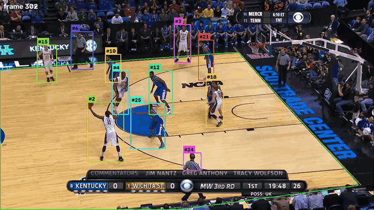
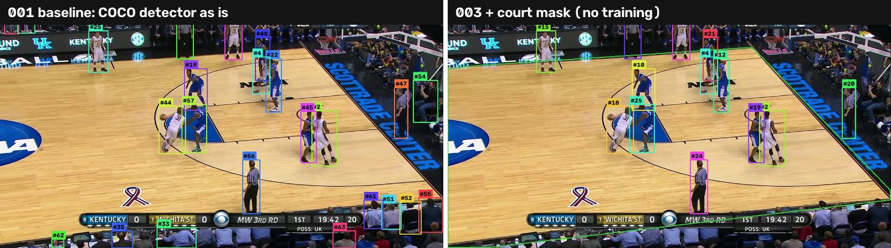
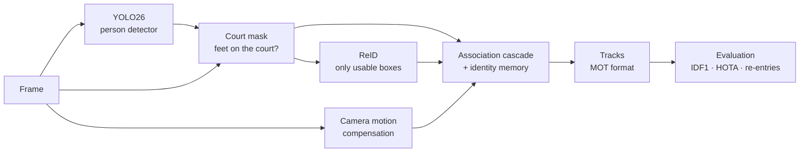

<div align="center">

# 🏀 hoop-reid-tracker

**Identity-preserving multi-player tracking for broadcast basketball**

YOLO26 detection · a tracker written from scratch · appearance re-identification · long-term identity memory<br>
developed **experiment by experiment**, every change measured on [SportsMOT](https://github.com/MCG-NJU/SportsMOT) (ICCV 2023)

[](https://github.com/VaroLG/hoop-reid-tracker/actions)




<sub>Experiment 003 on SportsMOT clip <code>v_00HRwkvvjtQ_c001</code>. Each colour/<code>#id</code> is one identity; the green polygon is the
playing surface estimated on every frame. ▶ <a href="assets/demo.mp4">20-second clip in full quality</a></sub>

</div>

---

## What this project is

Keeping track of **who is who** in a basketball broadcast is harder than street
pedestrian tracking: team-mates wear identical jerseys, players occlude each
other constantly, the camera pans with the ball and players leave the frame
and come back. On top of that, a generic person detector also sees the crowd,
the bench and the referees.

This repository is an end-to-end pipeline — detection → filtering →
re-identification → tracking → evaluation — whose goal is **never to give a
player someone else's identity, and to give it back when he returns.**

It is also a record of *how* it was built: each improvement starts from a
measured weakness of the previous run, is added behind a config switch, and is
kept only if the numbers say so. Nothing is deleted; every result can be
reproduced from its tag.

## Results so far

Clip `v_00HRwkvvjtQ_c001` (SportsMOT validation, basketball, 1162 frames, **10 players**), laptop CPU, no GPU.

| # | Change | IDF1 ↑ | MOTA ↑ | ID switches ↓ | Identities created | False positives ↓ | FPS ↑ |
|---|---|---|---|---|---|---|---|
| [001](experiments/001_baseline_yolo26m_coco/) | Baseline: YOLO26m (COCO) + tracker, no tuning | 37.8 | −27.7 | 49 | 123 | 13,725 | 0.49 |
| [002](experiments/002_reid_only_usable_boxes/) | Run ReID only on boxes the tracker can use | 37.8 | −27.7 | 49 | 123 | 13,725 | 1.75 |
| [003](experiments/003_court_mask_filter/) | **Court mask**: drop people whose feet are off the court | 56.6 | 68.0 | 48 | 58 | **2,941** | 2.38 |
| [004a](experiments/004a_component_ablation/) | Ablation → best measured: **court mask + motion + camera compensation, ReID off** | **58.2** | **69.1** | **36** | **50** | 2,909 | **52** ¹ |

<sub>¹ tracker only, detection cached — without ReID the tracker itself runs at 52 FPS on CPU.</sub>

**In short:**

- **+18.8 IDF1 and +95.7 MOTA without training anything.** The baseline's
  real problem was not the tracker but *who* was detected: half of the
  confident boxes were spectators, bench players and photographers.
- **4.9× faster end-to-end** (0.49 → 2.38 FPS): 3.6× from not computing
  appearance features the tracker never reads (identical tracks, 002), the
  rest from removing non-players *before* ReID (003).
- **No identity was ever handed to another player** after a re-entry
  (0 stolen ids in every run) — the conservative design holds even on noisy input.
- **Honest finding: off-the-shelf ReID did not pay off yet.** The ablation
  (004a) showed that adding ResNet ReID made *more* ID switches (36 → 50), all of
  them tracks cut by a too-strict appearance veto, and fixed none of the 14
  swaps between the two teams. ReID is off by default until it beats the
  simpler tracker — that is experiment 005.

<div align="center">

<br><sub>Same frame, same detector. Left: every person gets an id (#63 by frame 451). Right: the court mask keeps players and referees only (#25).</sub>
</div>

Full log, raw metrics and configs: **[`experiments/`](experiments/)**.

## How it works



| Stage | What it does | Code |
|---|---|---|
| **Detection** | YOLO26m, class `person`, low confidence threshold (0.10) so occluded players are not lost. Run once and cached. | [`detection/detectors.py`](src/hooptrack/detection/detectors.py) |
| **Court mask** | Estimates the playing surface from the floor colour on every frame and keeps a box only if its feet are on it. Classic image processing, ~5–18 ms/frame on CPU. | [`detection/filters.py`](src/hooptrack/detection/filters.py) |
| **Re-identification** | ResNet-50 / OSNet / colour embeddings, computed only for boxes the tracker can actually use. | [`reid/extractors.py`](src/hooptrack/reid/extractors.py) |
| **Motion model** | Constant-velocity Kalman filter in (cx, cy, w, h), warped by the camera's motion estimated with optical flow on the background. | [`tracking/kalman.py`](src/hooptrack/tracking/kalman.py) · [`gmc.py`](src/hooptrack/tracking/gmc.py) |
| **Association** | Hungarian matching in a cascade: confident boxes with motion + appearance, weak boxes with motion only (ByteTrack idea), then re-identification of lost players. | [`tracking/tracker.py`](src/hooptrack/tracking/tracker.py) |
| **Identity memory** | Players who leave the frame become *dormant* instead of being deleted, and can be revived by appearance — with an ambiguity margin that prefers a new id over a wrong one. | [`tracking/memory.py`](src/hooptrack/tracking/memory.py) |

The tracker is **not** `model.track()`: it is written from scratch so that every
decision is explicit and can be switched off for an ablation. It borrows ideas
from ByteTrack (two-pass association) and BoT-SORT (Kalman in w/h, camera
compensation, appearance fusion). More: [`docs/architecture.md`](docs/architecture.md) ·
the failures behind each choice: [`docs/design_decisions.md`](docs/design_decisions.md).

## How it is developed

The repository follows a few rules ([`experiments/README.md`](experiments/README.md)):

1. **Diagnose before changing.** [`scripts/analyze_detections.py`](scripts/analyze_detections.py)
   separates detector errors from tracker errors by re-running the same tracker
   on the raw detections, on player-only boxes and on ground-truth boxes.
2. **Additive changes only.** Every improvement is a new module or config key;
   its default in code reproduces the previous behaviour, so old configs still
   give old numbers.
3. **One experiment = one folder + one tag** with the hypothesis, the exact config,
   raw metrics and a conclusion — including what did *not* work.

## Roadmap

- [x] End-to-end pipeline: detection, ReID, tracker, memory, evaluation (IDF1, HOTA, custom re-entry metric)
- [x] **001** Baseline and detector-vs-tracker diagnosis
- [x] **002** Selective ReID — 3.7× faster, identical tracks
- [x] **003** Court mask — −79 % false positives, no player lost
- [x] **004a** Ablation — camera compensation wins; ReID as configured adds lost-track switches
- [ ] **005** Make ReID earn its place: appearance as soft cost instead of veto, thresholds calibrated on train
- [ ] **006** Team / referee classifier: filter referees and forbid cross-team matches (14 switches no component fixes today)
- [ ] External baselines: ByteTrack and BoT-SORT on the same detections
- [ ] YOLO26-pose: ankles for the court mask, keypoint-based occlusion, torso-aligned ReID crops
- [ ] Calibrated / fine-tuned ReID (OSNet on SportsMOT crops, jersey numbers) to separate team-mates
- [ ] Full validation split (15 clips) and HOTA / AssA on the official protocol
- [ ] Ball tracking
- [ ] Edge deployment: TensorRT on Jetson Orin Nano

## Quick start

```bash
git clone https://github.com/VaroLG/hoop-reid-tracker && cd hoop-reid-tracker
python -m venv .venv
source .venv/bin/activate              # Windows: .\.venv\Scripts\Activate.ps1
pip install -r requirements-dev.txt    # pinned versions
pip install -e . --no-deps

python scripts/smoke_test.py           # end-to-end check on a rendered clip: no data, no GPU
pytest                                 # 30 tests
```

**Data.** SportsMOT is released under CC BY-NC 4.0 and is gated: accept the terms at
[huggingface.co/datasets/MCG-NJU/SportsMOT](https://huggingface.co/datasets/MCG-NJU/SportsMOT), then

```bash
hf auth login
python scripts/download_data.py --splits val     # keeps only the basketball clips
```

**Run the current pipeline** (`configs/default.yaml` = best measured config: court mask + motion + camera compensation; add `reid.type=resnet` to turn ReID on):

```bash
CLIP='data.only=[v_00HRwkvvjtQ_c001]'
hooptrack detect --set detector.weights=yolo26m.pt detector.cache_dir=outputs/detections/yolo26m "$CLIP"
hooptrack track  --set detector.type=cached detector.cache_dir=outputs/detections/yolo26m output.save_video=true "$CLIP" --eval
python scripts/analyze_detections.py --set detector.cache_dir=outputs/detections/yolo26m "$CLIP"
python scripts/run_ablation.py --set detector.cache_dir=outputs/detections/yolo26m "$CLIP" --hota
```

Any parameter can be changed from the command line, e.g. `--set filters.court_mask=false reid.type=osnet`.

## Repository layout

```
configs/default.yaml          every hyper-parameter, documented
src/hooptrack/
  detection/                  YOLO wrapper, detection cache, ground-truth oracle, court-mask filter
  reid/                       histogram, ResNet-50 and OSNet extractors
  tracking/                   kalman · matching · gmc · track · memory · tracker
  eval/                       motmetrics, TrackEval (HOTA), re-entry metric
  pipeline.py                 per-video loop with per-stage latency
  cli.py                      hooptrack detect | track | evaluate
experiments/                  one folder per experiment: hypothesis, config, metrics, conclusion
scripts/                      download, diagnosis, ablation, calibration, dataset export, smoke test
tests/                        Kalman, matching, GMC, tracker behaviour, filters
docs/                         architecture and design decisions
```

## Limitations

- **One clip, one arena so far.** The court mask assumes a single dominant floor
  colour; it must be checked on the rest of the validation split.
- **Referees are still tracked** — they stand on the court (next: team/referee classifier).
- **Appearance does not yet separate team-mates.** Generic embeddings mostly encode
  the jersey; ReID needs calibration or fine-tuning.
- CPU-only numbers; no GPU timings yet.

## Data and licence

Code: MIT. The SportsMOT data is **not** included or redistributed; it belongs
to its authors (CC BY-NC 4.0). The figures and clip in this README are short
excerpts used for non-commercial research illustration.

```bibtex
@inproceedings{cui2023sportsmot,
  title     = {SportsMOT: A Large Multi-Object Tracking Dataset in Multiple Sports Scenes},
  author    = {Cui, Yutao and Zeng, Chenkai and Zhao, Xiaoyu and Yang, Yichun and Wu, Gangshan and Wang, Limin},
  booktitle = {ICCV},
  year      = {2023}
}
```
