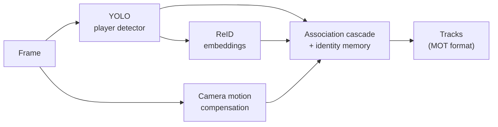

# hoop-reid-tracker

**Identity-preserving multi-player tracking for broadcast basketball.**
YOLO detection + a from-scratch tracker with appearance re-identification and a
long-term identity memory, evaluated on the basketball split of
[SportsMOT](https://github.com/MCG-NJU/SportsMOT) (ICCV 2023).

[](https://github.com/<your-user>/hoop-reid-tracker/actions)


<!-- After `make demo`, convert outputs/runs/demo/videos/*.mp4 to a GIF and drop it here:
 -->

---

## The problem

Keeping *who is who* in basketball broadcast footage is harder than street
pedestrian tracking:

| Challenge | Why it breaks naive trackers |
|---|---|
| **Same jersey, same build** | team-mates are near-identical for a generic appearance model → identity swaps |
| **Constant occlusion** | screens, post-ups and rebounds hide players behind each other for many frames |
| **Players leave the frame** | the camera follows the ball; a player can be off-screen for seconds and return elsewhere |
| **Camera motion** | fast pans and zooms make a standing player "move" by the pan speed |
| **Non-player people** | referees, coaches and crowd are not annotated → a COCO person detector produces many false tracks |

The goal of this project is not "draw boxes", it is **never give a player
someone else's identity** — and get it back when he returns.

## How it works



The tracker (`src/hooptrack/tracking/`) is written from scratch — no
`model.track()` — so every decision is explicit and can be ablated:

1. **Kalman filter in (cx, cy, w, h)** with **camera-motion compensation**
   (optical flow on the background, players masked out).
2. **Fused motion + appearance cost** with two gates: a spatial gate
   (players cannot teleport) and an appearance gate (two overlapping
   players with different appearance must not swap).
3. **Low-score recovery** (ByteTrack idea): an occluded player still
   produces a weak box; it is used to keep his track alive.
4. **Occlusion-aware appearance**: crops covered by another player are never
   used to learn, seed or claim an identity — they would mix two people.
5. **Long-term identity memory**: tracks lost for too long become *dormant*
   instead of being deleted. Returning players compete jointly with
   recently-lost tracks in a single assignment, protected by an
   **ambiguity margin**: when two identities are nearly tied, the tracker
   prefers a new id (fragmentation) over a wrong one (switch).

Details: [`docs/architecture.md`](docs/architecture.md) ·
the failures that drove each choice: [`docs/design_decisions.md`](docs/design_decisions.md).

## Results

### SportsMOT — basketball, validation split (15 clips)

| Configuration | HOTA | AssA | IDF1 | IDSW ↓ | Re-entry recovered |
|---|---|---|---|---|---|
| 1 · motion only (≈ ByteTrack) | — | — | — | — | — |
| 2 · + camera motion compensation | — | — | — | — | — |
| 3 · + ReID appearance | — | — | — | — | — |
| 4 · + identity memory (**full**) | — | — | — | — | — |
| 5 · full tracker on ground-truth boxes | — | — | — | — | — |

> Fill with `make ablation` (writes `outputs/ablation/ablation.md`). Row 5
> isolates the association logic from detector errors.
> *Re-entry recovered* is a custom metric: of all the times a player left the
> view and came back, how often he got his previous id back (see
> [`eval/metrics.py`](src/hooptrack/eval/metrics.py)).

### Sanity check — rendered synthetic clip (CI)

Every commit runs the full pipeline on a rendered clip with a panning
camera, two teams with identical jerseys and three players leaving the
frame (one for longer than the short-term buffer). These are **synthetic**
numbers, useful only to show each component does its job:

| Configuration | IDF1 | IDSW | Re-entries recovered | Stolen ids |
|---|---|---|---|---|
| motion only | 91.5 | 3 | 0 / 3 | 0 |
| + ReID, no memory | 96.6 | 1 | 2 / 3 | 0 |
| **full** | **98.3** | **0** | **3 / 3** | **0** |

## Quick start

```bash
git clone https://github.com/<your-user>/hoop-reid-tracker && cd hoop-reid-tracker
make install                     # pip install -e ".[vision,data,eval,dev]"
make smoke                       # end-to-end check, no data or GPU needed

# Data (CC BY-NC 4.0, gated): accept the terms at
# https://huggingface.co/datasets/MCG-NJU/SportsMOT, then `huggingface-cli login`
make data                        # downloads train+val, keeps only basketball

make detect                      # run YOLO once, cache detections
make track                       # track + IDF1 / IDSW / re-entry
make eval                        # + HOTA / AssA (official TrackEval)
make ablation                    # the results table above
make demo                        # annotated video of one clip
```

Any parameter can be overridden without editing files:

```bash
hooptrack track --set reid.type=osnet tracker.memory_thresh=0.2 detector.type=cached --eval
```

### Going further

```bash
make yolo-data     # single-class "player" dataset from the train split
yolo detect train data=data/yolo_basketball/data.yaml model=yolo11m.pt imgsz=1280 epochs=50
make reid-data     # Market-1501-style crops to fine-tune OSNet on team-mates
make calibrate SET="reid.type=osnet"   # derive appearance thresholds on TRAIN
```

## Repository layout

```
configs/default.yaml        every hyper-parameter, documented
src/hooptrack/
  tracking/                 kalman · matching · gmc · track · memory · tracker
  detection/                YOLO wrapper, detection cache, ground-truth oracle
  reid/                     histogram, ResNet-50 and OSNet extractors
  eval/                     motmetrics, TrackEval runner, re-entry metric
  pipeline.py               per-video loop with per-stage latency (det / ReID / track)
  cli.py                    hooptrack detect | track | evaluate
scripts/                    download, YOLO/ReID dataset export, calibration, ablation, smoke test
tests/                      Kalman, matching, GMC and behavioural tracker tests
docs/                       architecture and design decisions
```

## Evaluation protocol

* Train-split only for anything that is tuned (detector, ReID, thresholds);
  validation split only for reporting. The SportsMOT test split has no public
  ground truth.
* HOTA / DetA / AssA / IDF1 / MOTA with the official
  [TrackEval](https://github.com/JonathonLuiten/TrackEval) code, same protocol
  as the dataset authors.
* Latency is reported per stage (`timing.csv`) because on edge hardware the
  ReID crops, not the detector, are often the bottleneck.

## Limitations and next steps

- **Team-mates remain the hard case.** Generic ReID embeddings separate
  teams, not players. Next: fine-tune OSNet on SportsMOT crops and add a
  jersey-number cue.
- **Offline refinement.** An offline pass (tracklet clustering over the whole
  clip) could merge the fragments that the online tracker leaves on purpose.
- **Edge deployment.** Export detector and ReID to TensorRT and profile the
  pipeline on a Jetson Orin Nano.
- **Pose cues.** YOLO-pose keypoints could provide body-proportion features
  and better occlusion reasoning than box overlap.

## Data and licence

Code: MIT. The SportsMOT dataset is **not** included or redistributed; it is
released by its authors under CC BY-NC 4.0 and must be downloaded from the
official source. This project is non-commercial.

```bibtex
@inproceedings{cui2023sportsmot,
  title     = {SportsMOT: A Large Multi-Object Tracking Dataset in Multiple Sports Scenes},
  author    = {Cui, Yutao and Zeng, Chenkai and Zhao, Xiaoyu and Yang, Yichun and Wu, Gangshan and Wang, Limin},
  booktitle = {ICCV},
  year      = {2023}
}
```
