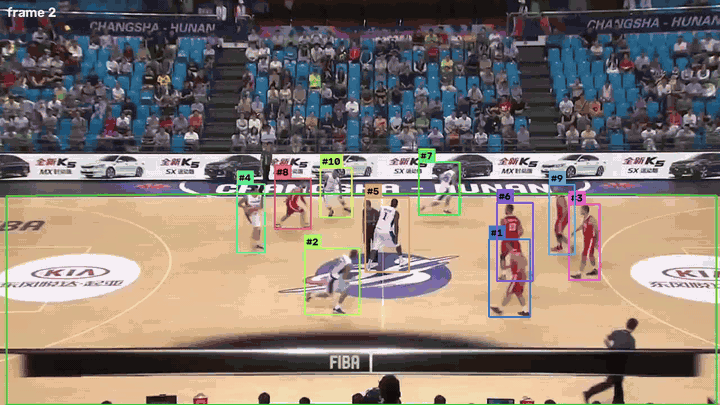
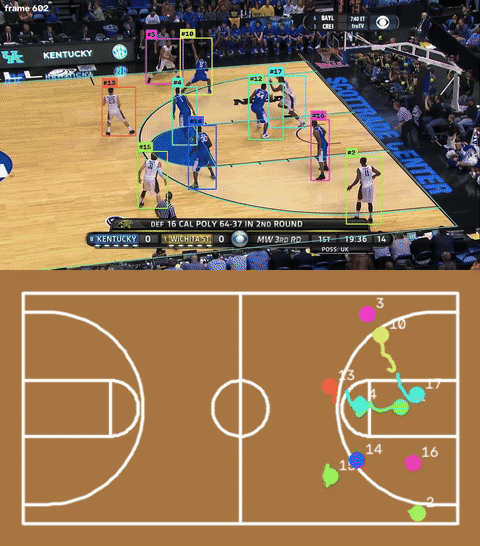
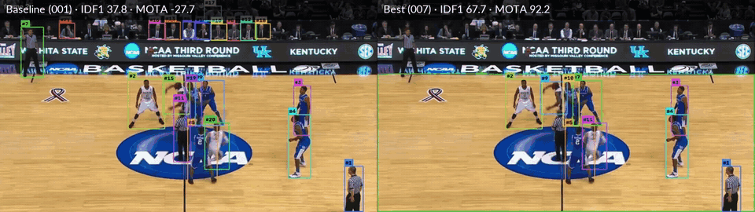
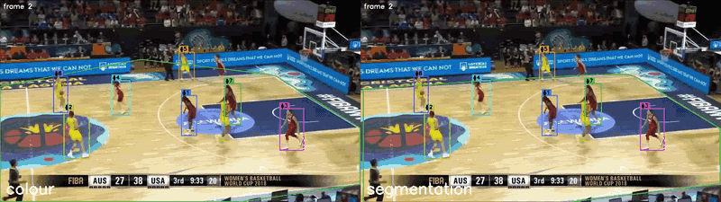
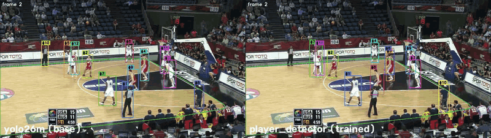
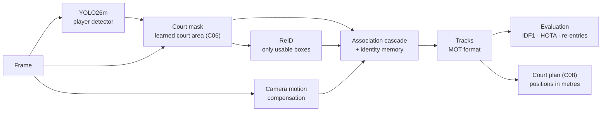

<div align="center">

# 🏀 hoop-reid-tracker

**Identity-preserving multi-player tracking for broadcast basketball**

YOLO26 detection · a tracker written from scratch · appearance re-identification · long-term identity memory · court geometry<br>
developed **experiment by experiment**, every change measured on [SportsMOT](https://github.com/MCG-NJU/SportsMOT) (ICCV 2023)

[](https://github.com/VaroLG/hoop-reid-tracker/actions)




<sub><b>Best configuration so far</b> (experiment 011b): YOLO26m fine-tuned to detect <i>players</i> + learned court mask (C06) +
the tracker with ResNet ReID and identity memory. FIBA Asia 2015, Changsha (<code>v_4r8QL_wglzQ_c001</code>, an arena never seen in
training): <b>IDF1 85.6 · MOTA 97.3</b>. Over 4 validation arenas: <b>IDF1 74.6 · MOTA 96.0</b>. Each colour/<code>#id</code> is one identity;
the green polygon is the court area predicted on every frame. ▶ <a href="assets/011/demo_player_c06.mp4">20-second clip in full quality</a></sub>

<br>



<sub><b>The same tracks on the court plan, in metres</b> (chapter 2, C08): NCAA clip <code>v_00HRwkvvjtQ_c001</code>. Every player's feet are
projected with the court homography of the frame (5.7 cm from a hand-made reference); distances and speeds per identity come out of
<code>hooptrack map</code>. Made with an earlier tracker configuration (COCO detector). ▶ <a href="experiments/court/C08_topdown_map/">C08</a></sub>

</div>

---

## What this project is

Keeping track of **who is who** in a basketball broadcast is harder than street
pedestrian tracking: team-mates wear identical jerseys, players occlude each
other constantly, the camera pans with the ball and players leave the frame
and come back. On top of that, a generic person detector also sees the crowd,
the bench and the referees.

This repository is an end-to-end pipeline — detection → filtering →
re-identification → tracking → evaluation — whose goal is **never to give a
player someone else's identity, and to give it back when he returns.**

It is also a record of *how* it was built: each improvement starts from a
measured weakness of the previous run, is added behind a config switch, and is
kept only if the numbers say so. Nothing is deleted. Every result can be
reproduced, including the ideas that failed.

## Results, step by step

All numbers on SportsMOT **validation** clips (never used for training or tuning), laptop CPU.
IDF1 measures how well identities are kept, MOTA how many errors there are (false positives, misses,
ID switches). "OVERALL" means the metrics recomputed over all clips together, not an average.

### 1 · One clip: the tracker built from scratch (001–007)

NCAA clip `v_00HRwkvvjtQ_c001` (1162 frames, **10 players**), YOLO26m with COCO weights (no training).

| # | Change | IDF1 ↑ | MOTA ↑ | ID switches ↓ | Identities | False positives ↓ | FPS ↑ |
|---|---|---|---|---|---|---|---|
| [001](experiments/001_baseline_yolo26m_coco/) | Baseline: YOLO26m (COCO) + tracker, no tuning | 37.8 | −27.7 | 49 | 123 | 13,725 | 0.49 |
| [002](experiments/002_reid_only_usable_boxes/) | Run ReID only on boxes the tracker can use | 37.8 | −27.7 | 49 | 123 | 13,725 | 1.75 |
| [003](experiments/003_court_mask_filter/) | **Court mask** (floor colour): drop people whose feet are off the court | 56.6 | 68.0 | 48 | 58 | 2,941 | 2.38 |
| [004a](experiments/004a_component_ablation/) | Ablation: court mask + motion + camera compensation, no ReID | 58.2 | 69.1 | 36 | 50 | 2,909 | **52** ¹ |
| [005](experiments/005_make_reid_earn_its_place/) | **ReID as a soft cost, not a veto** (+ identity memory) | 60.5 | 68.0 | 34 | 42 | 2,941 | 2.9 |
| [006](experiments/006_team_classifier/) | **Team / referee colour classifier**: hide referees | 66.9 | 90.1 | 34 | 42 | 390 | 2.5 |
| [007](experiments/007_referee_leftovers/) | Offline mode: remove referee tracks after the whole video ² | **67.7** | **92.2** | **33** | **42** | **142** | 2.4 |

<sub>¹ detection cached; without ReID the tracker itself runs at 52 FPS on CPU. ² analytics mode (`--set teams.offline_suppress_other=true`).</sub>

- **+29.9 IDF1 and +119.9 MOTA without training anything.** The baseline's problem was *who* was detected:
  half of the confident boxes were spectators, bench and photographers (court mask), most of the rest referees
  (colour classifier).
- **ReID had to earn its place**: as a hard veto it made things worse (004a); as a soft cost, calibrated on
  the train split, it beat the motion-only tracker (005).
- **A good idea that failed**: forbidding matches between the two teams fixed none of the cross-team swaps — they
  all happen inside occlusions, where the hidden jersey cannot be seen (006).

<div align="center">

<br><sub>Left: baseline (001). Right: 007 — court mask, soft ReID with memory, referee filter. False positives 13,725 → 142.
▶ <a href="assets/compare_baseline_best.mp4">side-by-side clip</a> · step by step: <a href="experiments/003_court_mask_filter/">003</a> · <a href="experiments/006_team_classifier/">006</a> · <a href="experiments/007_referee_leftovers/">007</a></sub>
</div>

### 2 · The honest test: other arenas

Everything above was tuned on **one** clip. Measured on clips from the other validation arenas
(three FIBA games: Tenerife 2018, Istanbul 2010, Changsha 2015), the same configuration falls apart. The
floor-colour mask lets the bench and crowd through in some arenas and cuts real players in others; the
referee classifier switches itself off when it cannot find three clear colour groups.

| 4 clips, one per validation arena | IDF1 | MOTA | ID switches | False positives | Missed players |
|---|---|---|---|---|---|
| Configuration of section 1 (006, live) | 45.0 | 55.6 | 107 | 6,897 | 4,169 |

One clip per arena from here on: NCAA `c005`, Tenerife `c002`, Istanbul `c012`, Changsha `c001`,
with `scripts/run_court_source_eval.py` (detections cached once, one folder per run, per-arena tables).

### 3 · A court mask that works in any arena (C06 → 010)

Rules about the floor colour cannot cover every arena, so the court area is **learned**: YOLO26n-seg trained
on 15 French arenas (DeepSportRadar), NBA broadcasts, SportsMOT train clips and synthetic courts with random
floors, paint and cameras (domain randomisation). On the validation arenas it overlaps the true court by
IoU 0.82–0.94 and, unlike the court homography (C05), it is never catastrophically wrong.
▶ [C06](experiments/court/C06_court_segmentation/)

| 4 arenas | IDF1 | MOTA | ID switches | False positives | Missed players |
|---|---|---|---|---|---|
| Floor-colour mask (003) | 45.0 | 55.6 | 107 | 6,897 | 4,169 |
| **Learned court mask (C06)** | **53.1** | **76.8** | 107 | **3,989** | **1,732** |

<sub>Tenerife: MOTA 54.8 → 90.3 · Istanbul: 5.2 → 48.9. ID switches do not change: the mask decides <i>who</i> enters the tracker, not how identities are assigned.</sub>

<div align="center">

<br><sub>FIBA Tenerife, same detector and tracker. Left: floor-colour mask. Right: learned court mask (green polygon).
▶ <a href="assets/010/compare_colour_vs_c06_tenerife.mp4">20-second clip</a></sub>
</div>

### 4 · A detector that sees players, not people (011)

The COCO detector's class is *person*: everyone is detected, and sections 1–3 remove the non-players with
rules. The strong trackers on SportsMOT do the opposite: they fine-tune the detector. SportsMOT labels only
the ten players, so referees, bench and crowd are background during training, and the detector learns the
difference from the whole image. YOLO26m, 40 epochs on a Colab T4, trained on 3 games
([notebook](notebooks/colab_train_player_detector.ipynb)). On the 4 unseen games: false positives per frame
**8.4 → 0.17**, missed players per frame 0.81 → 0.19. ▶ [011](experiments/011_player_detector/)

| 4 arenas | IDF1 | MOTA | ID switches | False positives | Missed players |
|---|---|---|---|---|---|
| COCO detector + C06 mask (section 3) | 53.1 | 76.8 | 107 | 3,989 | 1,732 |
| Players-only detector + C06 mask | 73.7 | 93.6 | 50 | 324 | 1,226 |
| **… without the referee classifier (011b)** | **74.6** | **96.0** | **49** | 397 | **551** |

- **False positives ÷10, ID switches halved** without touching the tracker: with fewer people in the image,
  each track has fewer wrong candidates.
- **The referee classifier became harmful.** It hides the smallest of three colour groups; with no referees
  left in the detections, it was hiding real players (NCAA: 787 → 139 missed players without it). It stays
  behind its switch, off in the best configuration ([`configs/player.yaml`](configs/player.yaml)).
- The C06 mask still helps on top of the new detector (+1.9 IDF1): the colour mask now mostly cuts real players.

<div align="center">

<br><sub>FIBA Istanbul, same court mask and tracker. Left: COCO detector (referees and staff get identities). Right: players-only detector.
▶ <a href="assets/011/compare_coco_vs_player_istanbul.mp4">20-second clip</a></sub>
</div>

### 5 · A ReID model trained on players (012) — better model, same tracking

The appearance model was a ResNet-50 trained on ImageNet; for it, two team-mates are "a person in a white
shirt". An **OSNet ReID model fine-tuned on SportsMOT player crops** (the main ingredient of Deep-EIoU, the
reference tracker on SportsMOT; [notebook](notebooks/colab_train_reid_osnet.ipynb)) finds the same player
among his team-mates twice as well on the unseen games: rank-1 **0.42 → 0.71**, mAP 0.19 → 0.41.
Its distances live on another scale, so the tracker's thresholds were recalibrated on the train split.

| 4 arenas | IDF1 | MOTA | ID switches | Identities per clip |
|---|---|---|---|---|
| ResNet-50 ImageNet (011b) | 74.6 | 96.0 | 49 | 17–21 |
| OSNet fine-tuned, calibrated | 72.9 | 96.1 | 47 | 18–22 |

**Neutral, and the diagnosis says why.** Classifying every identity break: two thirds happen inside
crossings, where by design the tracker uses motion only (the crop mixes two players), and the memory that
should bring lost players back never fires. The bottleneck is how the tracker uses appearance, not the
model. ▶ [012](experiments/012_reid_osnet/)

### 6 · Joining each player's fragments after the video (013)

Seeing the whole video at once, every id is a *tracklet*. Two tracklets that are never on screen together
and look alike (OSNet, median over many clean crops) are the same player and get one id; if a team-mate on
screen at the same time looks almost as alike, nothing is merged. This is the *connector* of GTA (Global
Tracklet Association), the step that lifts Deep-EIoU from 77 to 81 HOTA on SportsMOT. Thresholds come
from the train-split calibration. It post-processes a finished run in minutes, without re-tracking.
▶ [013](experiments/013_tracklet_stitching/)

| 4 arenas | IDF1 | MOTA | ID switches | Identities per clip |
|---|---|---|---|---|
| Online tracker (011b) | 74.6 | 96.0 | 49 | 17–21 |
| **+ offline tracklet stitching (013)** | **77.2** | **96.1** | **43** | 16–19 |

<sub>Changsha: IDF1 85.6 → 90.6. Of the 10 merges, 6 joined fragments of the same player, 3 involved stray
non-player tracklets and 1 joined two different players; 7 doubtful merges were refused.</sub>

**Next:** swaps inside crossings remain the main identity error. A swap leaves tracklets that mix two
players, which stitching cannot join correctly: GTA's *splitter* (cut a tracklet where its appearance
changes) is the next step.

Full log, raw metrics and configs: **[`experiments/`](experiments/)**.

## How it works



| Stage | What it does | Code |
|---|---|---|
| **Detection** | YOLO26m fine-tuned on SportsMOT players (or COCO `person`), low confidence threshold (0.10) so occluded players are not lost. Run once and cached. | [`detection/detectors.py`](src/hooptrack/detection/detectors.py) |
| **Court mask** | Keeps a box only if its feet are on the court. Three interchangeable sources (`filters.court_source`): floor colour (003), court homography (009), learned court-area segmentation (C06, best). | [`detection/filters.py`](src/hooptrack/detection/filters.py) · [`integrations/court_filter.py`](src/hooptrack/integrations/court_filter.py) |
| **Re-identification** | ResNet-50 / OSNet / colour embeddings, computed only for boxes the tracker can actually use. | [`reid/extractors.py`](src/hooptrack/reid/extractors.py) |
| **Motion model** | Constant-velocity Kalman filter in (cx, cy, w, h), warped by the camera's motion estimated with optical flow on the background. | [`tracking/kalman.py`](src/hooptrack/tracking/kalman.py) · [`gmc.py`](src/hooptrack/tracking/gmc.py) |
| **Association** | Hungarian matching in a cascade: confident boxes with motion + appearance, weak boxes with motion only (ByteTrack idea), then re-identification of lost players. | [`tracking/tracker.py`](src/hooptrack/tracking/tracker.py) |
| **Identity memory** | Players who leave the frame become *dormant* instead of being deleted, and can be revived by appearance, with an ambiguity margin that prefers a new id over a wrong one. | [`tracking/memory.py`](src/hooptrack/tracking/memory.py) |
| **Court plan** | Feet projected to metres with verified court homographies: trajectories, distances, speeds. | [`integrations/topdown.py`](src/hooptrack/integrations/topdown.py) |

The tracker is **not** `model.track()`: it is written from scratch so that every
decision is explicit and can be switched off for an ablation. It borrows ideas
from ByteTrack (two-pass association) and BoT-SORT (Kalman in w/h, camera
compensation, appearance fusion). More: [`docs/architecture.md`](docs/architecture.md) ·
the failures behind each choice: [`docs/design_decisions.md`](docs/design_decisions.md).

## How it is developed

The repository follows a few rules ([`experiments/README.md`](experiments/README.md)):

1. **Diagnose before changing.** [`scripts/analyze_detections.py`](scripts/analyze_detections.py)
   separates detector errors from tracker errors; [`scripts/run_court_source_eval.py`](scripts/run_court_source_eval.py)
   measures one change at a time on several arenas.
2. **Additive changes only.** Every improvement is a new module or config key;
   its default in code reproduces the previous behaviour, so old configs still
   give old numbers.
3. **One experiment = one folder** with the hypothesis, the exact config,
   raw metrics and a conclusion, including what did *not* work.
4. **No leakage.** Training uses SportsMOT *train*; all reported numbers come from the
   *validation* games, which are never used to train or to pick a model.

## Chapter 2 · Court geometry

A separate chapter of the same project, with its own code (`src/hooptrack/court/`),
scripts (`scripts/court/`), tests and experiments ([`experiments/court/`](experiments/court/)):
find the court in every frame, and from it a court mask for the tracker and a top-down map of
the players. The tracker and the court chapter do not import each other; the only bridge is
`src/hooptrack/integrations/`.

- [x] **C01** Public court-keypoint dataset audited (850 NBA frames, CC BY 4.0): court template verified to ~1–2 px, split leakage and clamped labels found and fixed
- [x] **C02** Court-keypoint detector (YOLO26n-pose, CPU) — 0.27 m on NBA test frames; does not transfer to SportsMOT (documented)
- [x] **C03** Court templates per league (NBA / NCAA / FIBA) + line-based refinement — fixes close starts only
- [x] **C04** Hand anchors on 3 frames + propagation → homography for all 1,162 frames of the NCAA clip, validated by two independent chains (5–20 cm)
- [x] **C05** No annotation: court homographies from straight lines + physics filter, confirmed by two chains, league picked automatically; on unseen FIBA arenas it can be confidently wrong (found in 009)
- [x] **C06** Learned court-area segmentation, trained on many arenas + synthetic courts: IoU 0.82–0.94 on unseen arenas, never catastrophically wrong; the court mask of the best configuration
- [x] **C07** One camera per clip: a homography no fixed broadcast camera can produce is rejected; clips without a trustworthy camera go to review instead of a confident wrong court
- [x] **C08** Top-down map in the pipeline (`hooptrack map`): tracks in metres, distances and speeds — 5.7 cm from the hand-made court on NCAA
- [ ] **C09** Review clips: hand-annotated test set and a learned keypoint detector to make review rare (in progress)

## Roadmap (chapter 1 · tracking)

- [x] End-to-end pipeline: detection, ReID, tracker, memory, evaluation (IDF1, HOTA, custom re-entry metric)
- [x] **001–007** Baseline, selective ReID, colour court mask, ablation, soft ReID + memory, referee classifier, offline mode
- [x] **008** Court border — no gain (documented)
- [x] **009** Court mask from the court homography — helps only where the automatic homography is right (documented)
- [x] **010** Evaluation on several arenas + learned court mask (C06): IDF1 45.0 → 53.1, MOTA 55.6 → 76.8
- [x] **011** Players-only detector (fine-tuned YOLO26m): IDF1 → 74.6, MOTA → 96.0 on 4 arenas
- [x] **012** Player ReID: OSNet fine-tuned on SportsMOT crops (rank-1 0.42 → 0.71); neutral in the online tracker (diagnosed)
- [x] **013** Offline tracklet stitching by appearance (GTA connector): IDF1 74.6 → 77.2
- [ ] Tracklet splitter (GTA): cut tracklets that mix two players after a swap
- [ ] All 15 validation clips; external baseline (Deep-EIoU) on the same clips
- [ ] Ball tracking
- [ ] Edge deployment: TensorRT on Jetson Orin Nano

## Quick start

```bash
git clone https://github.com/VaroLG/hoop-reid-tracker && cd hoop-reid-tracker
python -m venv .venv
source .venv/bin/activate              # Windows: .\.venv\Scripts\Activate.ps1
pip install -r requirements-dev.txt    # pinned versions
pip install -e . --no-deps

python scripts/smoke_test.py           # end-to-end check on a rendered clip: no data, no GPU
pytest                                 # 98 tests
```

**Data.** SportsMOT is released under CC BY-NC 4.0 and is gated: accept the terms at
[huggingface.co/datasets/MCG-NJU/SportsMOT](https://huggingface.co/datasets/MCG-NJU/SportsMOT), then

```bash
hf auth login
python scripts/download_data.py --splits train val     # keeps only the basketball clips
```

**Best configuration** ([`configs/player.yaml`](configs/player.yaml)). It needs two trained models, which are not stored in git:
the player detector (`weights/Player_detector.pt`, [Colab notebook](notebooks/colab_train_player_detector.ipynb)) and the court
segmentation model (`outputs/court_runs/c06_yolo26n_seg/weights/best.pt`, [C06](experiments/court/C06_court_segmentation/)).

```bash
hooptrack track --config configs/player.yaml "data.only=[v_4r8QL_wglzQ_c001]" output.save_video=true --eval
hooptrack map   --run outputs/runs/player --video          # court plan (clips with a verified court)
```

**Offline tracklet stitching** (013) on a finished run, with the OSNet ReID model (`weights/osnet_x1_0_sportsmot.pth`,
[notebook](notebooks/colab_train_reid_osnet.ipynb)); thresholds from `scripts/calibrate_reid.py` on the train split:

```bash
python scripts/stitch_tracklets.py --run outputs/runs/player --config configs/player.yaml \
    --set reid.type=osnet reid.weights=weights/osnet_x1_0_sportsmot.pth --out outputs/runs/player_stitched
```

**Compare one change on several arenas** (detections cached once, resumable, per-arena tables, side-by-side videos):

```bash
python scripts/run_court_source_eval.py --config configs/player.yaml --variants colour segmentation --video \
    --clips v_00HRwkvvjtQ_c005 v_5ekaksddqrc_c002 v_BgwzTUxJaeU_c012 v_4r8QL_wglzQ_c001
```

`configs/default.yaml` keeps the configuration of section 1 (COCO detector, colour mask), which needs no training.
Any parameter can be changed from the command line, e.g. `--set filters.court_source=segmentation reid.type=osnet`.

## Repository layout

```
configs/default.yaml          every hyper-parameter, documented (section 1 configuration)
configs/player.yaml           best configuration (011b)
src/hooptrack/
  detection/                  YOLO wrapper, detection cache, ground-truth oracle, colour court mask, team classifier
  reid/                       histogram, ResNet-50 and OSNet extractors
  tracking/                   kalman · matching · gmc · track · memory · tracker
  eval/                       motmetrics, TrackEval (HOTA), re-entry metric
  court/                      chapter 2: templates, homographies, clip camera, court segmentation (independent)
  integrations/               the only bridge: court mask filters for the tracker, top-down map
  pipeline.py                 per-video loop with per-stage latency
  cli.py                      hooptrack detect | track | evaluate | map
notebooks/                    Colab training: player detector (011), ReID (012)
experiments/                  chapter 1: one folder per experiment: hypothesis, config, metrics, conclusion
  court/                      chapter 2: C01 … C09
scripts/                      download, datasets, multi-arena evaluation, diagnosis, ablation, calibration
  court/                      chapter 2: datasets, training, evaluation, homographies, overlay videos
tests/                        tracker, filters, court geometry, chapter independence
docs/                         architecture and design decisions
```

## Limitations

- **Identities are the weak point**: 16–19 identities for 10 players on the validation clips after
  stitching, and swaps between team-mates in crossings.
- **Measured on 4 clips (one per validation arena)**, not yet on all 15 validation clips.
- **Few training games**: the player detector and the ReID model learn from the 3 basketball games of
  SportsMOT train. The detector generalises well to the 4 validation games; crowded rebounds are its
  remaining misses.
- CPU-only inference numbers; training on a free Colab GPU.

## Data and licence

Code: MIT. The SportsMOT data is **not** included or redistributed; it belongs
to its authors (CC BY-NC 4.0). DeepSportRadar images (C06) are CC BY-NC-SA 4.0. The figures and clips in this
README are short excerpts used for non-commercial research illustration.

```bibtex
@inproceedings{cui2023sportsmot,
  title     = {SportsMOT: A Large Multi-Object Tracking Dataset in Multiple Sports Scenes},
  author    = {Cui, Yutao and Zeng, Chenkai and Zhao, Xiaoyu and Yang, Yichun and Wu, Gangshan and Wang, Limin},
  booktitle = {ICCV},
  year      = {2023}
}
```
