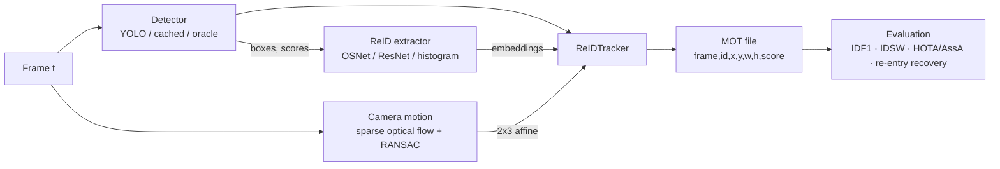
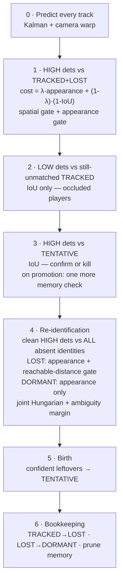
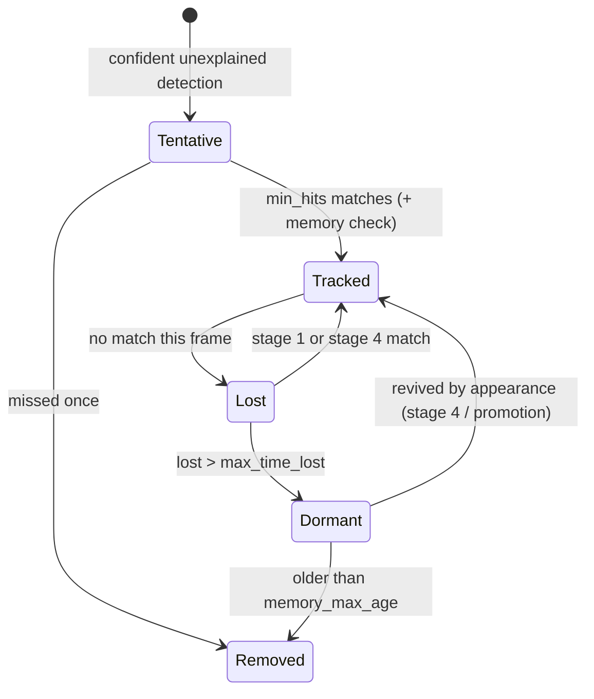

# Architecture

## Data flow

## Per-frame association cascade

Each stage only sees what the previous stages could not explain, and each one
is stricter about what it accepts.

## Track life cycle

## Module map

| Module | Responsibility |
|---|---|
| `tracking/kalman.py` | constant-velocity Kalman filter in (cx, cy, w, h), camera-motion warp |
| `tracking/matching.py` | IoU, coverage, cosine distance, gated Hungarian, motion/appearance fusion |
| `tracking/gmc.py` | global motion compensation (players masked out) |
| `tracking/track.py` | single-track state machine and appearance model (EMA + gallery) |
| `tracking/memory.py` | dormant-identity gallery, nearest-neighbour distance, ambiguity margin |
| `tracking/tracker.py` | the association cascade above |
| `detection/` | YOLO wrapper, detection cache, ground-truth oracle |
| `reid/` | colour-histogram, ResNet-50 and OSNet extractors |
| `eval/` | motmetrics (IDF1, IDSW…), TrackEval (HOTA/AssA), re-entry recovery metric |
| `pipeline.py` | per-video loop with per-stage latency |
| `cli.py` | `hooptrack detect / track / evaluate` |
