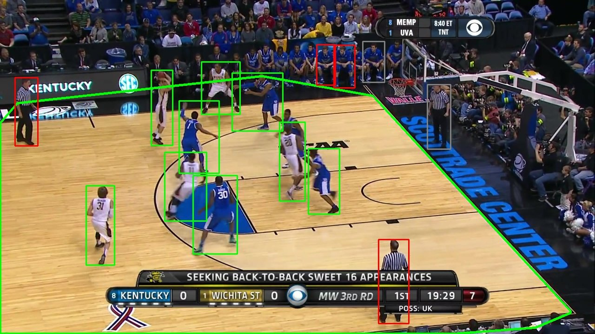

# 001 · Baseline — YOLO26m (COCO) + ReIDTracker

| | |
|---|---|
| **Date** | 2026-10-18 |
| **Code** | tag `v0.1-baseline` |
| **Question** | How does the full pipeline behave on real broadcast basketball, with off-the-shelf models and no tuning? |

## Setup

| Component | Choice |
|---|---|
| Data | SportsMOT · val · basketball · `v_00HRwkvvjtQ_c001` (1162 frames, 25 fps, 1280×720, 10 players) |
| Detector | `yolo26m.pt`, COCO-pretrained, class `person`, conf ≥ 0.10, imgsz 1280 — run once and cached |
| ReID | ResNet-50 ImageNet features (torchvision), not fine-tuned, thresholds **not calibrated** |
| Tracker | `configs/default.yaml` as of this tag: camera motion compensation on, identity memory on |
| Hardware | laptop CPU, no GPU |

`track_config.yaml` is the exact snapshot written by the run. Its `detector.weights`
field says `yolo11m.pt` but is **unused**: with `detector.type: cached` the boxes come
from `outputs/detections/yolo26m`, produced by the `detect` command below.

### Reproduce

```bash
hooptrack detect --set detector.weights=yolo26m.pt detector.cache_dir=outputs/detections/yolo26m "data.only=[v_00HRwkvvjtQ_c001]"
hooptrack track  --set detector.type=cached detector.cache_dir=outputs/detections/yolo26m output.save_video=true "data.only=[v_00HRwkvvjtQ_c001]" output.dir=outputs/runs/demo_yolo26 --eval
python scripts/analyze_detections.py --set detector.cache_dir=outputs/detections/yolo26m "data.only=[v_00HRwkvvjtQ_c001]"
```

## Results

| IDF1 | MOTA | IDSW | Frag | IDs created (GT = 10) | Re-entries recovered | Re-entries stolen |
|---|---|---|---|---|---|---|
| 37.8 | −27.7 | 49 | 111 | 123 | 0 / 4 | 0 |

| Stage | ms / frame |
|---|---|
| Detection | cached |
| ReID | **2014** |
| Tracking | 35 |
| **Total** | 0.49 FPS |

Raw files: [`summary.json`](summary.json) · [`motmetrics.csv`](motmetrics.csv) ·
[`timing.csv`](timing.csv) · full diagnosis: [`detection_analysis.md`](detection_analysis.md).

## Diagnosis

The negative MOTA comes from **13,725 false positives against 626 misses**.
To separate detector errors from tracker errors, `scripts/analyze_detections.py`
re-runs the same motion-only tracker on three inputs:

| Input boxes | IDF1 | MOTA | IDSW | IDs |
|---|---|---|---|---|
| A · detector as is | 36.1 | −25.0 | 44 | 132 |
| B · only boxes that match a player | 64.4 | 94.3 | 42 | 24 |
| C · ground-truth boxes | 80.3 | 99.8 | 9 | 17 |

**A → B is worth ~28 IDF1 points and ~120 MOTA points.** The dominant problem
is *which* people are detected, not *how* they are associated.



*Frame 780. Green: detections that match a player. Red: false positives
whose feet are on the court (referees, bench players at the edge). Grey: false
positives off the court (crowd, photographers, bench). Green polygon: a
colour-based court mask, prototyped for the next experiment.*

## What worked

- **Recall is high: 97.4 %.** The players are found; the low-score boxes the
  tracker's second stage relies on are there.
- **No identity was stolen.** 0 of 4 re-entries handed a player another
  player's id. The conservative design (appearance gates, ambiguity margin)
  holds even with very noisy input; the failures are fragmentations, not swaps.
- **The tracker itself is cheap:** 35 ms/frame on a laptop CPU.
- **The run is fully reproducible** from cached detections and a config snapshot,
  so every later change can be measured against this one.

## Limitations

1. **Detector precision is 50 % at score ≥ 0.5.** A COCO `person` model
   detects everyone; SportsMOT only annotates players. False positives are smaller
   than players (median height 79 px vs 144 px) and mostly off the court.
2. **ReID is the speed bottleneck (2 s/frame).** It embeds ~58 boxes per frame,
   but ~40 of them are below `high_thresh`: the tracker never uses their
   appearance (they are matched by IoU only and are too weak to update a model).
3. **Re-entry recovery is 0 / 4.** The identity memory fills with spectators,
   and the ResNet-50 thresholds were copied, not calibrated.
4. **Association still needs work.** Even with player-only boxes (row B), the
   motion-only tracker makes 42 ID switches. ReID and GMC must be re-measured once
   the false positives are gone.
5. **One clip only.** Numbers on the full validation split come later.
6. **Detector provenance is not recorded** when tracking from a cache (see the
   `weights` note above).

## Next hypotheses

| # | Hypothesis | Type | Evidence so far |
|---|---|---|---|
| H1 | Most false positives stand **off the playing surface** → a court mask removes them **without training** | detector filter | Prototype on 20 frames: removes **72 %** of false positives (score ≥ 0.5), keeps **100 %** of players |
| H2 | Embedding only boxes the tracker can use gives the **same metrics, ~3× faster ReID** | speed | 17.6 instead of 57.8 crops/frame |
| H3 | Remaining on-court false positives are **referees**: separable by appearance (two teams + "other") | detector filter | Visible in the figure (striped shirts) |
| H4 | With clean boxes, **calibrated ReID thresholds** recover re-entries | tracker | 0 / 4 with uncalibrated thresholds |
| H5 | Record which detector produced a cached run | reproducibility | Limitation 6 |

A fine-tuned single-class detector is a valid alternative to H1 + H3; it will be
compared against them as its own experiment.
