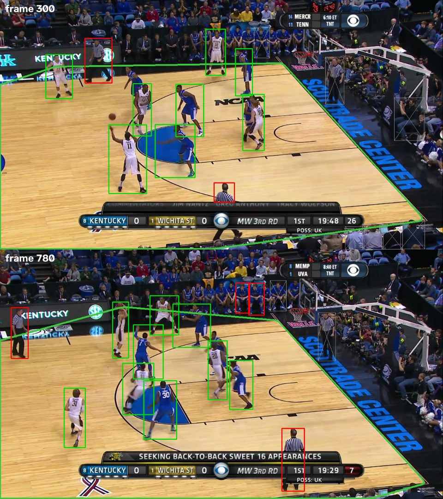

# 003 · Court mask: drop people whose feet are not on the court

| | |
|---|---|
| **Date** | 2026-10-18 |
| **Builds on** | [001](../001_baseline_yolo26m_coco/) — limitation 1, hypothesis H1 · uses [002](../002_reid_only_usable_boxes/) |
| **Switch** | `filters.court_mask: true` (default `false` = no filtering, as in 001) |
| **Code** | `src/hooptrack/detection/filters.py` (`CourtMask`) · tests in `tests/test_improvements.py` |

## Hypothesis

In 001, half of the confident detections were not players, and most of them
were spectators, bench players and photographers. They have one thing in
common: **their feet are not on the playing surface.** A geometric filter
should remove most of them **without training anything**, on CPU, while
keeping every player.

## Change

A post-detection filter, applied before ReID and tracking:

1. Estimate the floor colour (median HSV of a central band, people excluded).
2. Threshold, clean, keep the largest region, take its **convex hull**.
3. Keep a box if its foot point is inside the hull, with a tolerance of 15 %
   of the box height (players step on the lines).
4. Safety nets: if too little floor is visible, reuse the last good hull for a
   few frames, then let everything through. The filter only ever removes boxes.



*Green polygon: estimated court. Green boxes: players (kept). Grey crossed
boxes: removed by the filter. Red boxes: false positives the filter keeps —
referees and bench players standing on the baseline.*

## Results

### Detector level (exact, full clip — [`detection_analysis.md`](detection_analysis.md))

| score ≥ 0.5 | Detections / frame | Precision | Players kept | False positives removed |
|---|---|---|---|---|
| without filter | 17.6 | 50.3 % | — | — |
| **with court mask** | **11.4** | **77.8 %** | **100 %** | **71.0 %** |

Recall is unchanged (97.4 %). The mask was trusted on all 1162 frames.
Cost: 4.6 ms/frame.

### Tracker level — motion-only (same analysis script)

| Input boxes | IDF1 | MOTA | IDSW | IDs (GT 10) |
|---|---|---|---|---|
| A · detector as is | 36.1 | −25.0 | 44 | 132 |
| **A+F · detector + court mask** | **51.5** | **69.1** | 44 | **54** |
| B · only boxes that match a player (ceiling for any filter) | 64.4 | 94.3 | 42 | 24 |

The filter closes **55 % of the IDF1 gap** and **79 % of the MOTA gap**
between the raw detector and a perfect player-only detector.

### Full tracker — validation with histogram ReID

| | IDF1 | MOTA | IDSW | IDs |
|---|---|---|---|---|
| 001 setup | 22.8 | −24.0 | 186 | 180 |
| + court mask | 34.1 | 66.2 | 189 | 115 |

MOTA improves as expected, but **ID switches do not**, and this tracker does
worse than the motion-only one above (IDSW 186 vs 44). The colour histogram puts
team-mates almost as close as the same player, so with uncalibrated gates the
appearance cost *causes* swaps. This is evidence for hypothesis H4
(calibrate ReID), not a problem of the filter.

### Official run (ResNet-50, same setup as 001)

```bash
hooptrack track --set detector.type=cached detector.cache_dir=outputs/detections/yolo26m "data.only=[v_00HRwkvvjtQ_c001]" reid.only_usable_boxes=true filters.court_mask=true output.save_video=true output.dir=outputs/runs/003_court_mask --eval
```

| | IDF1 | MOTA | IDSW | IDs | Re-entries | ReID ms/frame | FPS |
|---|---|---|---|---|---|---|---|
| 001 | 37.8 | −27.7 | 49 | 123 | 0 / 4 | 2014 | 0.49 |
| 003 | _pending_ | | | | | | |

## Limitations

- **Referees are not removed**: they stand on the court. They need an
  appearance cue (two team colours + "other") — next experiment.
- **Bench players on the baseline** can fall inside the tolerance.
- **One clip, one arena.** The colour model assumes a single dominant floor
  colour. Courts with large painted areas or very different lighting must be
  checked on the rest of the validation split.

## Conclusion

_Detector-level result confirmed on the full clip_: 71 % of false positives
removed, no player lost, no training. Final verdict pending the official run.
