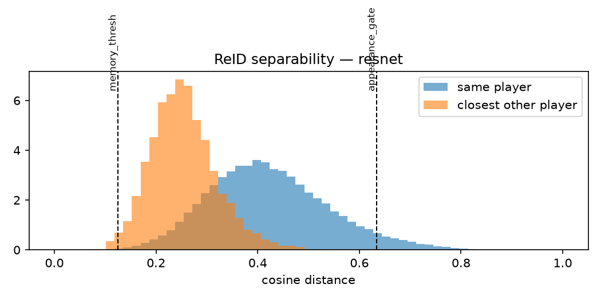

# 005 · Make ReID earn its place

| | |
|---|---|
| **Date** | 2026-10-19 |
| **Builds on** | [004a](../004a_component_ablation/) — ReID added 14 ID switches, all "lost track" |
| **Bar to beat** | motion + GMC, no ReID: **IDF1 58.2 · HOTA 56.4 · 36 IDSW** (current default) |

## Hypotheses

- **005a · Veto, not appearance, breaks tracks.** In stage 1 the appearance gate
  is a hard veto at any IoU. When a player's look changes for a few frames,
  a correct motion match is forbidden, the track is cut and a new id is born
  (lost-track switches 16 → 29 in 004a). Limiting the veto to pairs where
  motion is ambiguous (IoU < 0.5) should remove most of those switches while
  keeping appearance as a tie-breaker.
- **005b · The thresholds were never calibrated.** `appearance_gate: 0.35` and
  `memory_thresh: 0.25` were copied, not measured for ResNet-50 features.
  Measuring same-player vs closest-other-player distances on the **train**
  split gives thresholds that fit this extractor without touching validation data.

## Change

| Switch | Default (= 004a) | 005a |
|---|---|---|
| `tracker.appearance_veto_max_iou` | `.inf` (veto at any IoU) | `0.5` |

Code: `fuse_motion_appearance()` in `src/hooptrack/tracking/matching.py` ·
test: `test_veto_limited_to_ambiguous_motion`.

## Commands

```bash
# 005a — soft appearance (court mask on by default; ReID turned on explicitly)
hooptrack track --set detector.type=cached detector.cache_dir=outputs/detections/yolo26m "data.only=[v_00HRwkvvjtQ_c001]" reid.type=resnet tracker.memory_enabled=false tracker.appearance_veto_max_iou=0.5 output.dir=outputs/runs/005a_soft_reid --eval
hooptrack track --set detector.type=cached detector.cache_dir=outputs/detections/yolo26m "data.only=[v_00HRwkvvjtQ_c001]" reid.type=resnet tracker.memory_enabled=true  tracker.appearance_veto_max_iou=0.5 output.dir=outputs/runs/005a_soft_reid_memory --eval

# HOTA + switch breakdown
hooptrack evaluate --run outputs/runs/005a_soft_reid --hota --set "data.only=[v_00HRwkvvjtQ_c001]"
hooptrack evaluate --run outputs/runs/005a_soft_reid_memory --hota --set "data.only=[v_00HRwkvvjtQ_c001]"
python scripts/idsw_breakdown.py outputs/ablation/004a_court/2_plus_gmc outputs/ablation/004a_court/3_plus_reid outputs/runs/005a_soft_reid outputs/runs/005a_soft_reid_memory --set "data.only=[v_00HRwkvvjtQ_c001]"

# 005b — calibrate on TRAIN (needs: python scripts/download_data.py --splits train)
python scripts/calibrate_reid.py --set reid.type=resnet
```

## Results

### 005a · soft appearance (ResNet-50, court mask on, GMC on)

| Configuration | IDF1 | HOTA | AssA | IDSW | Lost-track switches | Cross-team | IDs (GT 10) | Re-entries | FPS ¹ |
|---|---|---|---|---|---|---|---|---|---|
| 004a · motion + GMC (bar) | 58.2 | 56.4 | 48.0 | 36 | 16 | 14 | 50 | 0 / 4 | 52 |
| 004a · + ReID, veto at any IoU | 58.3 | 57.2 | 49.7 | 50 | 29 | 14 | 64 | 1 / 4 | 3.0 |
| **005a · + ReID, soft** | **60.4** | **58.4** | **51.8** | **35** | **15** | 14 | 49 | 1 / 4 | 2.5 |
| **005a · + ReID, soft, + memory** | **60.5** | 58.3 | **51.8** | **34** | **14** | 14 | **42** | 1 / 4 | 2.9 |

¹ detection cached; ReID dominates the cost (~315–365 ms/frame on the laptop CPU).

Raw files: [`005a_soft_reid/`](005a_soft_reid/) · [`005a_soft_reid_memory/`](005a_soft_reid_memory/)
(config snapshot, `summary.json`, `timing.csv`).

- **The hypothesis holds.** Limiting the veto to ambiguous motion (IoU < 0.5)
  removes the lost-track switches ReID was causing (29 → 15) and, for the first
  time, appearance beats the motion-only tracker: **+2.2 IDF1, +2.0 HOTA, +3.8 AssA**.
- Memory on top: 1–2 fewer switches and **fewer identities created (49 → 42)**,
  same HOTA. The re-entry it recovers is the same one as before (1 / 4) and
  still **no identity is stolen**.
- **Cross-team swaps are still 14 in every configuration.** No component touches
  them — the team gate (006) is the remaining lever.

### 005b · calibration on the train split

`python scripts/calibrate_reid.py --set reid.type=resnet` — 15 basketball train
clips, ground-truth boxes, 103,941 same-player pairs (≥ 30 frames apart) and
5,388 hard negatives (closest *other* player). Raw: [`calibration/resnet.json`](calibration/resnet.json).



| Cosine distance | p1 | p5 | p50 | p95 |
|---|---|---|---|---|
| Same player, ≥ 1.2 s apart | — | — | 0.41 | 0.63 |
| Closest other player | 0.13 | 0.16 | 0.25 | — |

What this explains:

- **The old gate (0.35) rejected most correct matches**: half of all same-player
  pairs are further apart than 0.41. That is exactly the veto damage seen in 004a.
- **ImageNet ResNet-50 features cannot tell players apart**: the closest other
  player is usually *closer* than the same player a second later. (The hard
  negative is a minimum over many crops, so this comparison is biased low —
  but the gap is large.) Whatever ReID adds in 005a comes from coarse cues
  (jersey colour, size) used as a tie-breaker, not from recognising individuals.
- Suggested values: `appearance_gate 0.63` (keeps 95 % of true pairs),
  `memory_thresh 0.13` (accepts only 1 % of hard negatives — the memory would
  almost never revive anyone, which is the honest consequence of this extractor).

Optional check of the calibrated values:

```bash
hooptrack track --set detector.type=cached detector.cache_dir=outputs/detections/yolo26m "data.only=[v_00HRwkvvjtQ_c001]" reid.type=resnet tracker.memory_enabled=true tracker.appearance_veto_max_iou=0.5 tracker.appearance_gate=0.63 tracker.memory_thresh=0.13 output.dir=outputs/runs/005b_calibrated --eval
```

## Conclusion

**Confirmed: ReID now earns its place — on accuracy.** With the veto restricted
to ambiguous motion, ResNet ReID + memory reaches IDF1 60.5 / HOTA 58.3 /
34 ID switches, above the motion-only bar (58.2 / 56.4 / 36). It becomes the
default (`reid.type: resnet`, `appearance_veto_max_iou: 0.5`, `memory_enabled: true`).

The price is speed: ~2.9 FPS instead of 52 on a laptop CPU. The motion-only
tracker stays one flag away for real-time use:
`--set reid.type=none tracker.memory_enabled=false`.

The calibration also shows the **ceiling of a generic extractor**: it cannot
separate individual players. Next, in order of expected gain:

1. **006 · Team gate** — forbid cross-team matches (the 14 untouched switches),
   colour clustering on CPU, no training.
2. **007 · Player-specific ReID** — fine-tune OSNet on SportsMOT train crops
   (`scripts/export_reid_crops.py`) so that same-player distances fall below
   other-player distances; then re-calibrate.
