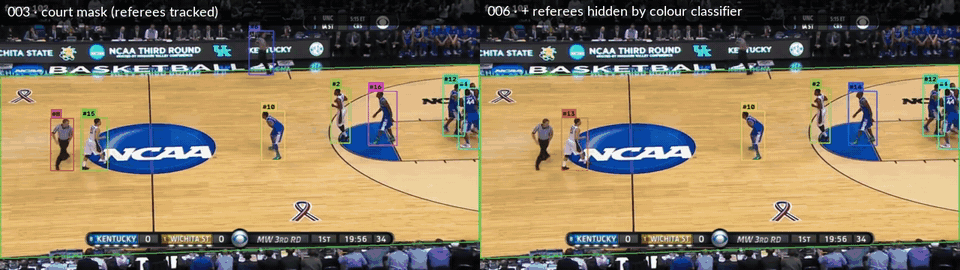

# 006 · Team / referee classifier

| | |
|---|---|
| **Date** | 2026-10-19 |
| **Builds on** | [005](../005_make_reid_earn_its_place/) — 14 cross-team switches untouched by every component; referees still tracked |
| **Bar to beat** | 005a ReID soft + memory: **IDF1 60.5 · HOTA 58.3 · MOTA 68.0 · 34 IDSW** (current default) · motion-only: IDF1 58.2 · MOTA 69.1 · 36 IDSW |

## Idea

Two jersey colours plus the referees' stripes are a strong, free cue. Cluster
them per video, without labels, on CPU:

- `src/hooptrack/detection/teams.py` — torso colour features (fraction of white,
  black and saturated pixels), k-means with k = 3 fitted on the first 60 frames,
  the smallest cluster per frame = **other** (referees, staff). Labels per box:
  team 0 / team 1 / other / unknown.
- `Track.team()` — a track's team is the majority vote of its box labels
  (per-box labels are noisy, a track's vote is not).

Every use of the labels is a separate switch, off by default:

| Switch | What it does |
|---|---|
| `teams.enabled` | run the classifier (alone it changes nothing: verified, identical metrics) |
| **006a** `tracker.team_gate` | forbid cross-team pairs when motion is ambiguous (IoU < `team_gate_max_iou`) and in re-identification |
| **006b** `teams.label_occluded` | also label occluded boxes, from the torso pixels not hidden by a player closer to the camera |
| **006c** `tracker.team_cost` | soft version of the gate: extra stage-1 cost for cross-team pairs at any IoU |
| **006d** `tracker.suppress_other` | do not output tracks whose majority label is *other* |

Tests: `tests/test_teams.py` (classifier on a synthetic scene, majority vote,
gate, soft cost, occlusion masking, suppression).

## Classifier quality (clip `v_00HRwkvvjtQ_c001`, ground-truth teams from `idsw_breakdown.py`)

Player boxes matched to the ground truth (IoU > 0.6), score ≥ 0.5:

| Player boxes | Labelled | Wrong team (of labelled) | Labelled *other* (of labelled) |
|---|---|---|---|
| clean (coverage < 0.2) | 5,442 boxes | 3.3 % | 7.0 % |
| occluded, 006b on | 2,590 of 3,748 (69 %) | 5.8 % | 6.3 % |

The "other" cluster is identified correctly (fewest boxes per frame) and the two
teams split 5 / 5 players, matching the ground truth.

## Results — preliminary, motion-only (`reid.type=none`, memory off)

Run in the Linux VM for speed (~70 FPS, detections cached). Same clip, court mask on.
HOTA not computed here (TrackEval not installed in the VM).

| Run | IDF1 | MOTA | IDSW | Cross-team | Same team | Lost track | FP | Misses |
|---|---|---|---|---|---|---|---|---|
| motion-only bar (= `teams.enabled` alone) | 58.2 | 69.1 | 36 | 14 | 6 | 16 | 2,909 | 537 |
| 006a · gate (IoU < 0.5) | 58.2 | 69.1 | 36 | 14 | 6 | 16 | 2,909 | 538 |
| 006a+b · gate + occluded labels | 58.2 | 69.1 | 36 | 14 | 6 | 16 | 2,909 | 541 |
| 006a+b · gate at **any** IoU | 49.2 | 66.9 | 149 | 30 | 12 | 107 | 2,949 | 638 |
| 006b+c · soft cost 0.2 | 58.2 | 69.1 | 36 | 14 | 6 | 16 | 2,909 | 539 |
| 006b+c · soft cost 0.4 | 56.2 | 68.9 | 39 | **12** | 6 | 21 | 2,915 | 549 |
| **006d · suppress *other*** | **62.9** | **87.2** | 36 | 14 | 6 | 16 | 715 | 698 |
| **006b+d · suppress *other* + occluded labels** | **64.0** | **89.6** | 36 | 14 | 6 | 16 | **501** | 631 |

### Why the team gate does nothing (006a–c)

A diagnostic of the 14 cross-team switches (frame, track, which player it covered
before and after, labels at that frame):

- **Every one involves an occluded box** (coverage 0.25–1.0). 006a only labels
  clean crops, so the gate never had a label to act on.
- With 006b, 6 of the 14 boxes get a label, 2 of them wrong.
- The swaps are **continuous**: the track covers player A for 15 frames, then
  player B the next frame, while the two players overlap heavily (ground-truth
  IoU up to 0.89). Motion is *not* ambiguous for the tracker (IoU > 0.5), so a
  gate restricted to ambiguous motion is never triggered.
- Applying the gate at any IoU makes it worse (36 → 149 switches): a 6 % label
  error rate means a correct high-IoU continuation gets forbidden every few
  seconds. The soft cost cannot tell the right box from the wrong one either
  when the right one is unlabelled: at 0.4 it removes 2 cross-team swaps but
  cuts 5 correct tracks.

**Conclusion: jersey colour cannot fix swaps that happen inside an occlusion,
because the crop that would need the colour is the one that is hidden.** This
needs either a detector that keeps two boxes in a crowd or appearance that
works after the occlusion (player-specific ReID, jersey numbers).

### Why suppressing *other* works (006d)

Referees walk on the court, so the court mask keeps them, and they are not in
SportsMOT's ground truth: every referee box was a false positive. Dropping
tracks voted *other* removes **83 % of the remaining false positives**
(2,909 → 501) for +94 misses (players briefly voted *other*). Identity is
untouched (36 switches) but IDF1 counts false positives too, so it rises
**58.2 → 64.0**, MOTA **69.1 → 89.6** — the largest single gain since the court mask.

## Commands (official runs, default config = ResNet ReID + memory)

```bash
# 006 reference: classifier on, nothing uses it (must equal 005a soft + memory)
hooptrack track --set detector.type=cached detector.cache_dir=outputs/detections/yolo26m "data.only=[v_00HRwkvvjtQ_c001]" teams.enabled=true output.dir=outputs/runs/006_ref --eval

# 006d: suppress referees (+ occluded labels)
hooptrack track --set detector.type=cached detector.cache_dir=outputs/detections/yolo26m "data.only=[v_00HRwkvvjtQ_c001]" teams.enabled=true teams.label_occluded=true tracker.suppress_other=true output.dir=outputs/runs/006d_suppress_other --eval

# 006d, real-time variant (motion only) — reproduces the table above
hooptrack track --set detector.type=cached detector.cache_dir=outputs/detections/yolo26m "data.only=[v_00HRwkvvjtQ_c001]" reid.type=none tracker.memory_enabled=false teams.enabled=true teams.label_occluded=true tracker.suppress_other=true output.dir=outputs/runs/006d_suppress_other_motion --eval

# HOTA + switch breakdown
hooptrack evaluate --run outputs/runs/006_ref --hota --set "data.only=[v_00HRwkvvjtQ_c001]"
hooptrack evaluate --run outputs/runs/006d_suppress_other --hota --set "data.only=[v_00HRwkvvjtQ_c001]"
hooptrack evaluate --run outputs/runs/006d_suppress_other_motion --hota --set "data.only=[v_00HRwkvvjtQ_c001]"
python scripts/idsw_breakdown.py outputs/runs/006_ref outputs/runs/006d_suppress_other outputs/runs/006d_suppress_other_motion --set "data.only=[v_00HRwkvvjtQ_c001]"
```

## Official results (ResNet ReID + memory, laptop CPU)

| Run | IDF1 | HOTA | DetA | AssA | MOTA | IDSW | FP | Misses | IDs (GT 10) | Re-entries | FPS |
|---|---|---|---|---|---|---|---|---|---|---|---|
| 006 ref · classifier on, unused (= 005) | 60.5 | 58.3 | 65.6 | 51.8 | 68.0 | 34 | 2,974 | 597 | 42 | 1 / 4 | 2.6 |
| **006d · hide *other* + occluded labels** | **66.9** | **63.7** | **78.9** | 51.4 | **90.1** | 34 | **390** | 691 | 42 | 1 / 4 | 2.5 |
| 006d, motion-only (real-time variant) | 63.9 | 61.2 | 78.6 | 47.7 | 89.6 | 36 | 501 | 631 | 50 | 0 / 4 | 40 |

Raw files: [`006_ref/`](006_ref/) · [`006d_suppress_other/`](006d_suppress_other/) ·
[`006d_suppress_other_motion/`](006d_suppress_other_motion/) (config snapshot,
`summary.json`, `motmetrics.csv`, `trackeval.csv`, `timing.csv`).

- **The reference reproduces 005 exactly** (same IDF1, HOTA, switches): running
  the classifier alone changes nothing, as the rules require.
- **Hiding referees: +6.4 IDF1, +5.4 HOTA, +22 MOTA.** False positives drop
  −87 % (2,974 → 390) for +94 misses. The gain is all detection quality
  (DetA 65.6 → 78.9); association is unchanged (AssA 51.8 → 51.4, 34 switches),
  as expected from a filter that does not touch matching.
- ReID + memory still beats motion-only by +3.0 IDF1 / +2.5 HOTA, at 16× the cost.

<div align="center">

<br><sub>Left: 003, the court mask keeps the referees (they stand on the court). Right: 006, tracks voted "other" are hidden —
referees disappear, players keep their ids. ▶ <a href="../../assets/compare_003_006.mp4">side-by-side clip</a> ·
<a href="../../assets/demo_006.mp4">006 alone</a></sub>
</div>

## Conclusion

**Partly confirmed.** The colour classifier is reliable enough to **remove
referees**, which is now the largest single gain after the court mask, and it
becomes the default (`teams.enabled`, `teams.label_occluded`,
`tracker.suppress_other`). The **team gate is a negative result**: every
cross-team swap happens inside an occlusion, where the hidden crop has no
usable colour and motion looks confident. The gate stays in the code, off.

What is left is pure association: 34 switches, 14 of them cross-team inside
occlusions. Next, in order of expected gain:

1. **007 · Player-specific ReID** (fine-tuned OSNet) — appearance that still
   tells two players apart right after they separate.
2. **External baselines** (ByteTrack, BoT-SORT) on the same filtered detections,
   to place these numbers.
3. **YOLO26-pose** — keypoints to tell which player is in front during an occlusion.
