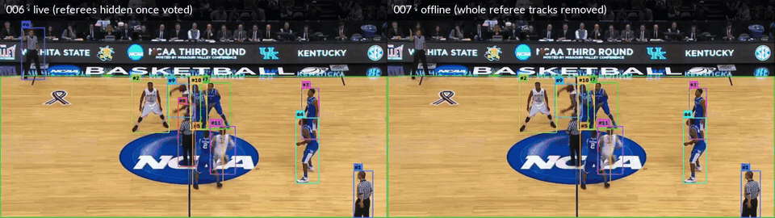

# 007 · Referee leftovers

| | |
|---|---|
| **Date** | 2026-10-19 |
| **Builds on** | [006](../006_team_classifier/) — referees hidden by a jersey-colour vote; 386 false positives left |
| **Bar to beat** | 006d (default): **IDF1 66.9 · HOTA 63.7 · MOTA 90.1 · 34 IDSW · 390 FP** · motion-only: IDF1 64.0 · MOTA 89.6 · 501 FP |

## What is left (diagnosis of the 006d run)

Each remaining false-positive box was traced back to its track:

| Where the false positives come from | Boxes | Share |
|---|---|---|
| Start of the clip (frames 1–75): 3 referees shown until the colour model is fitted (60-frame warm-up) | 178 | 46 % |
| Referees re-entering during play, shown for a few frames before their track has 3 votes | 81 | 21 % |
| Scattered boxes on player tracks (loose boxes, drift) | ~127 | 33 % |

The court mask was checked as well, because referees seemed to "come in" when it moved:
consecutive masks overlap ≥ 94 % (median 99 %) and it fails on 1 of 1,162 frames.
It follows the camera; it does not jump. Its real limit is different: it is
the colour of the floor, and the wood outside the lines is the same colour.
65 false-positive boxes stand in that border band — a job for court geometry (008).

## Changes (all off by default)

| Switch | Hypothesis |
|---|---|
| **007a** `teams.early_fit_frames` | Fit a provisional colour model after N frames, refit at 60 → referees hidden earlier. |
| **007b** `tracker.team_probation` | A new track is not shown until it has a team (or is N frames old) → re-entering referees never appear. |
| **007c** `teams.offline_suppress_other` | **Offline mode**: after the whole video, drop every frame of an id whose final vote is *other*, including frames before the vote existed. Ids that never got a vote are labelled afterwards with the final model (`TeamClassifier.classify`). The video is rendered in a second pass so it matches the results file. |

Code: `detection/teams.py`, `tracking/tracker.py` (`_visible`, `final_team`),
`pipeline.py` (`_retro_label_other`, `_render_offline_video`) · tests: `tests/test_teams.py`.

## Results — preliminary, motion-only (VM, `reid.type=none`, memory off)

| Run | IDF1 | MOTA | IDSW | FP | Misses |
|---|---|---|---|---|---|
| 006d motion-only (bar) | 64.0 | 89.6 | 36 | 501 | 631 |
| 007a · early fit at 5 / 10 / 30 frames | 64.0 | 89.6 | 36 | 501 | 631 |
| 007b · probation 5 frames | 64.2 | 89.6 | 34 | 426 | 714 |
| 007b · probation 10 frames | 64.4 | 89.2 | 34 | 398 | 780 |
| **007c · offline filter** | **65.0** | **92.8** | 35 | **143** | 639 |
| 007b+c · probation 5 + offline | 65.1 | 92.1 | 33 | 132 | 722 |

- **007a does nothing.** In the first seconds the players are bunched (≈ 5 clean
  crops per frame) and the three clusters are not yet separable, so the early
  model is rejected as unreliable every time and the 60-frame model takes over.
  Kept off; a negative result.
- **007b trades errors 1 : 1.** Every referee frame it hides costs a player
  frame at the start of a track (FP −75, misses +83 at 5 frames). Not worth it.
- **007c removes 71 % of what was left** (501 → 143) for +8 misses: the warm-up
  referees and the re-entries disappear. The price is that it needs the whole
  video, so it is an **offline / analytics mode**, not live tracking.
- What it cannot fix: one referee track (id 1) that drifts onto a player before
  any vote — its few referee crops are ambiguous (white ≈ black stripes) and
  its later crops are a blue player.

## Commands (official, ResNet ReID + memory)

```bash
# reference: 007 code, all switches off (must equal 006d: IDF1 66.9)
hooptrack track --set detector.type=cached detector.cache_dir=outputs/detections/yolo26m "data.only=[v_00HRwkvvjtQ_c001]" output.dir=outputs/runs/007_ref --eval

# 007c offline filter, with the matching video
hooptrack track --set detector.type=cached detector.cache_dir=outputs/detections/yolo26m "data.only=[v_00HRwkvvjtQ_c001]" teams.offline_suppress_other=true output.save_video=true output.dir=outputs/runs/007c_offline --eval

hooptrack evaluate --run outputs/runs/007_ref --hota --set "data.only=[v_00HRwkvvjtQ_c001]"
hooptrack evaluate --run outputs/runs/007c_offline --hota --set "data.only=[v_00HRwkvvjtQ_c001]"
```

## Official results (ResNet ReID + memory, laptop CPU)

| Run | IDF1 | HOTA | DetA | AssA | MOTA | IDSW | FP | Misses | FPS |
|---|---|---|---|---|---|---|---|---|---|
| 007 ref · all switches off (= 006d) | 66.9 | 63.7 | 78.9 | 51.4 | 90.1 | 34 | 390 | 691 | 2.8 |
| **007c · offline filter** | **67.7** | **64.3** | **80.5** | 51.5 | **92.2** | **33** | **142** | 699 | 2.4 |

Raw files: [`007_ref/`](007_ref/) · [`007c_offline/`](007c_offline/).

- **The reference reproduces 006d exactly**: the new code changes nothing while
  its switches are off.
- **Offline filter: −64 % false positives (390 → 142) for +8 misses**, 256 rows
  dropped; IDF1 +0.8, HOTA +0.7, MOTA +2.1. Association is untouched (AssA 51.4 → 51.5).
- Since the baseline: false positives **13,725 → 142** without training anything.

<div align="center">

<br><sub>First seconds of the clip. Left (006, live): referees #6, #8 are boxed until the colour model exists. Right (007c, offline): their whole tracks are removed. #1 (bottom right) is the one case it cannot fix.</sub>
</div>

## Conclusion

**Partly confirmed.** Showing a referee *earlier* than the colour model can
recognise him is a timing problem, and the online fixes either do not work
(007a: too little evidence in the first seconds) or trade a referee frame for a
player frame (007b). Waiting for the whole video does work (007c), so it ships
as an **offline / analytics mode**: `--set teams.offline_suppress_other=true`.

The default stays **online** (006d): a live tracker cannot use the future. The
two modes are reported separately in the main README.

Next: **008 · court geometry** for the people standing on the out-of-bounds wood
(~65 boxes), then **009 · player-specific ReID** for the 33 remaining switches.
