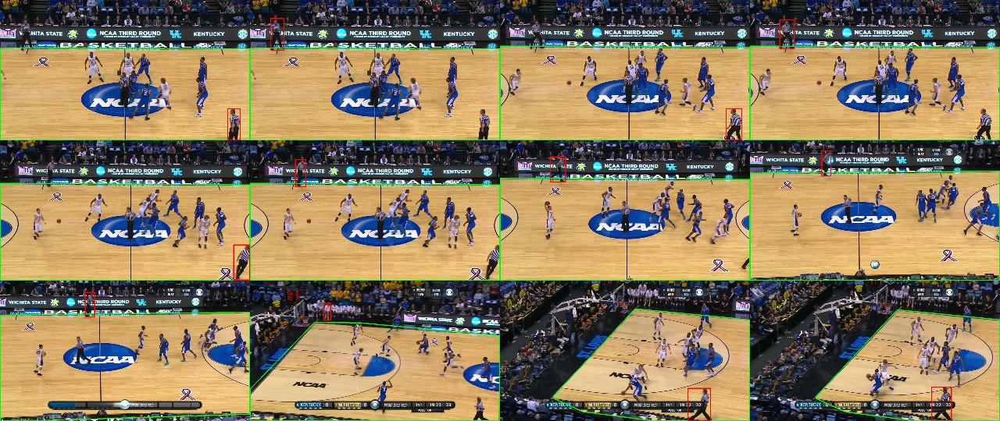
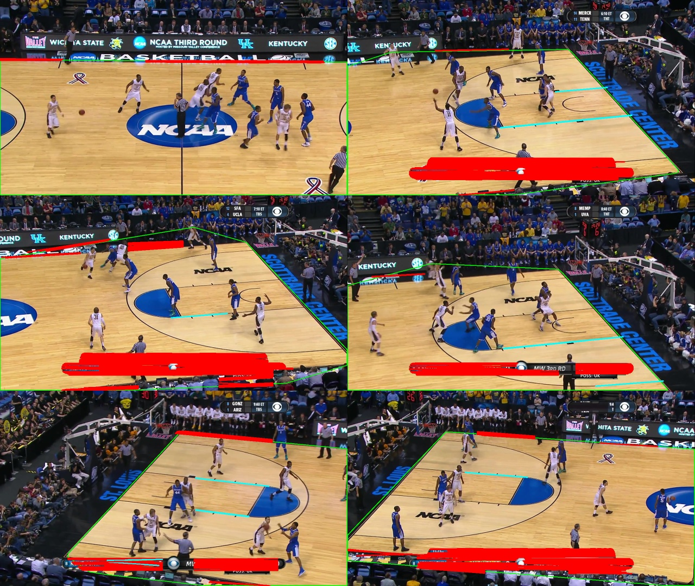
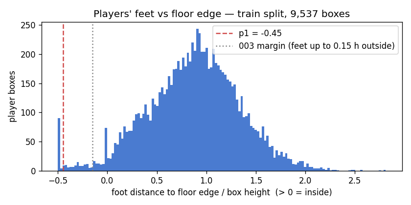
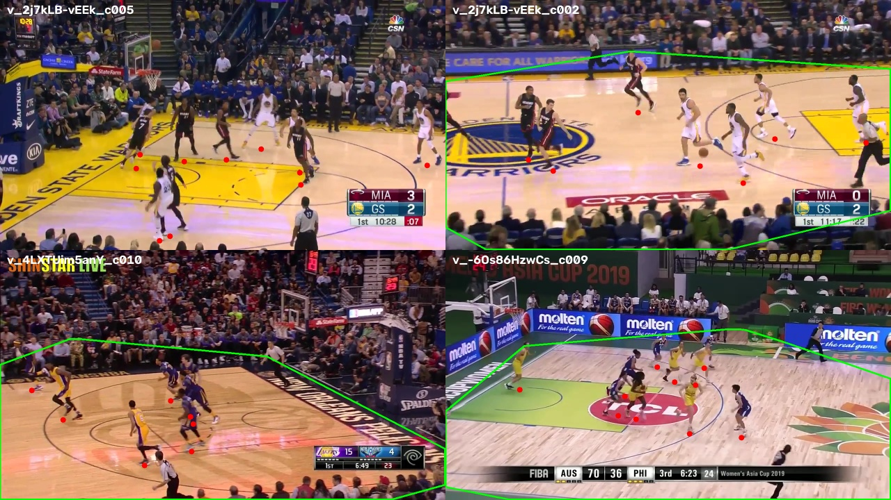

# 008 · Court border

| | |
|---|---|
| **Date** | 2026-10-19 |
| **Builds on** | [007](../007_referee_leftovers/) — people standing on the border of the court still get through the court mask |
| **Bar to beat** | 006d live (default): IDF1 66.9 · MOTA 90.1 · 390 FP · motion-only: IDF1 64.0 · MOTA 89.6 · 501 FP |

## The problem

The court mask (003) keeps a box when its feet are inside the convex hull of the
floor colour, **or up to 15 % of the box height outside it**. On the demo clip
that tolerance is generous: referees, bench players and staff stand on the strip
of wood around the court, right on the edge of the hull.


<sub>Red: false positives whose feet are on the hull edge (green). Mostly referees on the sidelines.</sub>

Measured on the demo clip (every 2nd frame, boxes with score ≥ 0.5): **no player**
has his feet within 5 % of his height of the hull edge or outside it; ~450
non-player boxes do.

## Attempt 1 · detect the court lines — dropped at the prototype stage

The plan was to find the painted sidelines and baselines (Hough transform on dark
pixels inside the floor) and cut the hull there.


<sub>Cyan: straight dark lines with wood on both sides (painted lines). Red: lines rejected.</sub>

It does not work on broadcast frames: the far sideline coincides with the edge of
the hull (the strip of wood beyond it is a few pixels tall), the near sideline is
often hidden by the score bar, and the only long lines found reliably are the
free-throw lanes — cutting there would delete players. Robust line geometry
needs a learned court-keypoint model, which needs labels this project does not have.

## Attempt 2 · a stricter margin — calibrated on train, it does not transfer

If players never stand on the edge, simply require the feet to be a little
*inside* the hull (negative margin). Per the project rules the value is measured
on the **train** split, not on the clip we evaluate:
`scripts/calibrate_court_margin.py` (ground-truth player boxes, 15 clips, 9,537 boxes).



| Train clips | Players' feet, 1st percentile (box heights, > 0 = inside) | Players removed by the **current** 0.15 margin |
|---|---|---|
| `v_-6Os86HzwCs_*` (4 clips, FIBA) | −0.01 … +0.21 | 0 – 0.2 % |
| `v_4LXTUim5anY_*` (5 clips, NBA) | −0.14 … +0.17 | 0 – 0.9 % |
| `v_2j7kLB-vEEk_*` (6 clips, NBA, Golden State) | **−1.22 … −0.25** | **1.6 – 9.9 %** |

Raw: [`calibration/court_margin.json`](calibration/court_margin.json).

- The 99 %-of-players rule gives **margin = +0.45**: *looser* than today. A single
  inward margin would delete players in some arenas.
- Bigger finding: **the court mask itself does not generalise.** In the Golden State
  arena the floor-colour hull misses part of the court (painted areas, logos, light),
  and the current 0.15 margin already deletes up to 10 % of the players.


<sub>Green: floor hull; red: ground-truth feet. Top: Golden State arena — no hull at all (left), or a hull that also swallows the crowd (right).</sub>

## Attempt 3 · a margin learned per video — implemented, no net gain

Since the right margin depends on the arena, let each video measure it: boxes
labelled team A / B by the colour classifier (006) report where their feet are;
after 150 frames the margin becomes `min(0.15, −(p1 − 0.05))` and is frozen. It
can only get stricter, and only when this video's players clearly stay inside.

| Switch | Default |
|---|---|
| `filters.court_mask_params.adaptive_margin` | `false` |
| `adaptive_after` / `adaptive_min_samples` / `adaptive_quantile` / `adaptive_slack` | 150 / 200 / 1.0 / 0.05 |

Code: `CourtMask.observe_players()` in `detection/filters.py`, fed by `pipeline.py` ·
test: `test_court_mask_adaptive_margin`.

On the demo clip the learned margin is **−0.087** (feet must be 9 % of the box
height inside), close to the value measured with ground truth — the
self-calibration itself works. Results (VM, motion-only):

| Run | IDF1 | MOTA | IDSW | FP | Misses |
|---|---|---|---|---|---|
| live, fixed margin (bar) | 64.0 | 89.6 | 36 | 501 | 631 |
| live, **adaptive margin** | 63.9 | 89.5 | 35 | 521 | 624 |
| offline (007c), fixed margin | 65.0 | 92.8 | 35 | 143 | 639 |
| offline (007c), **adaptive margin** | 65.0 | 92.8 | 34 | 150 | 632 |

Raw: [`vm_runs/`](vm_runs/).

Why no gain:

- Border false positives after frame 150 do drop (153 → 120), but the people it
  removes are **referees, which 006 already hides**. Cutting them at the border
  breaks their tracks; each new fragment is shown until it collects its
  "referee" votes again, so false positives deeper in the court rise (+53).
- The border false positives that remain are in the **first 150 frames**, before
  the margin is learned (the same warm-up problem as 007).
- In offline mode the fragments are removed anyway: identical result.

## Conclusion

**Not confirmed — and two useful negatives.**

1. The border people on this clip are referees; the colour vote (006/007) already
   handles them better than geometry.
2. The court mask from 003 was tuned on one arena and **loses up to 10 % of
   players in another**. That matters more than the 008 target: before more
   tuning on one clip, the pipeline must be evaluated on the **full validation
   split**, and the mask made safe across arenas (e.g. a margin learned per video
   in both directions, or a court-keypoint model).

The adaptive margin stays in the code, off by default.

## Commands

```bash
# calibration on train (needs: python scripts/download_data.py --splits train)
python scripts/calibrate_court_margin.py --stride 10 --out experiments/008_court_border/calibration

# adaptive margin, official run (optional: no gain expected from the VM runs)
hooptrack track --set detector.type=cached detector.cache_dir=outputs/detections/yolo26m "data.only=[v_00HRwkvvjtQ_c001]" filters.court_mask_params.adaptive_margin=true output.dir=outputs/runs/008_adaptive_margin --eval
```
