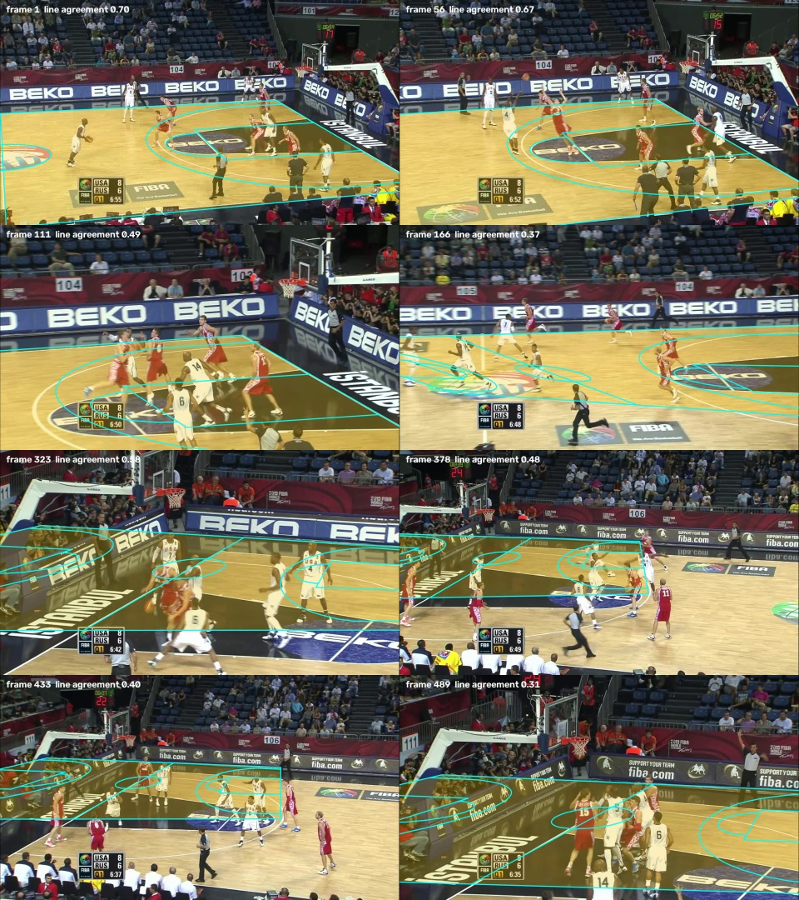

# 009 · Court mask from the court homography, in the tracker

| | |
|---|---|
| **Date** | 2026-10-20 |
| **Builds on** | [003](../003_court_mask_filter/) colour court mask (current default) · chapter 2 [C05](../court/C05_automatic_homographies/): court homographies with no annotation |
| **Question** | Does the exact court (real dimensions, from the homography) make a better tracker filter than the colour polygon — on videos we have **not** tuned anything on? |
| **Clips** | the NCAA clip used so far, plus three validation clips from three new arenas, all FIBA: `v_5ekaksddqrc_c001` (Women's World Cup 2018, Tenerife), `v_BgwzTUxJaeU_c008` (Women's World Cup 2014, Istanbul), `v_4r8QL_wglzQ_c001` (FIBA Asia 2015, Changsha) |

## What was built

* **The single bridge between the chapters**: `src/hooptrack/integrations/court_filter.py`.
  `HomographyCourtFilter` loads `<dir>/<sequence>/homographies.npz` (computed
  beforehand by `scripts/court/auto_homographies.py --edges`), and keeps a
  person if their feet, projected to the court plan, are inside the court
  + 0.25 m. Frames without a homography use the colour mask (003).
* Switch `filters.court_source: colour | homography` (default `colour`: every
  earlier run is reproduced). The pipeline gained one generic hook, `bind(seq)`,
  for filters with per-video data. `tests/court/test_separation.py` still
  passes: the tracker only imports `hooptrack.integrations`.
* **009b · colour guard** (`filters.homography.guard_colour`): if the homography
  would drop a confident person (score ≥ 0.5) whose feet are deep inside the
  colour floor (≥ 25 % of their box height), the homography is distrusted for
  that frame and the colour mask is used. Two independent court estimates must
  agree on the obvious.
* Chapter 2 additions made for this experiment (see C05): line evidence from the
  edges of painted areas (`--edges`), and the conflict rule.
* Detections (yolo26m, same settings as the cache) for the three new clips.
* Tests: `tests/test_court_filter.py` (feet inside / on the line / beyond it,
  fallback, unknown video, switch off, guard).

## Results (motion-only tracker, VM; teams on, referees hidden — the real-time variant of the default)

| Clip | Court found (auto) | Mask | IDF1 | MOTA | IDSW | FP | Misses |
|---|---|---|---|---|---|---|---|
| NCAA 2014 `00HRwkvvjtQ_c001` | ✔ 1,160 / 1,162 frames, 5.8 cm from hand reference | colour | 63.9 | 89.6 | 36 | 501 | 631 |
| | | homography | **64.0** | **89.9** | 36 | **468** | 631 |
| | | + guard | 64.0 | 89.9 | 36 | 468 | 631 |
| FIBA 2018 `5ekaksddqrc_c001` | ½ — right on 1–76, **wrong** on the corner views 401–550 (224 / 550 frames) | colour | 50.9 | 46.4 | 28 | 2,104 | 612 |
| | | homography | 50.5 | 55.0 | 27 | **1,591** | 685 |
| | | + guard | **52.5** | **55.3** | 28 | 1,652 | **607** |
| FIBA 2014 `BgwzTUxJaeU_c008` | ✘ **wrong** on all covered frames (387 / 500) | colour | **44.9** | 41.1 | 32 | 2,360 | 242 |
| | | homography | 36.5 | 40.7 | 34 | 1,123 | 1,495 |
| | | + guard | 41.1 | **52.1** | 36 | 1,510 | 596 |
| FIBA 2015 `4r8QL_wglzQ_c001` | ✘ league mis-picked (NBA), wrong (355 / 886) | colour | **56.0** | **85.4** | 26 | 748 | 419 |
| | | homography | 55.1 | 83.6 | 26 | 741 | 574 |
| | | + guard | 55.9 | 85.3 | 26 | 747 | 432 |

Raw files: [`runs/`](runs/) (motmetrics, summary, timing with the filter's
counters, config; `court_report_*.json` = how each clip's court was found).
HOTA is not computed in the VM.


<sub>Istanbul 2014: the automatic court is confidently wrong — neighbouring candidates made the same mistake and confirmed each other.</sub>

## Reading

1. **Where the court is right, it helps — modestly on the NCAA clip** (−7 % FP;
   the false positives left there are referees, which only the team classifier
   can remove), **clearly on the right half of the Tenerife clip** (−25 % FP).
   The new FIBA arenas show why it matters: the colour mask lets through
   2,100–2,400 false positives there (vs 501 on NCAA) — their floors, aprons and
   courtside areas share colours.
2. **Where the court is wrong, it hurts badly**: it cuts through the floor and
   drops players (Istanbul: misses 242 → 1,495, IDF1 −8.4).
3. **The guard limits the damage but does not remove it**: it rescues most
   wrongly dropped players (1,495 → 596 misses) and keeps part of the FP gain,
   giving the best MOTA on three of four clips; IDF1 is still below the colour
   mask on the two clips where the court is wrong.
4. **The cause is upstream (chapter 2), not in the filter.** On three new
   arenas C05 was right on one view type only. Its safety check — two chains
   from different candidates must agree — proves *consistency*: when
   neighbouring candidates are wrong in the same way, they confirm each other.

## Conclusion

**Negative on unseen arenas, positive where the court is right.** The default
stays `court_source: colour`. The integration (adapter, switch, guard) stays
in the code, ready: the experiment shows the tracker gains as soon as the
court is reliable, and that court registration on new FIBA arenas is the
bottleneck. Next (chapter 2, C06): a learned line / keypoint detector trained
on the homographies that *are* right (NCAA, NBA, the good FIBA views) as free
labels, with a correctness check that does not rely on chain agreement alone.

## Commands

```bash
# 1. court homographies, no annotation (resumable; --budget splits long runs)
python scripts/court/auto_homographies.py --sequence v_5ekaksddqrc_c001 --league auto --edges --out outputs/court_auto_edges
# 2. tracking, three variants (official runs on a laptop: drop the two reid/memory overrides)
hooptrack track --set detector.type=cached detector.cache_dir=outputs/detections/yolo26m "data.only=[v_5ekaksddqrc_c001]" reid.type=none tracker.memory_enabled=false filters.court_source=colour output.dir=outputs/runs/009_5ekaksddqrc_colour --eval
hooptrack track --set ... filters.court_source=homography filters.homography.dir=outputs/court_auto_edges output.dir=outputs/runs/009_5ekaksddqrc_homography --eval
hooptrack track --set ... filters.court_source=homography filters.homography.dir=outputs/court_auto_edges filters.homography.guard_colour=true output.dir=outputs/runs/009_5ekaksddqrc_guard --eval
```
