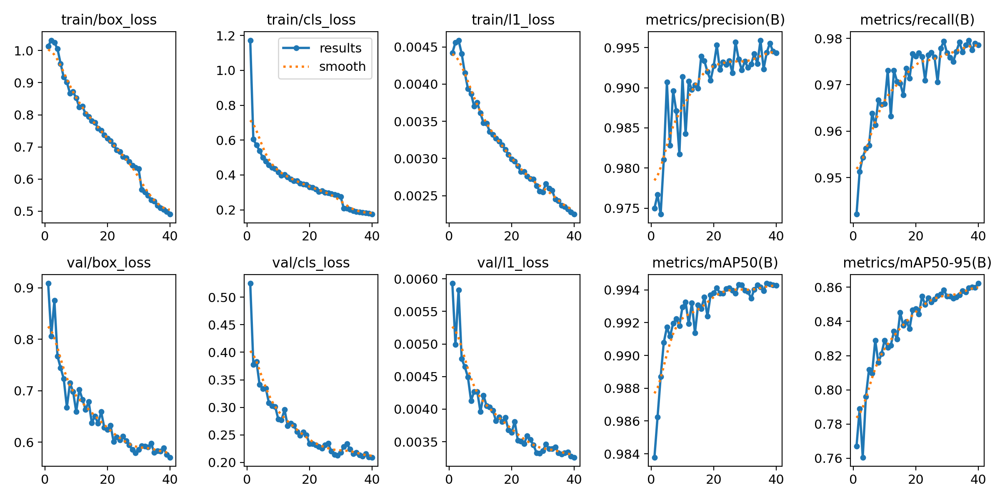
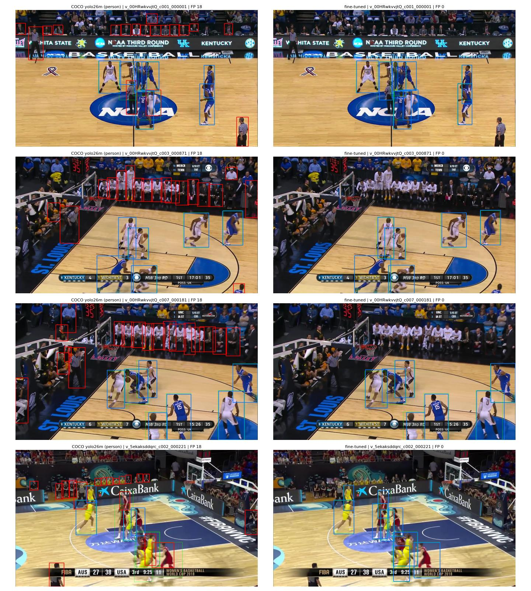

# 011 · A detector that sees players, not people

| | |
|---|---|
| **Date** | 2026-10-24 (detector + tracking on 4 clips) |
| **Builds on** | 010 ([C06](../court/C06_court_segmentation/) court mask in the tracker): +8 IDF1 / +21 MOTA on 4 clips, but referees and bench still reach the tracker, and in Istanbul the referee classifier switches itself off |
| **Question** | If the detector is fine-tuned on SportsMOT (players only), do referees / bench / crowd disappear at the source, also in arenas it has never seen? |

## Idea

The COCO detector's class 0 is *person*: everyone is detected, and experiments
003, 006 and C06 remove the non-players afterwards with rules. Every strong
tracker on SportsMOT instead fine-tunes the detector on SportsMOT (Deep-EIoU:
YOLOX-X, MOTA ≈ 96 without any court mask). SportsMOT labels only the ten
players, so referees and bench are *background* during training: the detector
learns the annotation policy from the whole image.

The new detector keeps class index 0, so the rest of the pipeline does not change:
only `detector.weights` does.

## Data and splits

`scripts/build_player_dataset.py` → `data/player_det.zip`:

| split | clips | frames | role |
|---|---|---|---|
| train | 12 SportsMOT train clips (3 games) | 1 in 3 | learning |
| val | 3 held-out train clips, one per game | 1 in 3 | best epoch (same arenas) |
| test | 15 SportsMOT val clips (4 other games) | 1 in 10 | final check, unseen arenas |

SportsMOT val is where tracking is measured, so it never influences training.
Limitation: only 3 training arenas.

## How to run

1. `python scripts/build_player_dataset.py`, then upload `data/player_det.zip` to `MyDrive/hooptrack/`.
2. Open [`notebooks/colab_train_player_detector.ipynb`](../../notebooks/colab_train_player_detector.ipynb) in Google Colab (T4 GPU) and run all cells. It runs YOLO26m at 1280 px for ~40 epochs (~2–3 h), resumable from Drive. It reports COCO vs fine-tuned mAP on val/test, false positives and misses per frame at the tracker's threshold, and side-by-side images.
3. Put `best.pt` in `weights/Player_detector.pt` and measure it in the tracker (same clips and script as 010, only the detector changes):

```powershell
python scripts/run_court_source_eval.py --set detector.weights=weights/Player_detector.pt `
    --cache-dir outputs/detections/yolo26m_player --out outputs/runs/011_player_detector `
    --variants colour segmentation `
    --clips v_00HRwkvvjtQ_c005 v_5ekaksddqrc_c002 v_BgwzTUxJaeU_c012 v_4r8QL_wglzQ_c001
```

## Results

### Training (Colab T4, YOLO26m, 1280 px, 40 epochs, batch 4 after an out-of-memory at 8, ~8.5 min/epoch)



Val mAP50-95 rises from 0.77 (epoch 1) to 0.86 (epoch 40) and is still creeping up; train and val box loss fall together, with no sign of overfitting. The val split comes from the training games, so these curves measure fitting. The test split below measures generalisation.

### Detection quality (`eval_011.json`)

| Detector | split | P | R | mAP50 | mAP50-95 |
|---|---|---|---|---|---|
| COCO yolo26m (*person*) | val (training games) | 0.623 | 0.705 | 0.617 | 0.473 |
| fine-tuned *player* | val (training games) | 0.994 | 0.979 | 0.994 | 0.862 |
| COCO yolo26m (*person*) | **test (4 unseen games)** | 0.729 | 0.774 | 0.783 | 0.631 |
| fine-tuned *player* | **test (4 unseen games)** | **0.983** | **0.981** | **0.992** | **0.855** |

What the tracker sees: test frames, score ≥ 0.5 (the tracker's `high_thresh`):

| Detector | false positives / frame | missed players / frame | precision | recall |
|---|---|---|---|---|
| COCO yolo26m | 8.44 | 0.81 | 0.506 | 0.915 |
| fine-tuned | **0.17** | **0.19** | **0.982** | **0.980** |

**The detector generalises to arenas it has never seen**: test is as good as val (mAP50-95 0.855 vs 0.862). False positives drop **50×** (8.4 → 0.17 per frame), and it also misses **4× fewer** players (0.81 → 0.19 per frame: occluded players in a crowd). Referees, bench, coaches and crowd are simply not detected; no rule is needed.


<sub>Test frames (unseen games). Left COCO, right fine-tuned. Blue = player found, red = false positive, thin green = ground truth. The referees (striped shirts) and the benches are detected by COCO and ignored by the fine-tuned model.</sub>

### Tracking

Same 4 clips (one per validation arena) and same tracker as 010 ([C06](../court/C06_court_segmentation/#in-the-tracker-one-clip-per-validation-arena-only-the-court-mask-changes));
only `detector.weights` changes. OVERALL = metrics recomputed on the 4 clips together.

| Detector | Court mask | IDF1 | MOTA | IDSW | FP | Misses |
|---|---|---|---|---|---|---|
| COCO (010) | colour (old default) | 45.0 | 55.6 | 107 | 6897 | 4169 |
| COCO (010) | segmentation C06 | 53.1 | 76.8 | 107 | 3989 | 1732 |
| **player (011)** | colour | 71.8 | 90.8 | 65 | 312 | 1930 |
| **player (011)** | **segmentation C06** | **73.7** | **93.6** | **50** | 324 | **1226** |

Per clip, IDF1 / MOTA (COCO + colour → player + segmentation):

| Clip | Arena | before | after |
|---|---|---|---|
| `v_00HRwkvvjtQ_c005` | NCAA | 50.5 / 64.7 | 64.2 / 84.5 |
| `v_5ekaksddqrc_c002` | FIBA Tenerife | 35.2 / 54.8 | 69.2 / 97.8 |
| `v_BgwzTUxJaeU_c012` | FIBA Istanbul | 35.1 / 5.2 | 69.5 / 93.1 |
| `v_4r8QL_wglzQ_c001` | FIBA Changsha | 55.7 / 85.8 | 85.5 / 97.2 |

* **False positives fall 21×** (6897 → 324): referees, bench and crowd no longer reach the tracker.
* **ID switches halve** (107 → 50), although the association was not touched. With fewer people
  in the image there are fewer wrong candidates for each track.
* **The C06 mask still helps** on top of the new detector (+1.9 IDF1, −704 misses). The colour mask
  now *removes real players* (Tenerife: 650 misses with colour, 64 with C06).
* **Misses in NCAA (787).** 634 of them are players the detector *did* find but the tracker does
  not output. Two players (GT ids 4 and 7) are missing for ~half the clip. Suspect: the referee
  classifier (006) still runs. It splits the people into 3 colour groups and hides the smallest one
  ("referees"), but with a players-only detector there are no referees left, so a group of real
  players gets hidden.

### 011b · without the referee filter (`tracker.suppress_other=false`)

Same detections, same C06 mask; only the 006 referee suppression is switched off.

| | IDF1 | MOTA | IDSW | FP | Misses |
|---|---|---|---|---|---|
| 011 (player + C06, referee filter on) | 73.7 | 93.6 | 50 | 324 | 1226 |
| **011b (player + C06, referee filter off)** | **74.6** | **96.0** | **49** | 397 | **551** |

Per clip, IDF1 / MOTA / misses (011 → 011b):

| Clip | 011 | 011b |
|---|---|---|
| NCAA c005 | 64.2 / 84.5 / 787 | **68.9 / 95.8 / 139** |
| Tenerife c002 | 69.2 / 97.8 / 64 | 69.1 / 97.6 / 64 |
| Istanbul c012 | 69.5 / 93.1 / 268 | 69.5 / 93.0 / 259 |
| Changsha c001 | 85.5 / 97.2 / 107 | 85.6 / 97.3 / 89 |

**Confirmed.** Without the filter, NCAA recovers the hidden players (misses 787 → 139, MOTA +11)
and the other arenas do not change. False positives rise only by 73 (+0.03 per frame). The referee
classifier was a fix for the COCO detector; with a players-only detector it does harm.
It stays available behind its switch.

The configuration is saved as [`configs/player.yaml`](../../configs/player.yaml):
`hooptrack track --config configs/player.yaml --eval` (needs `weights/Player_detector.pt`).

**Best configuration so far:** player detector + C06 court mask + no referee filter. On the 4
validation arenas, from the old default (COCO + colour + referee filter): **IDF1 45.0 → 74.6,
MOTA 55.6 → 96.0, ID switches 107 → 49, false positives 6897 → 397.**

The remaining problem is identity: 17–21 identities are still created for 10 players, and
crossings still swap IDs. That is the ReID's job (next: OSNet fine-tuned on SportsMOT crops).
