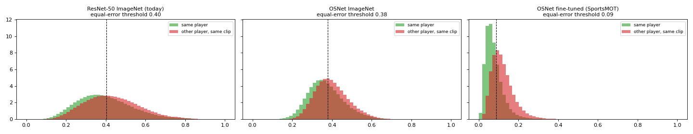
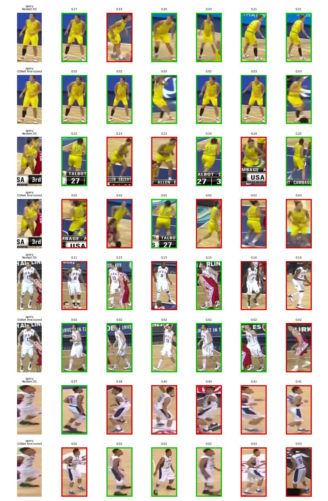

# 012 · A ReID model that tells team-mates apart (OSNet fine-tuned on SportsMOT)

| | |
|---|---|
| **Date** | 2026-10-24 → 26 (model trained; first tracking test: neutral) |
| **Builds on** | [011b](../011_player_detector/): players-only detector + C06 court mask, IDF1 74.6, MOTA 96.0 on 4 validation arenas. The detections are now right, but identities are not: 17–21 identities for 10 players, and swaps in crossings |
| **Question** | Does an appearance model trained on players (instead of ImageNet ResNet-50) keep identities through crossings and re-entries? |

## Idea

The tracker's appearance vector comes from ResNet-50 trained on ImageNet: for it, two
team-mates are "a person in a white shirt". Deep-EIoU, the reference tracker on SportsMOT,
uses OSNet fine-tuned on SportsMOT player crops (+3.9 HOTA in its ablation). OSNet is
built for re-identification (features at several scales at once) and is 11× smaller than
ResNet-50, so it is also faster on CPU.

Training uses an identity loss (cross-entropy over the training players) plus a batch-hard
triplet loss. Batches are 16 players × 4 crops **from the same clip**, so the hardest
negatives are team-mates.

## Data and evaluation

`scripts/build_reid_dataset.py` → `data/reid_players.zip`, crops resized to 128×256:

| split | clips | frames | role |
|---|---|---|---|
| train | 15 SportsMOT train clips (3 games) | 1 in 3 | learning |
| test | 15 SportsMOT val clips (4 other games) | 1 in 5 | final numbers only |

There is no validation split and no best-epoch selection. The recipe (60 epochs, Adam 3e-4,
step decay) is fixed in advance from Deep-EIoU, so nothing is tuned on the test arenas.

Test protocol = the tracker's situation: a query crop is searched among the crops of **the
same clip** (team-mates included) taken **≥ 2 s away**. Adjacent frames would make the task
trivial, which is the weakness of the older `scripts/export_reid_crops.py` split. Reported:
rank-1, mAP, and the distance distributions (same player vs other player). The tracker's
thresholds (`appearance_gate`, `memory_thresh`) were set for ResNet-50 and are recalibrated
from these distributions.

## How to run

1. `python scripts/build_reid_dataset.py`, then upload `data/reid_players.zip` to `MyDrive/hooptrack/`.
2. Run [`notebooks/colab_train_reid_osnet.ipynb`](../../notebooks/colab_train_reid_osnet.ipynb) in Colab (T4, ~1 h, resumable).
3. Put `osnet_x1_0_sportsmot.pth` in `weights/`, run `pip install torchreid gdown`, then measure it in the tracker with the 011b configuration, changing only the ReID model:

```powershell
python scripts/calibrate_reid.py --config configs/player.yaml --set reid.type=osnet reid.weights=weights/osnet_x1_0_sportsmot.pth
python scripts/run_court_source_eval.py --config configs/player.yaml `
    --set reid.type=osnet reid.weights=weights/osnet_x1_0_sportsmot.pth tracker.appearance_gate=0.157 tracker.memory_thresh=0.056 `
    --out outputs/runs/012_reid_osnet_calibrated --variants segmentation `
    --clips v_00HRwkvvjtQ_c005 v_5ekaksddqrc_c002 v_BgwzTUxJaeU_c012 v_4r8QL_wglzQ_c001
```

## Results

### The model: much better at telling players apart

Retrieval on the 4 unseen arenas (`eval_012.json`; query vs crops of the same clip ≥ 2 s away, team-mates included):

| Model | Rank-1 | mAP |
|---|---|---|
| ResNet-50 ImageNet (the tracker's ReID until now) | 0.42 | 0.19 |
| OSNet ImageNet (no ReID training) | 0.41 | 0.19 |
| **OSNet fine-tuned on SportsMOT** | **0.71** | **0.41** |

 

### Thresholds: each model has its own scale

Calibration on the **train** split (`scripts/calibrate_reid.py`, same pairs for both models):

| Cosine distance | ResNet-50 | OSNet fine-tuned |
|---|---|---|
| same player ≥ 1.2 s apart, median | 0.413 | **0.037** |
| same player, p95 → `appearance_gate` | 0.634 | 0.157 |
| closest *other* player, median | **0.249** | 0.159 |
| closest other player, p1 → `memory_thresh` | 0.125 | 0.056 |

ResNet puts the closest team-mate **nearer** than the same player a second later; OSNet puts the same
player 4× nearer than anyone else. With ResNet's thresholds (`appearance_gate` 0.35, `memory_thresh`
0.25) OSNet's gate rejects nothing and the memory accepts anyone, so the thresholds are part of the
model: run with OSNet's calibrated values. Caveat: OSNet was trained on these train clips, so its train
distances are optimistic (same-player median 0.037 on train vs 0.067 on the unseen arenas).

> A first run read the COCO detections by mistake (the evaluation script's default cache folder). Its
> numbers are discarded; the script now takes the cache from the config and checks which detector made it.

### In the tracker (4 arenas, only the ReID model and its thresholds change)

| | IDF1 | MOTA | ID switches | Frag | Identities per clip |
|---|---|---|---|---|---|
| 011b · ResNet-50 | **74.6** | 96.0 | 49 | 95 | 17–21 |
| 012 · OSNet fine-tuned, calibrated | 72.9 | 96.1 | 47 | 98 | 18–22 |

Per clip IDF1 (011b → 012): NCAA 68.9 → 65.4 · Tenerife 69.1 → 68.4 · Istanbul 69.5 → 71.1 · Changsha 85.6 → 82.2.
ReID time 0.65 → 5.4–6.0 s per frame on the laptop CPU.

**Neutral.** A ReID model twice as good at retrieval does not change the tracking. Every change of
identity of every ground-truth player was classified (`outputs/_review/idbreaks.py`, same for both runs):

| Identity break | 011b | 012 |
|---|---|---|
| id changes while the player is visible (swap or split, gap ≤ 2 frames) | 30 | 30 |
| player returns to an id he had before (swap and swap back) | 31 | 32 |
| new id after being lost ≤ 60 frames (Kalman re-acquisition) | 18 | 19 |
| new id after being lost > 60 frames (the memory's job) | 13 | 13 |

Why the appearance model cannot act on them:

1. **Two thirds of the breaks happen while the player is visible, mostly in crossings.** By design (005), a detection that overlaps
   another player gets **no appearance** (its crop mixes two people) and is matched by motion alone. So
   the ReID model is switched off exactly where the swaps happen, whichever model it is.
2. **The memory never revives anyone** (0 revivals in 012, 0–1 in 011b). With OSNet a revival needs a
   distance < 0.056 and a 0.05 lead over the second-best identity. On unseen games the same player is at
   ~0.067, and 0.05 is about the whole distance between the same player and a team-mate on OSNet's scale.
3. In the fused cost, OSNet's distances (0.04 vs 0.16) move the cost by a few hundredths, while motion
   (1 − IoU) spans 0–1.

**Conclusion.** The bottleneck is no longer the embedding but how the tracker uses it: no appearance
inside crossings, no correction when the players separate, and a memory gated on another model's
scale. Next steps, one at a time: appearance check when an occlusion ends (swap repair), memory
thresholds and margin on OSNet's scale, and offline tracklet stitching by appearance (as GTA does on
top of Deep-EIoU). The OSNet CPU time (8× ResNet) also needs a look.
