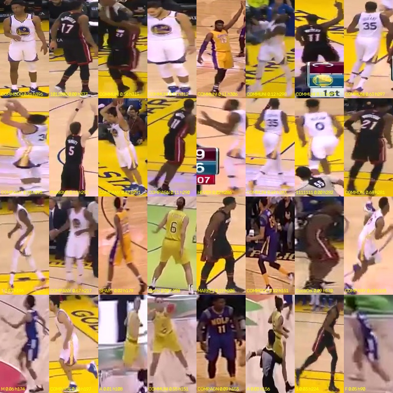

# 022 · Can jersey numbers be read without training? (feasibility)

| | |
|---|---|
| **Date** | 2026-10-28 · **negative for zero-shot**: a pretrained text recogniser reads almost nothing |
| **Builds on** | 021: what is left after 020 is the team-mate problem (wrong joins between team-mates, team-mate swaps), and appearance does not separate team-mates (AUC ~0.71) |
| **Question** | Before building anything on jersey numbers: can an off-the-shelf recogniser read them in SportsMOT crops, with no labels? |

## Protocol

Train split, clean ground-truth boxes ≥ 50 px tall, one frame in 5 (10,722 crops, median height 174 px). PARSeq
(Bautista & Atienza 2022, scene-text recognition, official weights) reads the upper body. With no number annotation,
quality is judged by consistency along each ground-truth player. Review scripts: `outputs/_review/jersey/`.

| crop and decoding | reads with confidence ≥ 0.5 / 0.7 | what comes out |
|---|---|---|
| upper body (10–50 % of the height), free text | – | words: COMPAGNE, COMMUNITY, COMPANY... (the language prior wins) |
| number area only (15–48 % height, 22–78 % width), **digits only** (other characters masked) | 2 % / 0.3 % of crops (3 clips) | mostly a lone "1", the same on different players |

## Reading

The numbers **are in the pixels**: in the contact sheet below many are readable by eye (17, 35, 11, 5, 21, 6...). A
generic text recogniser is not the right tool. It is trained on words in scenes, at a different scale, without folds,
motion blur or partial views. The published jersey-number pipelines (e.g. the SoccerNet jersey challenge) all add a
legibility classifier and a recogniser **fine-tuned on jersey crops**.

## Conclusion

Zero-shot reading is not usable. Jersey numbers need a model trained on jersey crops, so the next step needs a decision:
labelled jersey data (public dataset or a few hundred own labels), a larger vision-language model (slower, offline only),
or both.
