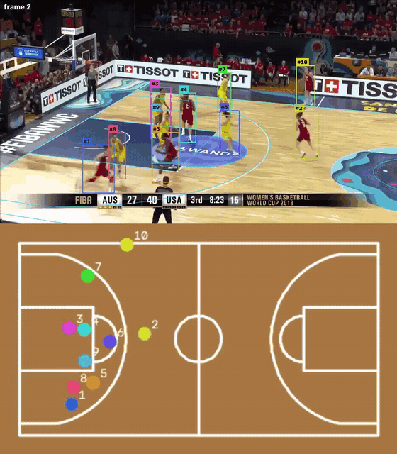

# 034 · Players on the court, in metres, and what the court can tell about the swaps

| | |
|---|---|
| **Date** | 2026-11-03 |
| **Builds on** | [029](../029_stitch_siglip_reid/) best run · court chapter: [C07](../court/C07_clip_camera/) clip camera, [C08](../court/C08_topdown_map/) top-down map, [C09](../court/C09_learned_keypoints/) learned keypoints |
| **Question** | (1) Can every validation clip be followed on the court plan, in metres? (2) Before changing the tracker: when two players swap ids, are they apart on the court, so that associating in metres could keep them apart? |
| **Clips** | all 15 validation clips (8.4 min) |

## What was done

1. **A court for every clip.** The 9 validation clips that had none got one with the C09 pipeline, with no
   annotation: only the court type, given by a person from one frame per clip (NCAA, FIBA, FIBA before 2010; each
   clip comes from the same game as one of the 6 clips that already had a court). C07 accepted all 9
   (`scripts/court/c09_pipeline.ps1 -CourtOnly`), and the projected lines were checked on one frame per clip.
2. **The map of the best run (029)** on the 15 clips: `hooptrack map` now also reads stitched runs.
3. **Diagnosis** ([`scripts/court_crossings.py`](../../scripts/court_crossings.py)), on the ground truth, with no
   change to the tracker:
   * every **crossing episode** (two players whose boxes overlap, the tracker's 20 % coverage rule, in consecutive
     frames) gets the smallest real distance between the two players' feet on the court, the share of frames where
     the feet of the player behind are hidden by the other, and whether 029 swapped those two players during it
     or within 1 s after it;
   * the **position error** of 029's boxes on the court against the ground-truth boxes, for free players and for
     players overlapping another one.

The tracker and the court code still do not import each other: the projection goes through
`hooptrack.integrations.topdown`, as in C08.

## Results

### 1 · The map

Court on **97–100 %** of the frames of every clip. Per clip ([`map_stats.csv`](map_stats.csv)): 11–14 identities,
10–11 of them on the court for more than half the clip; speeds of those (median over clips) 2.1 m/s mean and
5.4 m/s at the 95th percentile, the expected range for basketball.

<div align="center">

<br><sub>029 on a FIBA clip with a median number of switches (33 / min), first 12 s. ▶ <a href="../../assets/034/map_029_fiba_c003.mp4">20 s in full quality</a></sub>
</div>

### 2 · How far apart the swapped players really were

1,775 crossing episodes on the 15 clips; 85 end in a swap (and 37 swap records involve two players whose boxes
never overlapped: fragments and re-entries, not crossings).
[`swap_rate_by_distance.csv`](swap_rate_by_distance.csv)

| smallest distance on the court during the crossing | episodes | with a swap | swap rate | share of the swaps | feet of the player behind hidden |
|---|---|---|---|---|---|
| < 0.5 m | 225 | 53 | **23.6 %** | **62 %** | 66 % of the frames |
| 0.5 – 1 m | 358 | 18 | 5.0 % | 21 % | 51 % |
| 1 – 2 m | 430 | 10 | 2.3 % | 12 % | 60 % |
| 2 – 3 m | 327 | 2 | 0.6 % | 2 % | 72 % |
| > 3 m | 428 | 2 | 0.5 % | 2 % | 89 % |

On **12 of 15 clips** most swap episodes are between players less than 0.5 m apart ([`per_clip.csv`](per_clip.csv)).

### 3 · Position error of the run's boxes on the court

Median over clips: **5 cm** (p90 15 cm) for a free player, **8 cm** (p90 27 cm) for a player overlapping another
one; worst clip at crossings: p90 48 cm (FIBA 2010 c008).

## Reading

1. **Following the players on the court works on every clip**, with no annotation besides the court type: the
   project now gives positions in metres, distances and speeds for every validation clip.
2. **The swaps happen where the court cannot help.** Almost two thirds of them are between players less than half
   a metre apart on the court (body contact: screens, post-ups, a defender on his man). There, the two positions
   are as close as the error of the boxes at crossings (p90 27 cm), and the feet of the player behind are hidden
   two thirds of the time, so his box bottom is not where he stands. In metres they are as inseparable as in the
   image.
3. **Where the players are apart, the tracker already keeps them apart**: above 1 m, more than 97 % of the crossings
   end without a swap. A tracker that associates in metres could at most act on the 0.5–2 m band (28 swap
   episodes out of 85, a third), where it would have to beat what appearance already does.
4. **The map inherits the identity errors**: the statistics are per *identity*, and an identity that swapped
   carries two players' runs. Per-player statistics need the swaps solved first.

## Conclusion

**Positive for the map, negative for the tracker.** Tracking in court coordinates is integrated as an output
(`hooptrack map` on any run, all 15 validation clips). As an input to the association, the diagnosis says it can
reach at most a third of the swaps, at the price of a second motion model; it is **not built**. A cheap, offline
use remains open: refusing stitching joins that would need an impossible speed in m/s instead of a jump in pixels.

## Commands

```powershell
# court of the 9 clips that had none (court type given per clip)
powershell -File scripts/court/c09_pipeline.ps1 -CourtOnly -Clips "v_00HRwkvvjtQ_c003=NCAA,v_00HRwkvvjtQ_c007=NCAA,v_00HRwkvvjtQ_c008=NCAA,v_00HRwkvvjtQ_c011=NCAA,v_5ekaksddqrc_c001=FIBA,v_5ekaksddqrc_c002=FIBA,v_5ekaksddqrc_c004=FIBA,v_5ekaksddqrc_c005=FIBA,v_BgwzTUxJaeU_c014=FIBA_PRE2010"
# diagnosis
.venv/Scripts/python scripts/court_crossings.py --config configs/player.yaml --run outputs/runs/029_siglip_ft `
    --court-dir outputs/court_complete/c09_pipeline --out outputs/runs/034_court_crossings
# map of 029, with videos
.venv/Scripts/python -m hooptrack.cli map --config configs/player.yaml --run outputs/runs/029_siglip_ft `
    --set topdown.dir=outputs/court_complete/c09_pipeline --video
```
