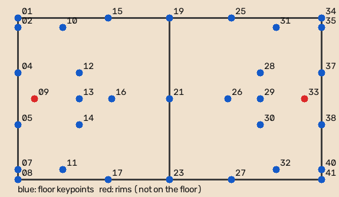
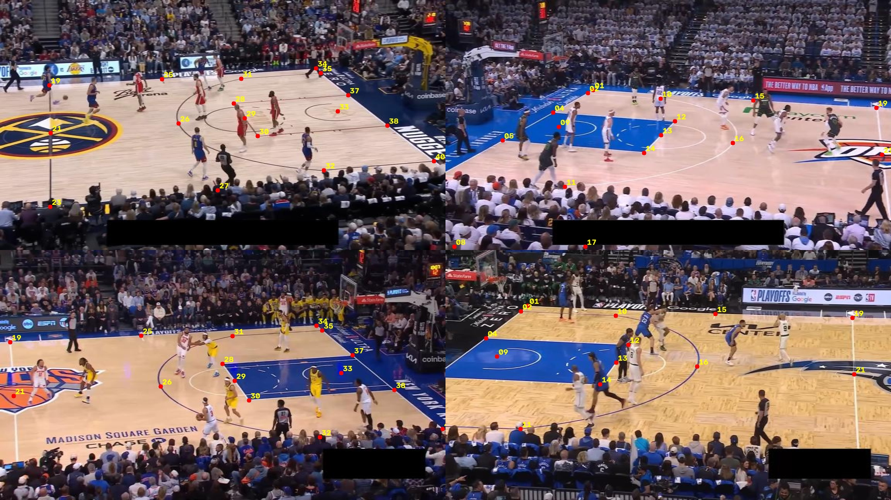
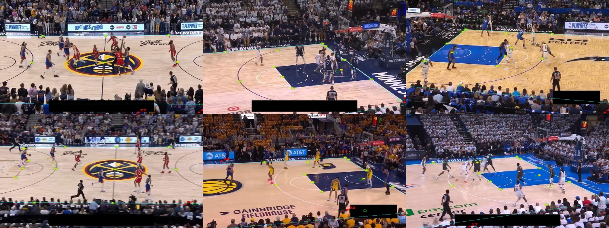

# C01 · Court-keypoint dataset audit

| | |
|---|---|
| **Date** | 2026-10-19 |
| **Chapter** | [Court geometry](../) — first step |
| **Question** | Is there a public dataset we can train a court-keypoint detector on, and can we trust its labels? |

## Dataset

**Dataset:** [`roboflow-jvuqo/basketball-court-detection-2`](https://universe.roboflow.com/roboflow-jvuqo/basketball-court-detection-2),
version 22, COCO export, **CC BY 4.0** (reuse with attribution). 850 frames of
2025 NBA playoff broadcasts, one "court" object per image with 33 named keypoints.
Stored in `data/court_keypoints/v22_coco/` (not committed).

Audit script: `python scripts/court/audit_dataset.py` → [`audit.json`](audit.json).

### The template: what each keypoint means

The dataset ships keypoint *names* (01 … 41, with gaps) but not their *positions*
on the court. They were derived from the official NBA dimensions and written
in `src/hooptrack/court/template.py` (metres; x along the court from the left
baseline, y across from the far sideline):

**Verification on all 850 images:** fit a homography per image (template → labels,
RANSAC) and measure how far each label is from where the template says it should be.

| Keypoints | Median error | Reading |
|---|---|---|
| Corners, baselines, lane, free-throw line, midcourt (29 points) | **0.6 – 2.9 px** (576 px images) | Template correct, labels consistent |
| `09`, `33` (rims) | 9.3 – 9.4 px, constant | Not on the floor (3.05 m up): kept as labels, **excluded from homographies** |

A homography that explains 29 points to ~1–2 px in 850 different frames means the
template is right; a wrong position would show a large, systematic error.

### Problems found (and what we do about them)

| Problem | Evidence | Decision |
|---|---|---|
| **Split leakage** — Roboflow splits frames at random | 16 of 19 validation games and 17 of 19 test games also appear in train | New split **by game** (deterministic, saved in `audit.json`): 609 / 115 / 126 images, no shared game |
| **Clamped labels** — near-side points hidden below the frame or behind the blacked-out score bar were placed on the image border | 97 labels (0.9 %) in 79 images with error > 15 px, none outside the image | Drop those labels (visibility = 0) when converting for training; the other labels of the image stay |
| **Stretched images** — 16:9 frames resized to 576 × 576 | all images 576 × 576 | Restore the 16:9 aspect (1024 × 576) when converting, so the model sees what SportsMOT looks like |
| **Score bar blacked out** | black rectangle at the bottom of every frame | Nothing: a useful augmentation against SportsMOT's score bars |
| **NBA only** | team names in every file | Lane width and 3-pt distance differ in NCAA/FIBA. Corners, baselines, sidelines and midcourt are the same court lines; step 3 will fit a template per league and keep only points that agree |

Yellow: labels · green circles: where the per-image homography puts them · cyan: projected court outline · red: labels flagged as clamped (on the image border instead of their true off-screen position).

## Conclusion

**Usable, after three fixes applied at conversion time (C02):** game-level split,
clamped labels dropped, 16:9 aspect restored. The template is correct for NBA
courts; other leagues are handled in C03.
