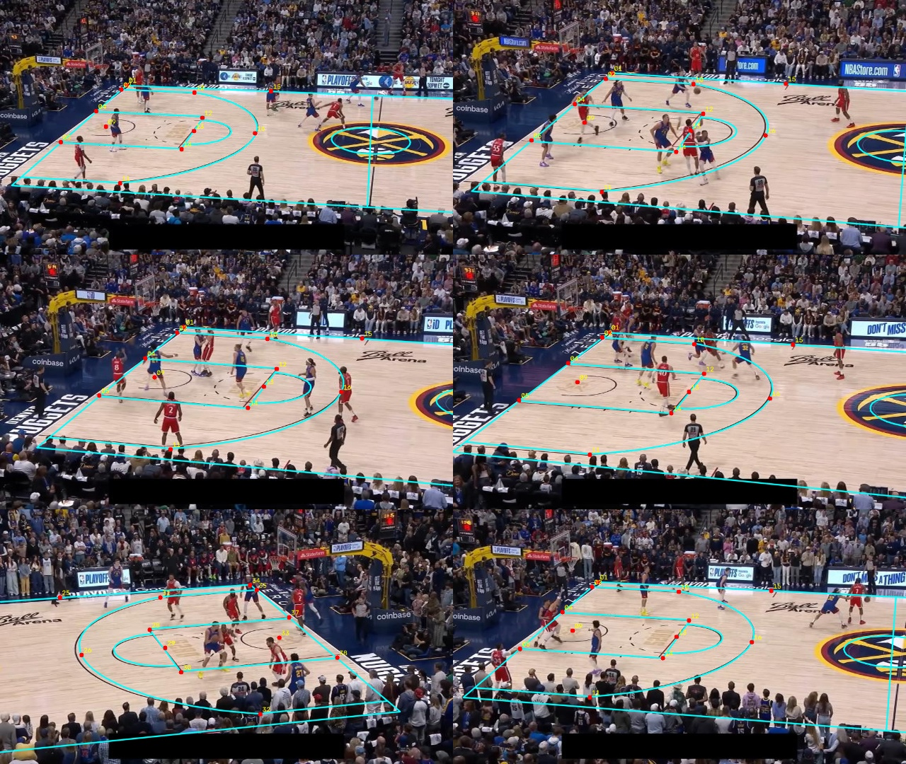
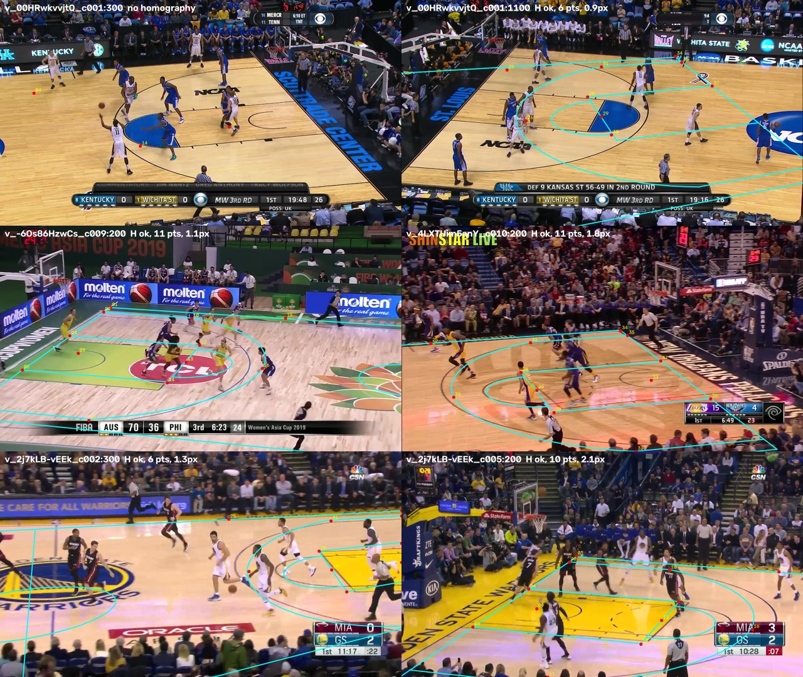

# C02 · Court-keypoint detector (YOLO26-pose, CPU)

| | |
|---|---|
| **Date** | 2026-10-19 |
| **Builds on** | [C01](../C01_dataset_audit/) — dataset audited, template verified |
| **Question** | Can a small keypoint model trained on CPU in < 3 h find the 33 court points well enough to compute a homography — first on NBA frames, then on SportsMOT? |

## Data (C01 fixes applied)

`python scripts/court/convert_to_yolo.py` → `data/court_keypoints/yolo_v22/` (not committed)

| Split (by game) | Images |
|---|---|
| train | 609 |
| val | 115 |
| test | 126 |

97 clamped labels set to "not labelled"; frames restored to 1024 × 576;
`flip_idx` computed from the template and cross-checked against the dataset's own flip pairs.

## Training

`python scripts/court/train_keypoints.py` — settings and their reasons are in the script docstring:
`yolo26n-pose.pt` (COCO-pretrained), `imgsz 640`, CPU, **time budget 2.75 h** (the
learning-rate schedule is fitted to the budget), early stopping (patience 20),
no mosaic, horizontal flip with `flip_idx`, no vertical flip or rotation.

Run on the laptop CPU: **27 epochs in 3 h 01 min** (budget 3 h), ~6.8 min per epoch.
Best epoch 24: pose mAP50-95 0.73 on the validation games.

## Results

### 1. NBA test split — 126 frames of games never seen in training

`python scripts/court/eval_keypoints.py --weights outputs/court_runs/c02_yolo26n_pose/weights/best.pt` → [`eval_test.json`](eval_test.json)

| Metric | Value |
|---|---|
| Labelled keypoints found (conf ≥ 0.5) | 82.5 % |
| Keypoint error on the court (median / p90) | **0.24 m** / 0.54 m |
| Homography from predictions: images with one | 115 / 126 |
| Homography error on the court (median / p90 per image) | **0.27 m** / 0.53 m |
| Images with a usable homography (< 0.5 m) | **81 %** |

Cyan: the whole NBA court drawn through the homography fitted on the predicted points (red) only.

On the kind of footage it was trained on, the detector does the job: a quarter of
a metre is less than a player's footprint.

### 2. SportsMOT — the footage we actually need (no labels: visual check)

| Frame | League / arena | What happens |
|---|---|---|
| `v_00HRwkvvjtQ_c001:300` | NCAA 2014 (our demo clip) | 3 points found — no homography |
| `v_00HRwkvvjtQ_c001:1100` | NCAA 2014 | Homography "found" from 6 points, but the court does not match the lines |
| `v_-6Os86HzwCs_c009:200` | FIBA 2019 | 11 points, partial fit: the FIBA lane and 3-pt line are not the NBA ones |
| `v_4LXTUim5anY_c010:200` | NBA 2016 | Roughly right near the baseline, off further away |
| `v_2j7kLB-vEEk_c002:300` | NBA 2016, Golden State | Wrong |
| `v_2j7kLB-vEEk_c005:200` | NBA 2016, Golden State | Lane roughly right, rest off |

**It does not transfer.** The gap between the public data (2025 NBA playoff
broadcasts, one camera style, score bar blacked out) and SportsMOT (2014–2019,
NCAA / FIBA / NBA, other cameras and court designs) is too large for 609 images.

**A second lesson: the reprojection error is not a quality signal.** With 6
points RANSAC fits *some* homography almost exactly (0.9 px) even when it is
wrong. A homography needs an independent check before it is trusted (C05):
enough inliers spread over the image, a plausible camera, and above all
**projected court lines landing on painted lines in the image**.

## Conclusion

**Partly confirmed.** A 3.8 M-parameter model trained on CPU in 3 h localises
court keypoints to ~0.25 m on unseen games of the same broadcast style. It does
**not** generalise to SportsMOT's leagues and cameras — which was the purpose
of steps C03 (league templates) and C04 (SportsMOT labels). C04 cannot rely on
this model's raw predictions alone; it needs a way to turn a rough homography
into an exact one (see the chapter plan).
