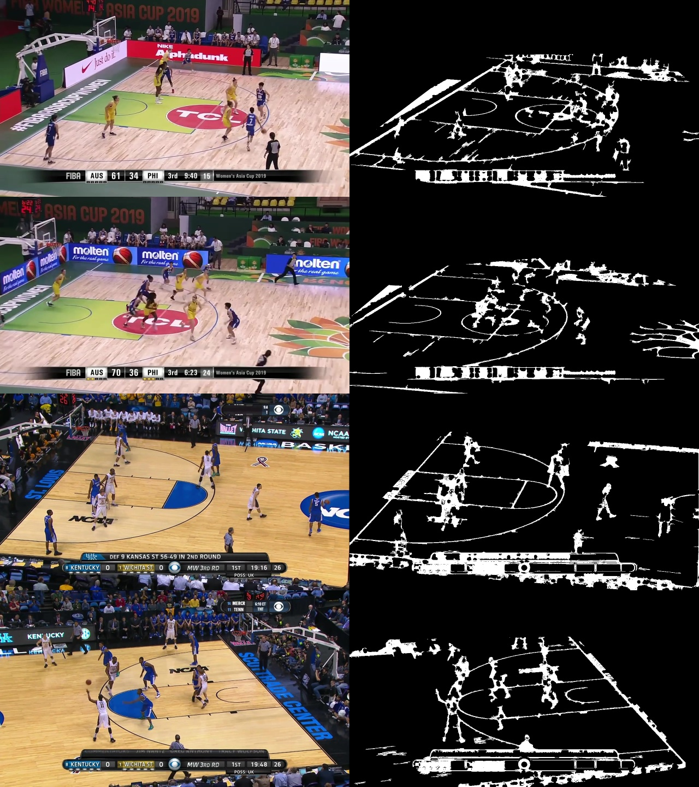
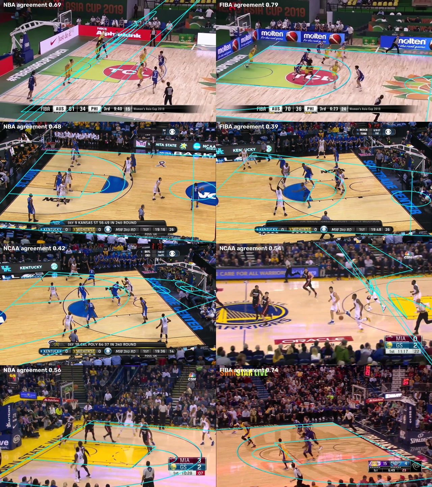
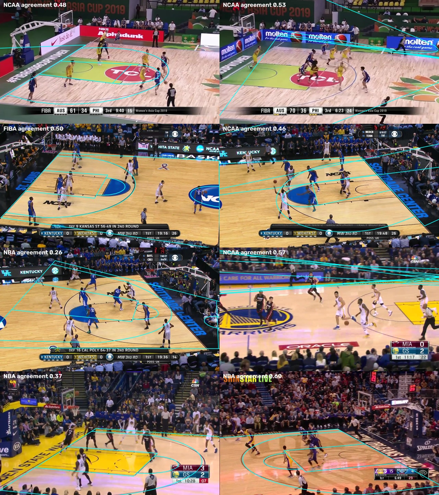

# C03 · League templates and line-based refinement

| | |
|---|---|
| **Date** | 2026-10-19 |
| **Builds on** | [C02](../C02_keypoint_detector/) — keypoints good on NBA test frames (0.27 m), poor on SportsMOT |
| **Question** | Can the painted lines turn a rough keypoint homography into an exact one, in any league — and tell us when a homography is wrong? |

## What was built

| Module | What it does |
|---|---|
| `court/leagues.py` | `CourtSpec` (9 official dimensions) → the 33 keypoints and all painted lines. Specs for **NBA, FIBA, NCAA (pre-2019)**. The NBA spec reproduces the C01-verified template within 6 cm. |
| `court/refine.py` | Line evidence (thin bright/dark strokes on the floor, elongated components only), distance map, **direction-aware agreement score**, and a homography refinement that moves 4 control points (8 pixel parameters) to minimise a truncated chamfer distance, coarse to fine. |

Tests (`tests/court/test_leagues_refine.py`): the specs differ where the rules say
they differ, and on a synthetic court a homography perturbed by ~15 px is
recovered (agreement 0.9 × the true one).

Line evidence on SportsMOT frames: the court lines come out clearly, together with players, logos and the score bar.

## First results on 8 SportsMOT frames (prototype)

**Attempt 1** — one initial homography per league (C02 keypoints), refined, best agreement wins:

The FIBA frame (top right) is fitted correctly *and* recognised as FIBA (agreement 0.79
vs 0.56 NBA, 0.57 NCAA). Every other frame stays wrong: the starting homography is
too far off for a local refinement, and wrong fits still reach 0.5–0.7 agreement.

**Attempt 2** — many initial homographies (keypoint subsets × RANSAC thresholds ×
leagues) and a score that also requires the painted line to run in the same
direction as the projected one:

Worse: more starting points means more wrong fits that happen to line up with a
few strong edges (ad boards, the score bar), and the score cannot separate them
from the right one — the FIBA frame is now fitted wrongly.

## What this shows so far

- Line refinement **works when the start is close** (synthetic test, FIBA frame):
  it is the right tool to polish a homography and to pick the league.
- It **cannot replace a decent start**. Courts are full of parallel lines and
  arcs; a local search from a wrong start converges to a wrong alignment.
- The agreement score, as built, is **not yet a reliable quality signal** on its
  own (wrong fits up to 0.6).

The bottleneck is the starting point on SportsMOT footage, i.e. keypoints from
SportsMOT's own domain.

## Conclusion

**Partly confirmed.** Line refinement and the league templates are kept: they
are what makes [C04](../C04_anchor_homographies/) work (hand anchors give the
close start, the lines make it exact and keep it exact through the video). On
their own, from C02's starts, they do not solve SportsMOT.
