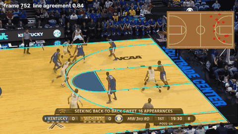
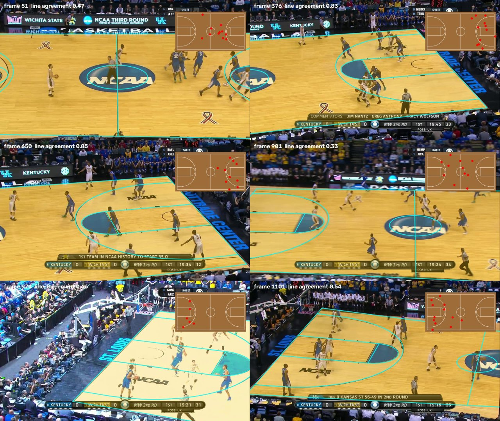

# C04 · Anchor homographies, propagated through the video

| | |
|---|---|
| **Date** | 2026-10-19 |
| **Builds on** | [C03](../C03_line_refinement/) — line refinement fixes a homography that starts close, but cannot rescue a bad start; [C02](../C02_keypoint_detector/) — the public keypoint model gives bad starts on SportsMOT |
| **Question** | With a *good* start on a few frames, can a homography be carried through every frame of a broadcast clip — panning, zooming, flashes — and can we prove it is right without ground truth? |
| **Clip** | `v_00HRwkvvjtQ_c001` (validation, NCAA 2014, 1,162 frames) |

## Method

1. **Anchors** ([`anchors_v_00HRwkvvjtQ_c001.json`](anchors_v_00HRwkvvjtQ_c001.json)).
   On 3 frames (300, 900, 1100), 6–7 court points whose position is fixed by
   the rules (lane corners on the baseline, free-throw line ends, where the
   halfway line meets the sidelines…) are read off zoomed crops of the image.
   Hidden points are placed by intersecting two visible lines
   (`anchors.line_intersection`). A homography is fitted to them and polished
   with the painted lines (`refine.refine`, C03). Every number below can be
   rebuilt from this JSON file.
2. **Propagation** (`court/propagate.py`). Between consecutive frames the
   camera moves a little: the floor's image motion `M` is measured with optical
   flow on corners *inside the projected court* (players masked out — they move
   on their own; score bar ignored), then `H_t = M · H_{t-1}` and line refinement
   pulls `H_t` back onto the painted lines before error can accumulate.
3. **Two chains per segment.** From every anchor one chain runs forwards to the
   next anchor and one backwards to the previous one, so every frame between
   two anchors is reached twice, from two independent hand annotations.
4. **Trust and merge.** A chain is cut at the first 5 consecutive frames with
   line agreement < 0.3 (lost). Each frame takes the trusted chain with the
   highest agreement; in frames 865–925 (midcourt during a fast pan, few lines,
   noisy agreement) the chain closest to its anchor wins instead.

```bash
python scripts/court/propagate_homographies.py --anchors experiments/court/C04_anchor_homographies/anchors_v_00HRwkvvjtQ_c001.json
python scripts/court/eval_court_mask.py --homographies outputs/court_homographies/v_00HRwkvvjtQ_c001/homographies.npz \
    --sequence v_00HRwkvvjtQ_c001 --margins 0 0.25 0.5 1.0 --out experiments/court/C04_anchor_homographies/mask_eval.json
python scripts/court/render_court_overlay.py --homographies outputs/court_homographies/v_00HRwkvvjtQ_c001/homographies.npz \
    --sequence v_00HRwkvvjtQ_c001 --out outputs/court_homographies/v_00HRwkvvjtQ_c001/court_overlay.mp4 --minimap
```

Run time on CPU: ~0.16 s per frame per chain (≈ 6 min for the clip, both directions).

## Results

<div align="center">

<br><sub>Court projected with each frame's homography, from 30 s into the clip (fast pan through midcourt).
Inset: detected people's feet on the court plan (preview of C06).</sub>
</div>


<sub>Frames 51 and 376 (far from any anchor), 650, 901 (midcourt, fewest lines), 974 (a camera flash) and 1101.</sub>

### Is it right? Two independent chains must agree ([`report.json`](report.json))

| Segment | Frames compared | Median disagreement | p90 |
|---|---|---|---|
| 300 → 900 (forward from 300 vs backward from 900) | 590 | **2.9 px · 0.055 m** | 7.4 px · 0.15 m |
| 900 → 1100 (forward from 900 vs backward from 1100) | 199 | 11.2 px · 0.20 m | 17.5 px · 0.28 m |

Two hand annotations, carried up to 600 frames through camera motion in opposite
directions, land within **5 cm** of each other on the 300–900 segment. That can
only happen if both are right: it is the validation, with no ground truth. The
900–1100 segment is the weakest (≈ 20 cm): it is midcourt during a fast pan, and
anchor 900 sees few lines (agreement 0.34 after refinement vs 0.69 / 0.55).

| | |
|---|---|
| Frames with a homography | **1,162 / 1,162** |
| Line agreement, median | 0.81 |
| Frames with agreement ≥ 0.5 | 94.6 % |

### The court mask it gives ([`mask_eval.json`](mask_eval.json))

Every 2nd frame, detections with score ≥ 0.5; a detection is a *player* if it
matches a ground-truth box (IoU ≥ 0.5) — SportsMOT labels only the ten players —
and a *non-player* otherwise (referees, bench, crowd). 5,204 player boxes,
5,019 non-player boxes.

| Mask | Players kept | Non-players removed |
|---|---|---|
| Colour mask (003, current tracker filter) | 100 % | 71.9 % |
| **Homography, feet inside the court** | 99.77 % | **82.5 %** |
| Homography, + 0.25 m margin | **99.98 %** | 80.7 % |
| Homography, + 0.5 m margin | 100 % | 76.0 % |
| Homography, + 1 m margin | 100 % | 65.8 % |

The exact court removes **+9 to +11 points more non-players** than the colour
mask at the same player recall. The few players lost at 0 m are standing on
the line (throw-ins); a 0.25 m margin keeps them. Referees still pass — they
are on the court — and remain the team classifier's job (006).

## Two failures found and fixed on the way

1. **A camera flash derails optical flow.** Frame 974 is over-exposed; flow
   (which assumes constant brightness) gave a wrong `M`, and the forward chain
   from 900 ended 9 m off — while its line agreement later reached **0.99** on a
   wrong alignment. Fixes, both in `propagate.py` and both tested:
   flow on contrast-normalised images, and a flash frame (mean brightness jump
   > 25) is never used as the reference for the next frame. Chain 900→1100:
   agreement median 0.34 → 0.83, disagreement with the other chain 9.2 m → 0.20 m.
2. **High agreement does not prove a chain is right after it got lost.** Hence
   the `trusted` cut (5 low frames in a row = lost; nothing after it is used).
   C03 had already shown the score can be fooled from a bad start; this is the
   same lesson in time.

## Tests

`tests/court/test_anchors_propagate.py` (synthetic textured court): points →
homography is exact; bad names / too few points are rejected; a 10-frame pan
is followed to < 2 px; a flash in the middle of the pan is survived; the
`trusted` cut ignores a late high score; the merge rules.

## Conclusion

**Confirmed for one clip.** Three hand-annotated frames (20 points in total)
give an exact homography for all 1,162 frames, validated by two independent
chains agreeing to 5–20 cm. The court mask built from it is the first one that
follows the real court dimensions: it lets through 31–38 % fewer non-players
than the colour mask (28.1 % → 19.3 % with a 0.25 m margin, 17.5 % without) at
the same player recall, and it does not depend on
the floor's colour.

This is not yet automatic: every new clip needs anchors. Next (chapter README):
anchors for more clips and leagues → labels derived from the homographies
(keypoints, line masks) → a detector trained on SportsMOT's own domain.
