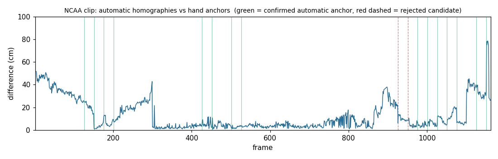
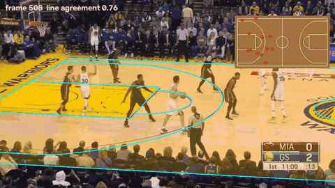
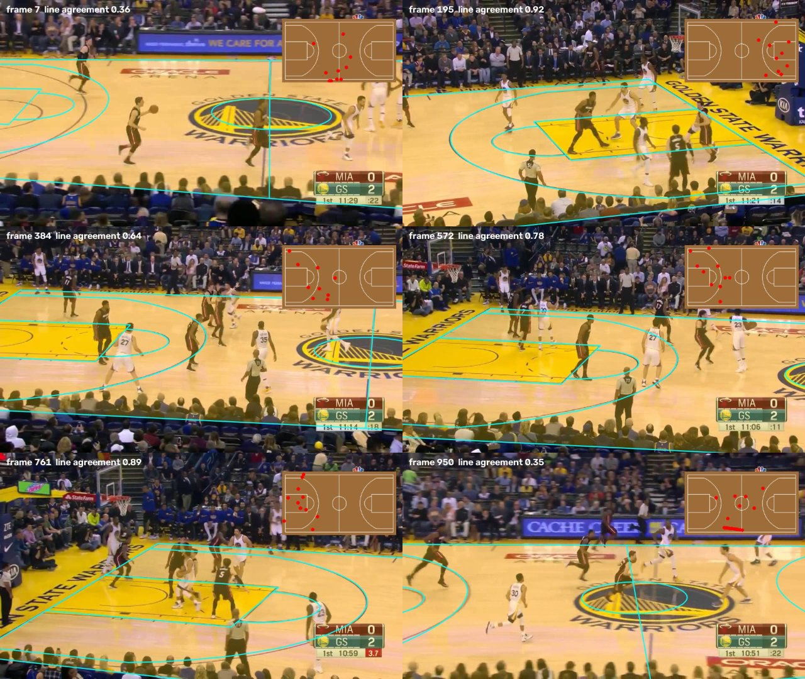

# C05 · Court homographies with no annotation

| | |
|---|---|
| **Date** | 2026-10-20 |
| **Builds on** | [C04](../C04_anchor_homographies/): 3 hand-annotated frames + propagation give an exact homography for every frame, validated by two independent chains |
| **Question** | Can the hand anchors be replaced by automatic ones, so that a new arena, league or camera needs **no annotation at all**? |
| **Clips** | NCAA 2014 (`v_00HRwkvvjtQ_c001`, val, hand reference from C04) · NBA 2016 Golden State (`v_2j7kLB-vEEk_c002`, train: the arena where the colour mask lost players in 008) · FIBA 2019 (`v_-6Os86HzwCs_c009`, train) |

No pretrained basketball court model transfers to SportsMOT (C02; KaliCalib,
the reference academic method, reports ~1.3 m error on FIBA courts only and
does not release weights). So the anchors are produced by geometry and proved
by the video itself.

## Method

```
every 25th frame ── straight lines ── 2+2 line hypotheses ── physics filter ── best candidate
                                                                                    │
consecutive candidates ── chain forwards + chain backwards ── agree < 0.5 m ? ── confirmed anchors
                                                                                    │
                                       C04 propagation + merge ── homography for every frame
```

1. **Candidates from straight lines** (`court/search.py::search_lines`).
   * Long straight lines of the line evidence (Hough), split into the two
     families of the court: *along* it (sidelines, lane edges, `y = const`,
     near-horizontal in a broadcast view) and *across* it (baselines, halfway
     line, free-throw lines, `x = const`, steep).
   * Two image lines of each family meet in 4 points. Saying *which* court
     lines they are gives 4 court points → one homography. The camera is on the
     near side, so the order is preserved (upper line = smaller `y`, left line =
     smaller `x`): ~5,000–35,000 hypotheses per frame.
   * **Physics filter** (`plausible`): every court corner in front of the
     camera, the court covering ≥ 30 % of the image; after refinement, a real
     camera (`court/camera.py`: positive focal length, above the floor, behind
     the near sideline — the camera is *read off* the homography).
   * **Ranking** (`explained`): image cells explained by a painted line running
     the same way, minus half the cells where a projected line finds nothing.
2. **Confirmation** (`court/autoinit.py`). A single frame can be fooled (C03).
   Consecutive candidates are linked by two chains (C04 propagation): forwards
   from the earlier, backwards from the later. If they agree (median < 0.5 m
   over the visible court, on ≥ 80 % of the frames between them), both are
   confirmed. Candidates that agree with no neighbour are dropped and their
   neighbours linked directly, until stable.
3. **League** (`--league auto`): the template (NBA / FIBA / NCAA) whose lines
   explain the most, summed over 6 frames.

```bash
python scripts/court/auto_homographies.py --sequence v_00HRwkvvjtQ_c001 --league auto \
    --reference outputs/court_homographies/v_00HRwkvvjtQ_c001/homographies.npz    # reference = measurement only
python scripts/court/eval_court_mask.py --homographies outputs/court_auto/<seq>/homographies.npz --sequence <seq> \
    --margins 0 0.25 0.5 --out experiments/court/C05_automatic_homographies/mask_eval_<seq>.json
```

The run is resumable (`--budget`): candidates and chains are cached, so it can
be split into short runs. CPU cost ≈ 2 s per searched frame + 0.16 s per
propagated frame.

## Results

### NCAA — automatic vs hand-anchored ([`report_v_00HRwkvvjtQ_c001.json`](report_v_00HRwkvvjtQ_c001.json))

| | |
|---|---|
| Candidates found / frames searched | 17 / 47 |
| Confirmed automatic anchors | 15 (2 candidates rejected: 926, 951 — midcourt during the fast pan) |
| Frames with a homography | **1,155 / 1,162** (7 frames at 891–897 not reached) |
| Difference with the hand-anchored homographies (C04) | **median 6 cm**, p90 34 cm, 99 % of frames < 0.5 m, 100 % < 1 m |



The curve is a *difference between two estimates*, not an error against
ground truth: C04 itself is only checked to 5–20 cm. Where the hand anchor is
(frame 300) the difference drops to 2 cm; it is largest at the clip ends and in
the midcourt pan (frames 880–930), the views with fewest lines for both methods.

### Three leagues, three arenas — the court mask

Same evaluation as C04 (detections ≥ 0.5; *player* = matches a ground-truth
box; SportsMOT labels only the ten players). Frames without a homography are
not counted (coverage column).

| Clip | League (auto) | Frames with H | Mask | Players kept | Non-players removed |
|---|---|---|---|---|---|
| NCAA 2014 | NCAA ✔ (given) | 1,155 / 1,162 | colour (003) | 100 % | 72.0 % |
| | | | **homography + 0.25 m** | 99.98 % | **80.0 %** |
| NBA 2016, Golden State | NBA ✔ (auto) | 652 / 1,176 ² | colour (003) | 97.3 % | 18.3 % |
| | | | **homography + 0.25 m** | **99.8 %** | **36.2 %** |
| FIBA 2019 | FIBA ✔ (auto, see below) | 253 / 500 | colour (003) | 100 % | 66.2 % |
| | | | **homography + 0.25 m** | 99.91 % | **77.9 %** |

² 944 frames before the *conflict rule* (added in 009, below): 292 frames lay
between two confirmed anchors whose chains did not meet and disagreed there;
they now get no homography instead of an arbitrary one.

The league was picked correctly in both clips where it was not given:
NBA 527 · FIBA 333 · NCAA 329 on Golden State; FIBA 386 · NBA 242 · NCAA 205
on the FIBA clip (that pick comes from an earlier run without player masks;
the final FIBA run then used `--league FIBA`).

**Golden State is where the colour mask failed in 008**, and it shows: the
colour mask drops 2 % of the players here (1.85 % of ground-truth player boxes
on the same frames) and removes only 15 % of the non-players, because the
yellow-and-maple floor and the courtside seats confuse a colour model. The
automatic homography keeps 99.8 % of players and removes 2× more
non-players. Many remaining "non-players" are referees, who stand on the court
and are handled by the team classifier (006).

On this clip the automatic pipeline also found the league, the court and the
camera by itself, with no hand anchor and no reference: frames 7–950 are
covered; the last 226 frames (close-ups of the free throws, no line pair
visible) get no candidate and no homography — the tracker would fall back to
the colour mask there.

<div align="center">

<br><sub>Golden State (NBA): court found and followed with no annotation. Inset: detected people projected to the court plan.</sub>
</div>



### Where it stops: the FIBA clip

Only the first half of the FIBA clip is covered. Its painted lines are thin
and white on a pale maple floor: the line detector (top-hat with a fixed
contrast threshold, C03) barely sees them, while ads, logos and the score bar
come out strongly. Five candidates in 20 searched frames, two confirmed;
after the camera pans to the other half no frame yields a candidate. Lowering
the contrast threshold (28 → 14) did not produce correct candidates either.
**The bottleneck is the line evidence, not the search or the confirmation**:
what the covered half gets is right (overlay checked frame by frame).

## Added after testing on new clips (experiment 009)

Experiment [009](../../009_court_mask_homography/) used these homographies inside
the tracker on three FIBA validation clips never seen before. Two additions and
one important limit came out of it:

* **Edges of painted areas** (`line_evidence(edges=True)`, `--edges`): modern
  FIBA courts draw the lane and the apron as filled colour, so their lines are
  steps, not thin strokes. Adding Canny edges also improves the NCAA clip:
  1,160 / 1,162 frames, **5.8 cm** median from the hand reference, 100 % of
  frames < 0.5 m (vs 1,155 frames, 99 % without). `white=True` (min(R, G, B)
  top-hat) was tried and did not help.
* **Conflict rule** (`autoinit.confirm`): frames between two confirmed anchors
  whose chains disagree there get no homography.
* **The limit: chain agreement proves consistency, not correctness.** On two of
  the three new FIBA arenas, neighbouring candidates were wrong *in the same
  way* (same wrong line assignment on baseline/corner views), propagated
  consistently and confirmed each other — the court is drawn confidently wrong
  (figures in 009). On the third the league itself was mis-picked (NBA instead
  of FIBA). The geometric pipeline is reliable on NCAA / NBA broadcasts with
  clear lines, not yet on unseen FIBA arenas.

## What did not work (kept in the code, documented)

* **C05a · searching the camera on a grid** (`search.search`, `SearchSpace`).
  ~10,700 broadcast cameras (position, target, zoom) scored against the lines,
  then local search. On NCAA frame 300 the true homography scores **67**, the
  best grid cell **24.5** — the score is right — but grid cells 1.2 m from the
  truth already score like clutter (rank ~4,000): the basin of the right answer
  is a needle. A smoother score with a large capture radius made it worse
  (wrong views among dense clutter outscore the truth). Starting *from the
  lines* removed the problem.
* **Per-sample counting** picked degenerate homographies that squash the whole
  court onto one strong line (all samples "match"); fixed by counting image
  cells and by the coverage test (both tested).
* **Sending ambiguous-angle lines to both families** (15°–40°): no gain on the
  FIBA clip it was meant for, fewer confirmed anchors on Golden State (905 vs
  1,048 frames). Default back to a plain 25° split.

## Tests

`tests/court/test_camera_search.py`: camera ↔ homography round trip (also the
straight-across view where the classic focal formula degenerates); the image is
not mirrored; mirrored / squashed courts are not plausible; squashing fools a
per-sample count but not `explained`; `search_lines` finds the court with no
annotation on synthetic NBA, FIBA and NCAA views (< 15 cm).

## Conclusion

**Confirmed on broadcast footage with visible lines; limited by line detection.**
On the NCAA clip the automatic pipeline reproduces the hand-anchored result
(6 cm median difference) with zero annotation, and on a new arena and league
(Golden State, NBA) it finds the league and the court by itself and keeps the
players the colour mask lost. The confirmation step is what makes it safe:
on the NCAA clip, where it can be checked, every accepted anchor was right
and the two rejected candidates were the ambiguous midcourt frames.

Next: the weak link is the line evidence (FIBA clip). The homographies
produced here are **free training labels** — line masks and keypoints for every
frame of every covered clip — for a learned line/keypoint detector on
SportsMOT's own domain (the original C05 plan, now without hand labels).
