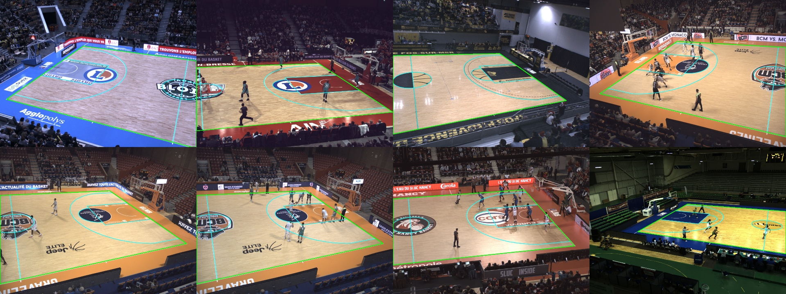
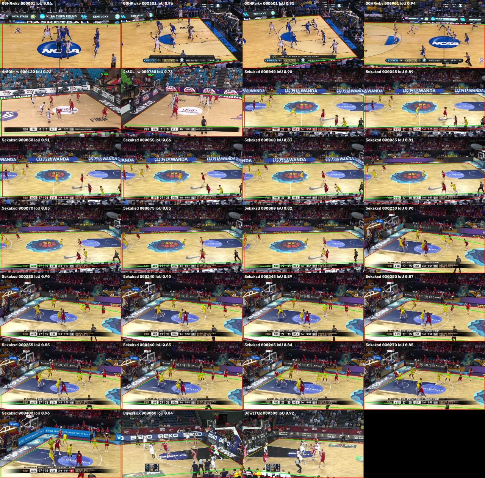

# C06 · A court mask that adapts to any arena: learned court-area segmentation

| | |
|---|---|
| **Date** | 2026-10-20 (trained) · 2026-10-23/24 (evaluated, used in tracking: 010, 011) |
| **Builds on** | [009](../../009_court_mask_homography/): on new FIBA arenas the colour mask lets 2,100–2,400 non-players through, and the automatic homography (C05) is sometimes confidently wrong |
| **Question** | Can a model trained on *many* arenas (real + synthetic) segment the playing area of an arena it has never seen? |

## Why segmentation, and why these data

Every earlier method encoded what ONE kind of court looks like: the colour mask
("the court is the floor colour"), C02 (2025 NBA broadcasts), C05 (thin dark
lines). C06 predicts the **court area** — everything inside the sidelines and
baselines — pixel by pixel. That mask is exactly what the tracker needs (feet
inside or not); a homography is no longer required (it can still be fitted to
the mask's four borders later, for the top-down map).

What decides whether it generalises is **variety in training**:

| Source | Arenas | Label from | Count |
|---|---|---|---|
| DeepSportRadar basketball instants | 15 French LNB arenas, fixed elevated cameras | per-image calibration, after undistortion (exact) | 728 |
| Roboflow v22 (C01) | NBA 2025 broadcast | the image's verified keypoints | 849 |
| SportsMOT **train** clips | Golden State (NBA), FIBA Asia 2019 | C05 homographies checked on overlay videos | ~110 |
| Synthetic (`court/synth.py`) | infinite: random floor, painted lane / apron, logos, line colour, camera, crowd, people, score bar | the render itself (exact) | 1,500–3,000 |

The synthetic courts are *domain randomisation*: everything that should not
matter is random, so colour cannot be memorised; only the geometry is constant.
All labels use one definition of the mask (`court/masks.py`), including courts
partly behind a wide camera (clipped in 3D before projection — tested).

**Leak-free evaluation.** DeepSport is split by **arena**, v22 by **game** (C01).
The four SportsMOT **validation** clips (NCAA + the three FIBA arenas of 009) are
never used in training: they are the final test, with the true court annotated
by hand on a few frames per clip and propagated (`c06_annotate_eval.py`,
`eval_anchors.json`).


<sub>Label check on DeepSport: court lines from the calibration (cyan) and the court-area polygon (green), after undistortion. Images: DeepSportRadar basketball instants dataset, CC BY-NC-SA 4.0.</sub>

## How to run (laptop, CPU)

```powershell
# 0. data: DeepSport unzipped in data/basketball-instants-dataset (done), v22 already converted (C02)
# 1. build the dataset (minutes); check the previews in data/court_seg/<source>/preview
python scripts/court/c06_build_dataset.py synth --n 1500
python scripts/court/c06_build_dataset.py deepsport
python scripts/court/c06_build_dataset.py v22
python scripts/court/c06_build_dataset.py sportsmot
python scripts/court/c06_build_dataset.py yaml
# 2. measure speed, then train within ~3 h
python scripts/court/c06_train_seg.py --probe
python scripts/court/c06_train_seg.py --hours 2.75 --imgsz 512
# 3. evaluate on unseen arenas (needs outputs/court_eval/*.npz, provided by c06_annotate_eval.py)
python scripts/court/c06_eval.py --weights outputs/court_runs/c06_yolo26n_seg/weights/best.pt
# 4. tracking with the learned mask (the 009 protocol)
hooptrack track --set detector.type=cached detector.cache_dir=outputs/detections/yolo26m "data.only=[v_5ekaksddqrc_c001]" filters.court_source=segmentation output.dir=outputs/runs/c06_5ekaksddqrc --eval
```

If the probe estimates fewer than ~10 epochs: `--imgsz 416`, `--freeze 10`, or
fewer synthetic images (`synth --n 800`, then `yaml`).

## Code

| File | What |
|---|---|
| `src/hooptrack/court/masks.py` | court area polygon / mask from a homography (3D clip behind the camera) |
| `src/hooptrack/court/synth.py` | synthetic broadcast frames with exact masks |
| `src/hooptrack/court/segment.py` | `CourtSegmenter` (model → mask, convex clean-up), `feet_inside` |
| `src/hooptrack/integrations/court_filter.py` | `SegmentationCourtFilter`: `filters.court_source: segmentation` |
| `scripts/court/c06_build_dataset.py` | the four sources → YOLO-seg dataset + `data.yaml` |
| `scripts/court/c06_train_seg.py` | YOLO26n-seg on CPU, time budget, strong colour augmentation |
| `scripts/court/c06_annotate_eval.py` | test ground truth on the SportsMOT validation clips |
| `scripts/court/c06_eval.py` | IoU vs true court, players kept, non-players removed — vs colour mask and C05 |
| `tests/court/test_masks.py` | masks vs dense projection, court behind the camera, synthetic labels exact, clean-up, feet test |

## Results

### Training

YOLO26n-seg, 512 px, CPU, 2.75 h budget → 6 epochs (~25 min each). Training data:
DeepSport 498, v22 608, SportsMOT train 87, synthetic 1,350 images. Validation mask
mAP50-95 0.98 on DeepSport + v22 validation arenas: that set is too easy to tell models
apart, so the real test is the next one.

### Is the mask the court? (4 SportsMOT validation arenas, never seen in training)

IoU between each mask and the true court area, on the hand-annotated test frames
(`eval_anchors.json`, `c06_annotate_eval.py`):

| Clip | Test frames | **C06 segmentation** | Colour mask (003) | Automatic homography (C05) |
|---|---|---|---|---|
| NCAA `00HRwkvvjtQ_c001` | 47 | 0.943 | 0.929 | **0.980** |
| FIBA Changsha `4r8QL_wglzQ_c001` | 2 | 0.824 | 0.811 | **0.859** |
| FIBA Tenerife `5ekaksddqrc_c001` | 19 | **0.869** | 0.804 | 0.850 |
| FIBA Istanbul `BgwzTUxJaeU_c008` | 2 | **0.882** | 0.787 | 0.537 |

The homography is the most precise *when it is right*, and it fails badly when it is wrong
(Istanbul). The segmentation is **never catastrophically wrong**. Its typical errors are the bottom
edge, where the near sideline is hidden by the score bar and the mask runs to the image border,
and the far sideline in corner views.


<sub>Green = true court, red = C06 mask, on the four validation arenas (never seen in training).</sub>

### In the tracker (one clip per validation arena, only the court mask changes)

Measured with `scripts/run_court_source_eval.py` (OVERALL over the 4 clips):

| Detector | Court mask | IDF1 | MOTA | FP | Misses |
|---|---|---|---|---|---|
| COCO | colour (old default) | 45.0 | 55.6 | 6897 | 4169 |
| COCO | **C06** | **53.1** | **76.8** | 3989 | 1732 |
| players-only ([011](../../011_player_detector/)) | colour | 71.8 | 90.8 | 312 | 1930 |
| players-only (011) | **C06** | **73.7** | **93.6** | 324 | 1226 |

With the COCO detector, C06 removes far more bench and crowd than the colour mask. Tenerife
goes from MOTA 54.8 to 90.3, and Istanbul from 5.2 to 48.9. With the players-only detector
C06 still helps: the colour mask then mostly *removes real players* (Tenerife: 650 missed
players with colour, 64 with C06). C06 is part of the best configuration
(`configs/player.yaml`).
