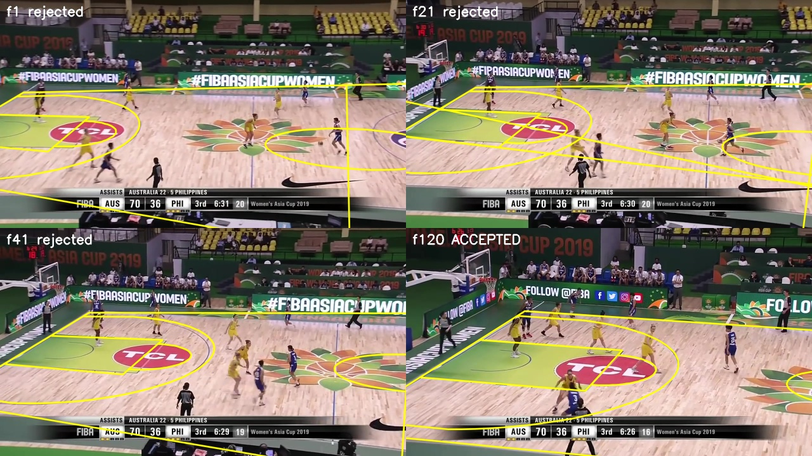
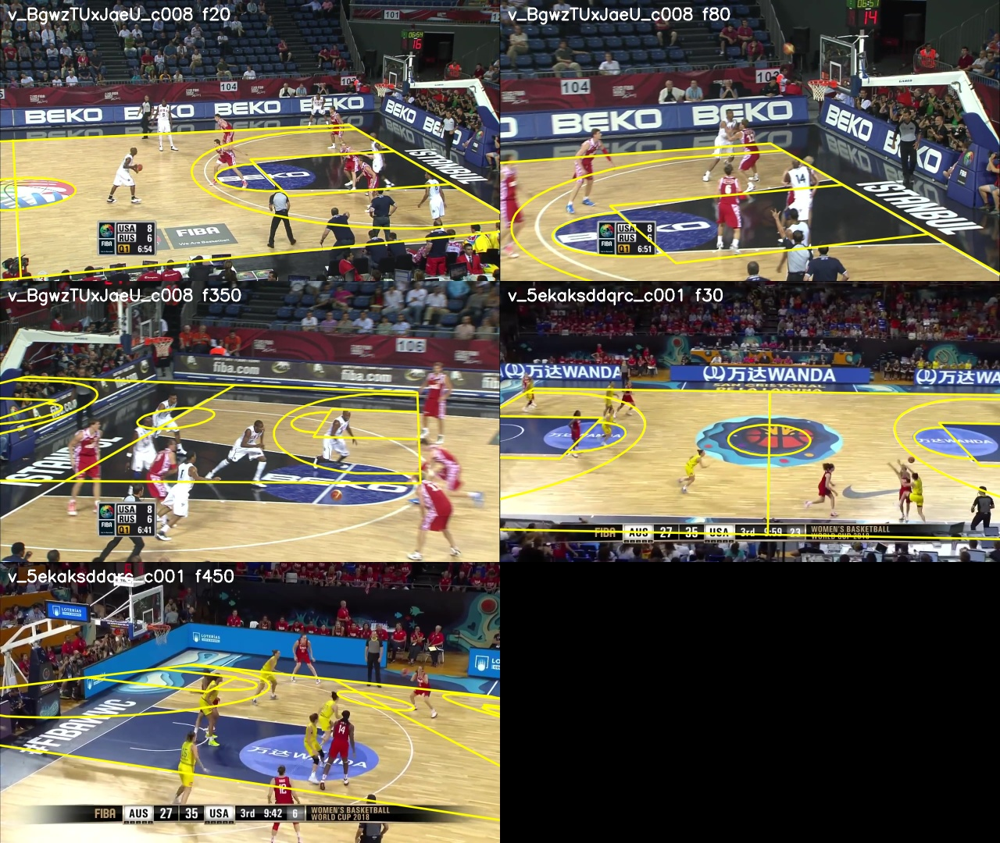

# C07 · One camera per clip: a correctness check for court homographies

| | |
|---|---|
| **Date** | 2026-10-23 |
| **Builds on** | [C05](../C05_automatic_homographies/) automatic homographies · [009](../../009_court_mask_homography/): on new FIBA arenas C05 can be *confidently wrong* — two wrong candidates confirm each other |
| **Question** | Can a wrong homography be recognised as wrong without ground truth and without relying on the chains agreeing? |
| **Clips** | the 7 clips with homographies: NCAA (hand C04 + automatic), Golden State (NBA), FIBA Asia 2019 (all right, or mostly) · Tenerife, Istanbul, Changsha (009's failures) |

## Idea

The main broadcast camera does not move during a clip: it pans, tilts and
zooms on a fixed head. So every correct homography of a clip must come from
**one camera centre** `C` (3 numbers for the whole clip) plus pan / tilt / roll /
zoom per frame (4 numbers):

    H_t ~ K(f_t) · R_t · [e1  e2  −C]

C05's check (two chains agree) proves consistency; this proves something
physical, and it is independent of the chains: a wrong line assignment
implies a camera somewhere else.

## Method (`src/hooptrack/court/clipcam.py`)

1. **PTZ fit.** For a given centre `C`, the rotation and focal length that best
   reproduce a homography (pixel least squares on the visible court); the
   residual is measured in metres on the court.
2. **Clip camera, RANSAC-style, among plausible cameras only**: the camera of
   30 frames is tried as the clip camera; the one explaining most frames (residual
   < 0.5 m) wins, then its centre is refined. *Plausible* = ≥ 5 m above the floor
   and ≥ 6 m behind the near sideline. The restriction matters: in Tenerife the
   **wrong** frames are the majority, so consensus alone would pick them.
3. **Per frame**: accepted if the clip camera explains it within 0.5 m.
4. **Per clip**: if even the best plausible camera explains < 60 % of the frames,
   the clip goes to **review** (no homographies at all) instead of guessing.

`scripts/court/verify_clip_camera.py` writes the accepted frames in the same
`homographies.npz` format (the tracker's `HomographyCourtFilter` reads it unchanged),
plus `H_ptz` (the same frames re-drawn by the clip camera) and a `report.json`.

## Two things learned on the way

* **The court frame is left-handed** (x along, y towards the camera, z up), so no
  rotation reproduces a court homography: a first prototype that forced
  `det R = +1` had metre-level residuals even on the hand-made homographies.
  The fit works on a z-flipped copy.
* **The camera of a single frame is poorly determined** (its x moves ±10 m along
  the NCAA clip), but the residual barely changes with it: pan / tilt / zoom
  absorb a wrong centre of a few metres. Per-frame camera positions are useless
  as a test; one centre for the whole clip is a strong one.

## Results

Diagnostic first (one camera fitted to all frames, no plausibility filter):

| Clip | Clip camera (x, y, z) m | Median residual | Frames < 0.5 m |
|---|---|---|---|
| NCAA, hand (C04) | 14.2, 47.3, 16.6 | **5 cm** | 100 % |
| NCAA, automatic (C05) | 14.3, 47.2, 16.7 | **5 cm** | 100 % |
| Golden State (NBA) | 14.9, 42.1, 9.3 | **11 cm** | 98 % |
| FIBA Asia 2019 | 13.6, 34.6, 8.9 | **8 cm** | 82 % |
| Tenerife | 8.8, 18.6, **2.3** | 0.85 m | 20 % |
| Istanbul | 19.9, 26.6, 5.6 | 1.19 m | 4 % |
| Changsha | 5.0, 17.5, 4.3 | 2.14 m | 18 % |

The hand-made and the automatic NCAA homographies, computed independently,
lead to the **same camera within 10 cm**. The failing clips are explained by no
camera, and the best one is physically absurd (2–5 m high, at the sideline,
focal length 200–700 px, i.e. a 100–140° lens).

Final verifier ([`report_*.json`](.)):

| Clip | Verdict | Frames accepted |
|---|---|---|
| NCAA, hand | ok | 1,162 / 1,162 |
| NCAA, automatic | ok | 1,160 / 1,160 — 5.8 cm from the hand reference (`H_ptz`: 6.2 cm) |
| Golden State | ok | 652 / 652 |
| FIBA Asia 2019 | ok | 212 / 253 — **the 41 rejected frames (1–41) are wrong** (figure) |
| Tenerife | review | 75 / 224 explained (frames 1–76, the right ones) |
| Istanbul | review | 127 / 387 explained, by a plausible but wrong camera |
| Changsha | review | no plausible camera |


<sub>FIBA Asia 2019: frames 1, 21, 41 were published by C05 but no camera of the clip produces them — they are wrong (lane and sideline shifted). Frame 120 is accepted and right.</sub>


<sub>Istanbul 20 / 80 / 350 and Tenerife 30 / 450 (C05 homographies). Istanbul's first frames are wrong with a *plausible* camera: only the clip-level rule (a camera must explain the majority) catches them.</sub>

### In the tracker (configuration of 009, motion-only, VM settings)

| Clip | colour (003) | homography (009) | + guard (009b) | **verified (C07)** |
|---|---|---|---|---|
| NCAA | IDF1 64.0 · MOTA 89.6 · FP 501 | 64.0 · 89.9 · 468 | 64.0 · 89.9 · 468 | **64.0 · 89.9 · 468** |
| Tenerife | 50.9 · 46.4 · 2,104 | 50.5 · 55.0 · 1,591 | 52.5 · 55.3 · 1,652 | 50.9 · 46.4 · 2,104 |
| Istanbul | 44.9 · 41.1 · 2,360 | 36.5 · 40.7 · 1,123 | 41.1 · 52.1 · 1,510 | 44.9 · 41.1 · 2,360 |
| Changsha | 56.0 · 85.4 · 748 | 55.1 · 83.6 · 741 | 55.9 · 85.3 · 747 | 56.0 · 85.4 · 748 |

Raw files: [`runs/`](runs/).

## Reading

1. **Never worse than the colour mask**, and the NCAA gain is kept: the court
   from the homography is used only where it is right.
2. **The price is coverage**: Tenerife's right first 3 s are dropped with the
   rest of the clip (the guard of 009b gained +1.6 IDF1 there). Telling them apart
   from Istanbul's wrong-but-plausible first frames would need information this
   test does not have; a person can (next steps).
3. Nothing here is specific to basketball footage except the plausibility box.

## Conclusion

**Positive: every wrong homography in the 7 clips is rejected, every clip that
was right is kept** (plus 41 wrong frames C05 had published on a "good" clip).
"Reliable for every video" now has a precise meaning: a clip either gets
verified homographies (`ok`) or is listed for review — never a confident wrong court.
Recommended for the tracker's court source: `filters.homography.dir:
outputs/court_verified/<source>`. Next: the top-down map on verified clips
([C08](../C08_topdown_map/)); review clips get anchors from a person (C04 tool)
until a learned line detector (C09) makes them rare.

## Commands

```bash
python scripts/court/verify_clip_camera.py --in outputs/court_auto_edges --out outputs/court_verified/auto_edges \
    --sequence v_00HRwkvvjtQ_c001 v_5ekaksddqrc_c001 v_BgwzTUxJaeU_c008 v_4r8QL_wglzQ_c001
hooptrack track --config experiments/009_court_mask_homography/runs/<seq>_homography/config.yaml \
    --set filters.homography.dir=outputs/court_verified/auto_edges filters.homography.guard_colour=false \
          output.dir=outputs/runs/c07_verified/<seq> --eval
```

~30–85 s per clip on CPU. Tests: `tests/court/test_clipcam.py` (PTZ round trip,
centre recovery, a minority from another camera rejected, an implausible
majority not chosen, implausible-only clips sent to review).
