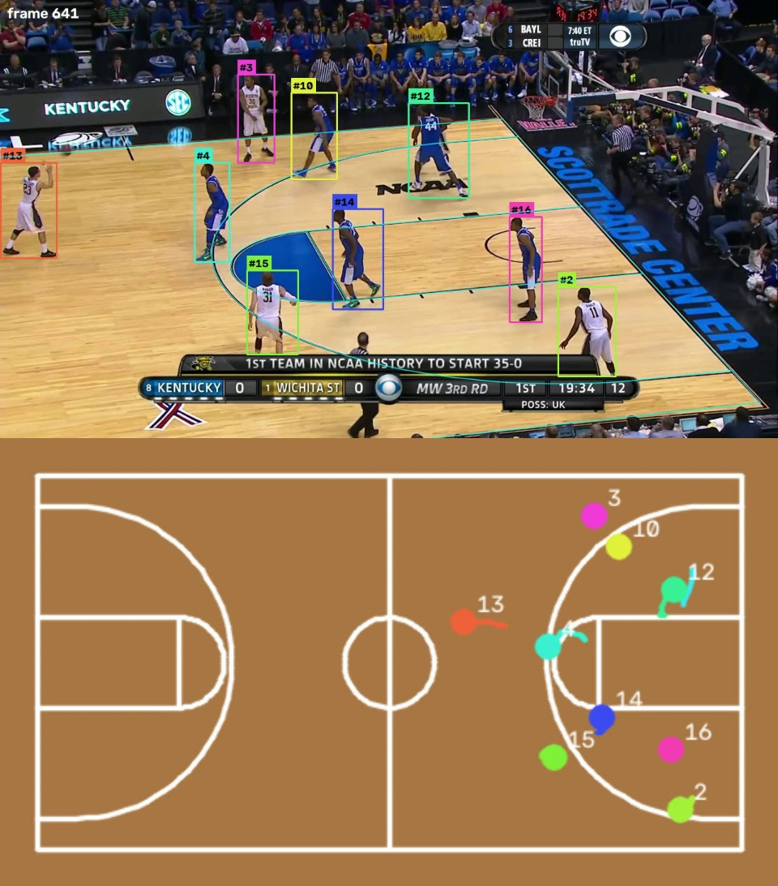

# C08 · Top-down map: tracks on the court plan, in metres

| | |
|---|---|
| **Date** | 2026-10-23 |
| **Builds on** | [C07](../C07_clip_camera/) verified homographies · the tracker's output (any run) |
| **Question** | With verified homographies, how accurate is the players' position on the court, and does it give sensible distances and speeds? |
| **Clip** | NCAA `v_00HRwkvvjtQ_c001` (val): the only one with a hand reference to measure against |

## What was built

* `src/hooptrack/integrations/topdown.py` — the adapter (the tracker and
  `hooptrack.court` still do not import each other): each box's feet (bottom
  centre) projected with the frame's verified homography, per-track smoothing
  (Savitzky–Golay, 9 frames, split at gaps > 5 frames), distance and speed per
  identity, and the video (broadcast with tracks + court lines, plan with trails).
* `hooptrack map --run <run> [--video]`, after `hooptrack track`: writes
  `<run>/topdown/<seq>.csv` (frame, id, x, y in metres, raw and smoothed),
  `<seq>_stats.csv` and `<seq>.mp4`. Config section `topdown` in
  `configs/default.yaml`.
* Frames without a verified homography get **no** position (a gap), and clips
  in review get no map: the map never shows a guessed court.
* Tests: `tests/test_topdown.py` (feet land where the player stands on a
  synthetic camera, gaps, off-court, distance / speed, smoothing).

## Results (NCAA, run with the C07 court mask)

| | |
|---|---|
| Frames with a verified court | 1,160 / 1,162 |
| Positions vs. the same boxes projected with the hand-made homographies (C04) | **median 5.7 cm**, p90 29 cm, p99 83 cm (11,091 positions) |
| Identities on the map | 36 (the tracker's IDSW / fragments show up as extra ids) |
| Speeds of the 10 long tracks | mean 1.6–2.5 m/s, p95 4.6–6.9 m/s |

Per-identity stats: [`ncaa_stats.csv`](ncaa_stats.csv).

<div align="center">

<br><sub>NCAA: tracks on the broadcast (top) and on the court plan (bottom), 0.4 s trails.</sub>
</div>



## Reading

1. **The geometry is not the limit**: positions agree with the hand-made court
   to a few centimetres — less than a foot's length. What remains is the box:
   its bottom is not always the feet (jumps, occlusion, a player cut by the
   score bar), which the p99 shows.
2. Speeds are physically sensible (basketball players: ~2 m/s average,
   sprints 6–8 m/s); the smoothing matters — on the synthetic test, 2 px of
   feet jitter turns a 10 m run into 12.9 m; smoothed, 10.2 m.
3. Statistics per *player* need identities that last the whole clip: the map
   inherits the tracker's switches and fragments (36 ids for 10 players + referees).

## Conclusion

**Positive on the clip with a reference.** The map is now one command after
tracking, for every clip C07 accepts. Next: clips in review need anchors
(person, C04 tool) or a better automatic court (C09, learned line detector);
for the map itself, pose ankles instead of the box bottom, and team colours
from 006 on the plan.

## Commands

```bash
hooptrack map --config outputs/runs/c07_verified/v_00HRwkvvjtQ_c001/config.yaml \
    --run outputs/runs/c07_verified/v_00HRwkvvjtQ_c001 --video
# measurement: the same with the hand-made homographies
hooptrack map ... --set topdown.dir=outputs/court_verified/hand topdown.use_ptz=false
```
